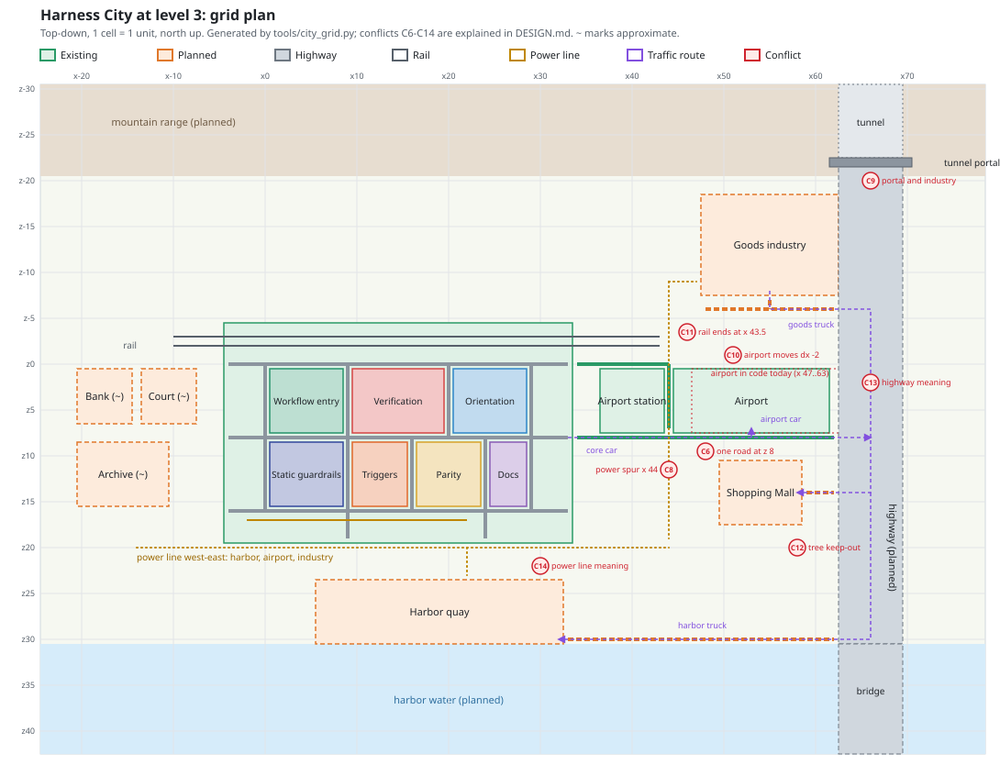

<!-- markdownlint-disable-next-line MD025 -->
# Harness City Design

The single source of truth for what the city shows and how. Every change to the city
starts here (see [AGENTS.md](AGENTS.md)). If code and this file disagree, fix one of them
in the same change.

## Purpose

A repository is a city. The city makes an audit result readable at a glance, and every
visible object explains itself when clicked. It is a view of the audit, never a second
scoring system.

## Principles

1. **Metaphor is data.** Each object stands for one audit fact. No decoration without
   meaning, except trees and ground.
2. **Level grows the thing.** Every area has levels L0 to L3: vacant fenced lot, small,
   working, agent-native. The same ladder applies everywhere (buildings, roads, transit,
   rail, airport).
3. **Reach shows as traffic.** Roads, buses, metro and trains show how well work reaches
   an area. A link is only as good as both ends (lower of the two levels).
4. **Next fix shows as construction.** Cranes and construction sites mark the next planned
   fix. **Decay shows entropy.** Wagons, graffiti, broken pylons.
5. **Overlays are not scored.** The 0-100 score comes from the seven pillars only. The
   infrastructure overlay has its own L0-L3 and is drawn outside the districts.
6. **Everything is explained.** Each clickable object has a side-panel text: question,
   what it stands for, what each level looks like (`levelList`). Add the text with the object.
7. **Deterministic.** Layout and randomness come from the repo id (`hash`, `rng`). The same
   data always draws the same city. No `Math.random` in scene building; cosmetic flicker in the animation loop is allowed.
8. **Honest.** Limits of the scan are listed (`lim`). Unknown is not drawn as good.

## Structure

| Pillar | Weight | Place | Colour |
|---|---|---|---|
| Verification | 25 | Hospital and test labs | `#d64545` |
| Orientation | 20 | City hall and visitor info | `#2f86c9` |
| Static guardrails | 15 | Police headquarters | `#33489c` |
| Workflow entry points | 15 | Central station and rail (transit hub) | `#24946a` |
| Automatic triggers | 10 | Fire and alarm station | `#e0672b` |
| Pipeline parity | 10 | Power plant and grid | `#d9a42a` |
| Doc hygiene | 5 | Public library | `#8a5bb5` |

Score = sum of level / 3 x weight, minus entropy penalty. Tiers: Thriving 80+,
Prosperous 60+, Working 45+, Neglected below. Pillar colours are fixed; do not reuse them
for other meanings. The pillar list lives in `PILLARS` in `index.html` and must match this table.

## Transit

The central station is visible in every city, including a closed station at L0.
Line level = lower of station level and district level: none (L0), one bus (L1),
underground metro plus buses with shelters (L2), frequent metro plus buses (L3).
New destinations (for example the airport) join this network and follow the same rule.

Surface and underground are permanent city views, independent of the airport prototype.
The underground view fades surface buildings and exposes the metro routes; it never
invents service below L2. View choice survives city and prototype option changes.
Restore original material properties before rebuilding or leaving the underground view.
Airport labels sit outside the buildings. Crowding hides secondary airport tags instead
of overlapping labels; all gate details remain available in the side panel.

PNG export captures the current camera, layer and visible labels, together with the city
summary, score, pillar legend, infrastructure levels and the selected object's description.
Descriptions wrap without clipping. Synthetic data and prototype overrides remain explicit
in the exported image. Export never changes the live camera or audit data.

## Infrastructure overlay (airport)

Status: **prototype** inside the real city, enabled with `?airport` (or the standalone build
`build_standalone.py --airport`). Not part of the default city yet. Details and open variants:
[../../docs/0007-v0.1-airport-overlay-evidence-matched/airport-assets.md](../../docs/0007-v0.1-airport-overlay-evidence-matched/research/airport-assets.md).

* The airport is the infrastructure overlay in teal `#0a9cb8`. It is never part of the 0-100 score
  and never replaces a district.
* It sits east of the districts, outside the city, on the same rail line and on the road row
  `z=8`. The station plot (airport station) and the airport plot together take about two
  district fields. A cross street joins them like the district blocks.
* Size follows the weakest applicable core area: Terraform, Compose and Dockerfile only.
  Devcontainer is an optional developer side-terminal; Agent guidance is a guidance office.
  Their own L0-L3 grows the supporting facility, but never lowers or closes the main airport.
  L0 means a closed supporting facility; not applicable means the facility is absent.
  Cross-cutting remains independent and non-blocking. With support areas only, show those
  facilities without a main airport, runway or main-airport transport service. This is a
  visualization rule only; audit results and the city score remain unchanged.
* Each infra area is a gate; a closed
  gate (L0) has a barrier. Repo-wide areas get gates too. Every applicable area has its own
  fixed-position forecourt status pylon at every airport level, including L0. Pylon height,
  lit bands and colour show that area's own level. Devcontainer, Agent guidance and
  Cross-cutting do not change the overall level. The control bar names the limiting core area(s).
  Aircraft stands are separate: capacity is 0 / 2 / 4 / 6 for L0 / L1 / L2 / L3. Adding an
  area never removes another area's display or changes the footprint at a fixed overall level.
* L0 fenced airstrip, L1 small airfield with a visible hangar and passenger building,
  L2 regional (terminal, tower, 4 stands), L3 hub (6 stands,
  canopy, tall tower, charters, crane). Repos without real infrastructure get no airport.
* The forecourt street follows the district street ladder (closed, one lane, two lanes,
  boulevard) at the airport level.
* Docker and Compose are air freight: containers on the cargo apron, capped by level (4, 8, 12).
* The link to the central station is only as good as both ends (lower of station level and
  airport level), the same rule as every district line: bus at L1+, metro at L2+, and in variant C an
  express train on its own rail platforms.

## City map (grid)

Status: planned layout for the full level 3 city, agreed 2026-10-29 and redrawn 2026-11-05 from
the L3 plan export ([research PDF](../../docs/0011-v0.1-harness-coverage-expansion/research/Repo%20harness%20audit%20and%20security%20-%20Claude.pdf),
whose east edge is cropped at x 50) and from the code. This section is the source of truth. Units are
grid cells, x east, z south; an integer is a cell centre and a .5 value is a cell edge, as in `DIST`,
`ROADS`, `AP` and `BOUNDS` in `index.html`. `~` marks an approximate position.

| Area | Cells (x, z) | State |
|---|---|---|
| City core, seven districts | x -4.5..33.5, z -4.5..19.5; roads at z 0, 8, 16 | exists |
| Rail and siding | tracks z -1.75 and -2.75, siding z -3.75; x -10.5..43.5, ends at the airport station's express platforms | exists; code end moves (C11) |
| Airport | x 45..61, z 1..7; entry from the core connector at x 53 | exists at x 47..63; moves (C10) |
| Airport station | x 37..43, z 1..7 | exists at x 39..45; moves with the airport (C10) |
| Airport roads | z 0, x 34..44 and x 44, z 1..7 | exists at x 46; moves with the airport |
| Core connector | z 8 from the city east gate (x 33.5) to the highway (x 62.5) | exists to x 64 with `?airport`; ends at the highway |
| Civic quarter | bank x -20..-15, court x -13..-8, both z 1..6; archive x -20..-11, z 9..15 (~) | planned |
| Shopping Mall | x 50..58, z 11..17; entry road z 14, x 59..62, with the toll gantry | planned |
| Goods industry | x 48..62, z -18..-8; land road z -6, x 48..62, joined at x 55 | planned |
| Harbor quay | x 6..32, z 24..30; spur z 30, x 33..62 (~); water from z 31 southward | planned |
| Highway | x 62.5..69.5; tunnel z -30..-23 under the mountains, portal frame x 61.5..70.5 at z -22, open road to the bridge on pillars from z 31 | planned |
| Mountain range | z -30..-21 along the whole north edge (x -24..78); the foot wavers between z -20 and z -24 | planned |
| Power line, today | z 17.3, x -2..22 (pipeline parity) | exists |
| Power line, west-east | z 20, x -14..44; drop to the harbor at x 22; spur x 44, z -9..19 between station and airport, feeding the airport and, along z -9, the industry | planned (C8) |
| Central station | between the rail and road z 0 near the workflow district (~) | open |



The plan above and the character map below are both generated by `tools/city_grid.py` from one
coordinate table. After a change, edit that table, run `python3 tools/city_grid.py --write` for the
plan, paste `python3 tools/city_grid.py --ascii` into the block below, and run
`python3 tools/city_grid.py --check`, which also fails on overlapping plots or a road crossing one.

Grid map, one character per cell (x -24..78, z -30..42), for agents and text diffs.

```text
          x-20      x-10      x0        x10       x20       x30       x40       x50       x60       x70
          |         |         |         |         |         |         |         |         |         |
z-30  ^^^^^^^^^^^^^^^^^^^^^^^^^^^^^^^^^^^^^^^^^^^^^^^^^^^^^^^^^^^^^^^^^^^^^^^^^^^^^^^^^^^^^^^TTTTTTT^^^^^^^^^
      ^^^^^^^^^^^^^^^^^^^^^^^^^^^^^^^^^^^^^^^^^^^^^^^^^^^^^^^^^^^^^^^^^^^^^^^^^^^^^^^^^^^^^^^TTTTTTT^^^^^^^^^
      ^^^^^^^^^^^^^^^^^^^^^^^^^^^^^^^^^^^^^^^^^^^^^^^^^^^^^^^^^^^^^^^^^^^^^^^^^^^^^^^^^^^^^^^TTTTTTT^^^^^^^^^
      ^^^^^^^^^^^^^^^^^^^^^^^^^^^^^^^^^^^^^^^^^^^^^^^^^^^^^^^^^^^^^^^^^^^^^^^^^^^^^^^^^^^^^^^TTTTTTT^^^^^^^^^
      ^^^^^^^^^^^^^^^^^^^^^^^^^^^^^^^^^^^^^^^^^^^^^^^^^^^^^^^^^^^^^^^^^^^^^^^^^^^^^^^^^^^^^^^TTTTTTT^^^^^^^^^
z-25  ^^^^^^^^^^^^^^^^^^^^^^^^^^^^^^^^^^^^^^^^^^^^^^^^^^^^^^^^^^^^^^^^^^^^^^^^^^^^^^^^^^^^^^^TTTTTTT^^^^^^^^^
      ^^^^^^^^^^^^^^^^^^^^^^^^^^^^^^^^^^^^^^^^^^^^^^^^^^^^^^^^^^^^^^^^^^^^^^^^^^^^^^^^^^^^^^^TTTTTTT^^^^^^^^^
      ^^^^^^^^^^^^^^^^^^^^^^^^^^^^^^^^^^^^^^^^^^^^^^^^^^^^^^^^^^^^^^^^^^^^^^^^^^^^^^^^^^^^^^^TTTTTTT^^^^^^^^^
      ^^^^^^^^^^^^^^^^^^^^^^^^^^^^^^^^^^^^^^^^^^^^^^^^^^^^^^^^^^^^^^^^^^^^^^^^^^^^^^^^^^^^^^OOOOOOOOO^^^^^^^^
      ^^^^^^^^^^^^^^^^^^^^^^^^^^^^^^^^^^^^^^^^^^^^^^^^^^^^^^^^^^^^^^^^^^^^^^^^^^^^^^^^^^^^^^^#######^^^^^^^^^
z-20  .......................................................................................#######.........
      .......................................................................................#######.........
      ........................................................................IIIIIIIIIIIIIII#######.........
      ........................................................................IIIIIIIIIIIIIII#######.........
      ........................................................................IIIIIIIIIIIIIII#######.........
z-15  ........................................................................IIIIIIIIIIIIIII#######.........
      ........................................................................IIIIIIIIIIIIIII#######.........
      ........................................................................IIIIIIIIIIIIIII#######.........
      ........................................................................IIIIIIIIIIIIIII#######.........
      ........................................................................IIIIIIIIIIIIIII#######.........
z-10  ........................................................................IIIIIIIIIIIIIII#######.........
      ....................................................................::::IIIIIIIIIIIIIII#######.........
      ....................................................................:...IIIIIIIIIIIIIII#######.........
      ....................................................................:..........=.......#######.........
      ....................................................................:...===============#######.........
z-5   ....................................................................:..................#######.........
      ....................,,,,,,,,,,,,,,,,,,,,,,,,,,,,,,,,,,,,,,..........:..................#######.........
      ..............rrrrrrrrrrrrrrrrrrrrrrrrrrrrrrrrrrrrrrrrrrrrrrrrrrrrrr:..................#######.........
      ..............rrrrrrrrrrrrrrrrrrrrrrrrrrrrrrrrrrrrrrrrrrrrrrrrrrrrrr:..................#######.........
      ....................,,,,,,,,,,,,,,,,,,,,,,,,,,,,,,,,,,,,,,..........:..................#######.........
z0    ....................++++++++++++++++++++++++++++++++++++++===========..................#######.........
      ....BBBBBB.JJJJJJ...,,,,+44444444+1111111111+22222222+,,,,...sssssss=PPPPPPPPPPPPPPPPP.#######.........
      ....BBBBBB.JJJJJJ...,,,,+44444444+1111111111+22222222+,,,,...sssssss=PPPPPPPPPPPPPPPPP.#######.........
      ....BBBBBB.JJJJJJ...,,,,+44444444+1111111111+22222222+,,,,...sssssss=PPPPPPPPPPPPPPPPP.#######.........
      ....BBBBBB.JJJJJJ...,,,,+44444444+1111111111+22222222+,,,,...sssssss=PPPPPPPPPPPPPPPPP.#######.........
z5    ....BBBBBB.JJJJJJ...,,,,+44444444+1111111111+22222222+,,,,...sssssss=PPPPPPPPPPPPPPPPP.#######.........
      ....BBBBBB.JJJJJJ...,,,,+44444444+1111111111+22222222+,,,,...sssssss=PPPPPPPPPPPPPPPPP.#######.........
      ....................,,,,+44444444+1111111111+22222222+,,,,...sssssss=PPPPPPPPPPPPPPPPP.#######.........
      ....................++++++++++++++++++++++++++++++++++++++=============================#######.........
      ....AAAAAAAAAA......,,,,+33333333+555555+6666666+7777+,,,,..........:..................#######.........
z10   ....AAAAAAAAAA......,,,,+33333333+555555+6666666+7777+,,,,..........:..................#######.........
      ....AAAAAAAAAA......,,,,+33333333+555555+6666666+7777+,,,,..........:.....MMMMMMMMM....#######.........
      ....AAAAAAAAAA......,,,,+33333333+555555+6666666+7777+,,,,..........:.....MMMMMMMMM....#######.........
      ....AAAAAAAAAA......,,,,+33333333+555555+6666666+7777+,,,,..........:.....MMMMMMMMM....#######.........
      ....AAAAAAAAAA......,,,,+33333333+555555+6666666+7777+,,,,..........:.....MMMMMMMMM====#######.........
z15   ....AAAAAAAAAA......,,,,+33333333+555555+6666666+7777+,,,,..........:.....MMMMMMMMM....#######.........
      ....................++++++++++++++++++++++++++++++++++++++..........:.....MMMMMMMMM....#######.........
      ....................,,:::::::::::+:::::::::::::,+,,,,,,,,,..........:.....MMMMMMMMM....#######.........
      ....................,,,,,,,,,,,,,+,,,,,,,,,,,,,,+,,,,,,,,,..........:..................#######.........
      ....................,,,,,,,,,,,,,+,,,,,,,,,,,,,,+,,,,,,,,,..........:..................#######.........
z20   ..........:::::::::::::::::::::::::::::::::::::::::::::::::::::::::::..................#######.........
      ..............................................:........................................#######.........
      ..............................................:........................................#######.........
      ..............................................:........................................#######.........
      ..............................HHHHHHHHHHHHHHHHHHHHHHHHHHH..............................#######.........
z25   ..............................HHHHHHHHHHHHHHHHHHHHHHHHHHH..............................#######.........
      ..............................HHHHHHHHHHHHHHHHHHHHHHHHHHH..............................#######.........
      ..............................HHHHHHHHHHHHHHHHHHHHHHHHHHH..............................#######.........
      ..............................HHHHHHHHHHHHHHHHHHHHHHHHHHH..............................#######.........
      ..............................HHHHHHHHHHHHHHHHHHHHHHHHHHH..............................#######.........
z30   ..............................HHHHHHHHHHHHHHHHHHHHHHHHHHH==============================#######.........
      ~~~~~~~~~~~~~~~~~~~~~~~~~~~~~~~~~~~~~~~~~~~~~~~~~~~~~~~~~~~~~~~~~~~~~~~~~~~~~~~~~~~~~~~bbbbbbb~~~~~~~~~
      ~~~~~~~~~~~~~~~~~~~~~~~~~~~~~~~~~~~~~~~~~~~~~~~~~~~~~~~~~~~~~~~~~~~~~~~~~~~~~~~~~~~~~~~bbbbbbb~~~~~~~~~
      ~~~~~~~~~~~~~~~~~~~~~~~~~~~~~~~~~~~~~~~~~~~~~~~~~~~~~~~~~~~~~~~~~~~~~~~~~~~~~~~~~~~~~~~bbbbbbb~~~~~~~~~
      ~~~~~~~~~~~~~~~~~~~~~~~~~~~~~~~~~~~~~~~~~~~~~~~~~~~~~~~~~~~~~~~~~~~~~~~~~~~~~~~~~~~~~~~bbbbbbb~~~~~~~~~
z35   ~~~~~~~~~~~~~~~~~~~~~~~~~~~~~~~~~~~~~~~~~~~~~~~~~~~~~~~~~~~~~~~~~~~~~~~~~~~~~~~~~~~~~~~bbbbbbb~~~~~~~~~
      ~~~~~~~~~~~~~~~~~~~~~~~~~~~~~~~~~~~~~~~~~~~~~~~~~~~~~~~~~~~~~~~~~~~~~~~~~~~~~~~~~~~~~~~bbbbbbb~~~~~~~~~
      ~~~~~~~~~~~~~~~~~~~~~~~~~~~~~~~~~~~~~~~~~~~~~~~~~~~~~~~~~~~~~~~~~~~~~~~~~~~~~~~~~~~~~~~bbbbbbb~~~~~~~~~
      ~~~~~~~~~~~~~~~~~~~~~~~~~~~~~~~~~~~~~~~~~~~~~~~~~~~~~~~~~~~~~~~~~~~~~~~~~~~~~~~~~~~~~~~bbbbbbb~~~~~~~~~
      ~~~~~~~~~~~~~~~~~~~~~~~~~~~~~~~~~~~~~~~~~~~~~~~~~~~~~~~~~~~~~~~~~~~~~~~~~~~~~~~~~~~~~~~bbbbbbb~~~~~~~~~
z40   ~~~~~~~~~~~~~~~~~~~~~~~~~~~~~~~~~~~~~~~~~~~~~~~~~~~~~~~~~~~~~~~~~~~~~~~~~~~~~~~~~~~~~~~bbbbbbb~~~~~~~~~
      ~~~~~~~~~~~~~~~~~~~~~~~~~~~~~~~~~~~~~~~~~~~~~~~~~~~~~~~~~~~~~~~~~~~~~~~~~~~~~~~~~~~~~~~bbbbbbb~~~~~~~~~
      ~~~~~~~~~~~~~~~~~~~~~~~~~~~~~~~~~~~~~~~~~~~~~~~~~~~~~~~~~~~~~~~~~~~~~~~~~~~~~~~~~~~~~~~bbbbbbb~~~~~~~~~
```

Legend: `^` mountains, `T` tunnel, `O` portal frame, `#` highway, `b` bridge on pillars, `~` water,
`,` city core ground, `+` core roads, `1`-`7` districts (1 verification, 2 orientation, 3 static
guardrails, 4 workflow entry points, 5 automatic triggers, 6 pipeline parity, 7 doc hygiene),
`r` rail, `=` other roads, `:` power lines, `s` airport station, `P` airport, `I` goods industry,
`M` Shopping Mall, `H` harbor quay, `B` bank, `J` court, `A` city archive. Keep the table, the
plan and this block in step through `tools/city_grid.py`.

Decisions (2026-10-29):

* The camera stays as in "Camera": isometric, orthographic, with the rotate-left and
  rotate-right buttons. New objects must look right from all four rotations.
* The highway enters through a tunnel in a mountain range at the north edge and crosses the
  harbor water on a bridge on pillars. The tunnel runs z -30..-22 hidden under the mountain;
  the portal (stone frame, dark opening, lamps) sits at z -22 and is the first thing the road
  shows. From the portal the road is open. The tunnel is as wide as the highway at that tier
  and the portal stays the same size at every level. Cars and trucks drive in and out of the
  portal. The portal must look right from all four rotations, because the mountain hides the
  road behind it. Industry (z -18..-8) keeps 4 cells to the portal. The rail no longer crosses it, because the airport and
  its station moved west.
* The city core connects to the highway through the core connector at z 8.
* Industry sits in the north with a land road to the highway. Goods trucks drive
  industry, highway, mall entry (toll gantry), Shopping Mall.
* The highway grows with the score tier. Neglected and Working: narrow, one lane each way.
  Prosperous and Thriving: the full grid width (three lanes each way at Thriving). The airport
  and harbor spurs appear from the Working tier.
* The Shopping Mall (renamed from supermarket) gets its own entry road from the highway.
* Trees, pylons and other scenery use exclusion zones for every planned rectangle above.
* The civic quarter connects through the central station: bus only on lower levels, bus and
  subway from level 2, like the airport.
* The power line runs west to east and feeds the harbor, the airport and the industry.
* Moving objects (cars, trucks, ships, planes, trains) may use the whole map in any direction,
  not only the x axis, with rounded corners, ramps and slow-downs on exits.
* Before building a new model, check the CC0 kits (see NOTICE.md and the research note in
  `docs/0009/`). New external assets need a NOTICE entry.

Decided 2026-10-30: the airport moves two cells east of the first proposal (airport x 45..61, station x 37..43), so the station is a gateway 3.5 cells outside the city edge and not against it. The exact position of the central station is still approximate.

### Conflicts and resolutions (2026-11-05)

C6 to C9 come from the L3 plan export; C10 to C14 were found against the code and the 0009 and
0011 designs. M4.3 of [0011](../../docs/0011-v0.1-harness-coverage-expansion/Implementation.md)
applies C10 to C12 before it draws any coverage anchor.

| ID | What collides | Resolution |
|---|---|---|
| C6 | The core connector at z 8 carries city traffic, the airport entry and the station road in the 3-cell gap between airport (z 1..7) and mall (z 11..17) | One road at z 8; airport entry at x 53; the mall is reached only from the highway at z 14 |
| C7 | Airport and station position | Decided 2026-10-30: airport x 45..61, station x 37..43 |
| C8 | The west-east power line has to reach the airport and the industry; a branch at x 49 (export proposal) would cross the airport plot on its way north | One spur at x 44, in the gap between station and airport, with pylons either side of z 0 and z 8 |
| C9 | Tunnel portal at z -22 and the industry | Industry keeps 4 cells to the portal; its land road joins the highway at z -6 |
| C10 | The code still draws the airport at x 47..63 and the station at x 39..45; the airport reaches into the highway at x 63 | Default `LAYOUT.airport.dx` becomes -2; it already moves plot, station, roads, tags, bounds and tree keep-out |
| C11 | The code runs the rail to `BOUNDS.x1 + 6` (x 72.5 with the airport), through the highway | With the airport on, the rail ends at x 43.5; without it, unchanged |
| C12 | Trees are scattered up to 9 cells outside the bounds and keep out only the core and the airport, so they land on the highway, mall and industry | Every drawn reservation gets a keep-out rectangle |
| C13 | 0009 uses the highway as the supply-chain delivery route; 0011 anchors CI/task/hook reachability on it | Width and traffic follow the score tier; coverage indicators on the highway show `ci_build` and runner edges only; trucks are scenery, not dependency evidence |
| C14 | The power line stands for pipeline parity; its west-east extension feeds overlays | The extension keeps the pipeline-parity click and carries no coverage indicators |

## Editor

Status: second version, decisions from the owner on 2026-10-29. Parked on 2026-10-30: the code stays in the repo, no further editor work until the owner resumes it. Research: [preserved editor research](../../docs/0010-v0.1-harness-coverage-discovery/Research.md). Path updated on 2026-11-04; editor scope is unchanged.
Usage: [EDITOR.md](EDITOR.md).

* The editor is a separate page, `editor.html`. It shows the viewer itself: `index.html?embed`
  runs in a frame and draws the city with the viewer's own builders, assets and level ladder.
  The editor only changes the layout and adds its own layers on top. The viewer page stays
  alone and unchanged without `?embed`.
* Layout as data: the viewer reads its layout from one `LAYOUT` object (districts `DIST`, road
  cells `ROADS`, rail tracks and siding, power line, bus link columns, meadow trees and ground,
  airport offset). Its defaults are the built-in city, so the default viewer draws exactly the
  same scene (checked with a scene fingerprint of every demo city, with and without airport).
  `applyLayout` and `window.__city` are the host interface for the editor.
* The station hub is the street in front of the station district; bus routes follow the
  district's front street. Moving districts keeps transit attached to them.
* Viewer-drawn in the editor: districts, guided streets (road cells, kit tiles), main rail line,
  power line, airport. Editor layers: terrain and water, free streets and highways, extra tracks,
  other zones (mall, industry, harbor, bank, court, archive), placed models, vehicle paths.
* Terrain brushes do not change cells under districts, road cells or the airport, because the
  viewer draws those flat.
* It edits one versioned map file (`city-map.json`, `schema: 2`; schema 1 files are migrated).
  Export formats: the map JSON, a GLB of the scene and a PNG image of the current view.
* Streets and tracks can be drawn guided (road cells, the viewer's tiles) or free (any angle,
  curves). Free is the default where it works.
* The editor may move the existing layout (districts, airport), not only add overlays.
* Asset palette: first the models the current map uses (the viewer's registry), then the
  other CC0 kits once they are imported with a NOTICE entry.
* Camera: the same orthographic isometric rig with 90 degree rotation. A top-down plan view
  is allowed in the editor only; it is still orthographic.
* Placement is deterministic: scatter uses a seeded generator from the map seed, never
  `Math.random`.
* Districts keep their pillar key. Editing a district changes its place, size, label and goal
  text, never a level or score. The editor shows a synthetic demo city's levels.
* Editor handles (junction spheres, curve diamonds, zone corners, brush rings) are tools, not
  city objects, so they need no registry row. Objects that the viewer will show still do.
* Known limit: the airport express platform on the main rail line does not move with the
  airport yet.
* The default viewer does not read `city-map.json` yet; only the editor applies it.

## Assets

* Kit models (Kenney, Quaternius, CC0) live in `assets/` and are loaded with `put` and
  `instanced`. Credits stay in `NOTICE.md`.
* Anything not in a kit (trains, planes, cranes, signs) is generated in code with the
  helpers `box`, `cyl`, `barrier`, `cone`, `textSprite`, `groundPlane`. No new binary
  assets or fonts without a `NOTICE.md` entry and a licence.
* Every generated asset has one builder function and is listed in the registry below.

### Asset registry

| Asset | Builder | Stands for |
|---|---|---|
| train, train car | `trainCar`, `buildRail` | workflow entry points |
| bus, bus stop | `busModel`, `busStop` | transit line L1-L2 |
| metro train, M sign | `ghostTrain`, `metroSign` | transit line L2+; permanent underground view |
| airport plot, runway, taxiway | `buildAirportAll`, kit `road-straight` and `pavement` | infrastructure overlay |
| airplane (prop, jet, business, charter, cargo) | `airPlane`, `airFlight` | infra traffic by level |
| terminal, tower, jet bridge, hangar, small passenger building | `buildAirportAll` | infra level L2+ / L1+ |
| forecourt area-status pylons, bands and barriers | `buildAirportAll` | each applicable tool or repo-wide area's own L0-L3 |
| developer side-terminal, guidance office | `buildAirportSupport` | independent Devcontainer / Agent guidance benefits; never blockers |
| airport station, express platforms | `buildAirportAll` | station link |
| containers, crane | `buildAirportAll` | Docker and Compose |
| wagon (abandoned) | `wagon` | ENR-01 orphaned script, on the rail siding |
| graffiti wall | `graffitiWall` | ENR-02 conflicting configs, police district |
| broken pylon, power cable | `pylon`, `cable` | ENR-04 stale CI reference (broken); power line (intact) |
| cooling tower | `coolingTower` | pipeline parity, power plant |
| construction crane, site | `crane` | next fix in a district |
| traffic light, cone, barrier | `trafficLight`, `cone`, `barrier` | district street ladder: L0 closed, L1 one lane |
| district landmark | `landmark` | one landmark per pillar and level |
| clock texture | `clockTex` | city hall clock face (texture helper, not a model) |

Add a row when you add an asset.

### Coverage anchor registry

Coverage anchors are selectable topic references, not score-bearing districts or
new asset models. Topic-to-anchor references come from the converted report; an
anchor's presence or infrastructure level is not a coverage observation.

| Anchor | Existing Grid source | Selection explanation |
| --- | --- | --- |
| Airport | Existing airport plot and `buildAirportAll` | Shows only the topics referenced by the projection; airport infrastructure level is independent of evidence. |
| Factory | Goods-industry reservation, x 48..62 / z -18..-8 | A planned-location anchor, not an implemented factory model or maturity claim. |
| Highway | Highway reservation, x 62.5..69.5 / z -30..40 | A planned-location anchor, not an implemented highway model or coverage claim. |

### Coverage indicators and selection

The existing selection panel and an accessible keyboard-operable topic inventory
are the inspection surface. The inventory includes every projected topic,
including unsupported and inapplicable topics that have no visible anchor.
Selecting an anchor lists its referenced topics; selecting a topic focuses its
location when one exists and opens the same detail panel. Pointer selection and
inventory selection expose the same details.

| Indicator | Values | Meaning |
| --- | --- | --- |
| Applicability | applicable, inapplicable, unsupported, undetermined | Whether the topic can be assessed for its component. |
| Evidence | declared, static implementation found, prototype simulated, unknown | What kind of observation exists; `execution_observed` has no producer in this scope. |
| Freshness | current, stale, unknown | Whether the observation identity still matches; stale history keeps its original evidence label. |
| Receipt | absent, present unverified, invalid, stale, partial, failed | Local receipt status only; never proof of execution. |
| Collection | complete, partial, failed | Outcome of bounded collection, separate from evidence and receipt status. |

Show each state independently with its text label, plus safe provenance
(relative source path and digest, a topic-specific locator, method and
observation time) and limitations where present. For testing topics, locators
must identify test-specific configuration or files, not broad package manifests.
Synthetic origin remains explicit independently of the evidence label. Never
display raw source excerpts, commands, credentials or endpoint identities.

Coverage indicators have no L0-L3 ladder and no numeric ordering. The existing
district and infrastructure ladders retain their current meanings; neither a
coverage state nor the presence or size of an airport, factory or highway
changes a district level, score, cap or entropy value. A reservation is not a
building, and unknown, unsupported and inapplicable are not L0.

PNG export keeps the current camera, layer and visible labels. Its description
includes the selected topic's independent states, safe provenance, limitations
and synthetic/prototype origin. Stale and simulated evidence retain those labels;
export never promotes either to observed evidence or changes audit data.

## Camera

Isometric: orthographic camera, azimuth 45 degrees, fixed elevation (height 0.82 x distance), drag pans, wheel or pinch zooms, rotation in 90 degree steps. Prototypes and new views must use the same camera, not a perspective one.

## Animation

Moving objects use the `shuttle` model (route, speed, dwell, phase) or the rail loop.
Speed and count rise with level; L0 means no traffic. Animation depends on time only, not
on frame rate, and must stop when the tab is hidden.

## Data contract

The page reads `data/cities.json` (format in [README.md](README.md)). New visual features
need data fields that are optional, so old files still render. Demo data is synthetic
(`tools/make_demo.py`) and covers every level of every new feature.

## Change checklist

Automated browser verification uses the trusted synthetic city only. The runner owns a
loopback server and exercises desktop/mobile layouts, actual controls, layer and rebuild
state, downloadable PNGs and offline packaging. Page/console errors and missing browser
prerequisites fail the run. Failure screenshots and traces stay ignored; reference images
are never automatically replaced to make a test pass. These tests execute this application,
not repositories examined by the read-only auditor.

1. Update this file (principle, table or registry).
2. Add the click explanation and level ladder text.
3. Add optional data fields to the converter and README.
4. Extend the synthetic demo so every level shows.
5. `task check`, then look at a screenshot of each demo tier.
6. Before the next viewer implementation is merged, run the full browser suite (`task app:test`) on a machine with a GPU or in CI. Six viewer tests time out under software rendering, so a green run is still missing (WN-031).
