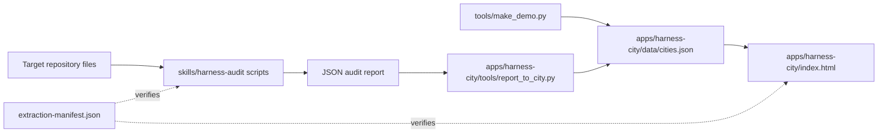
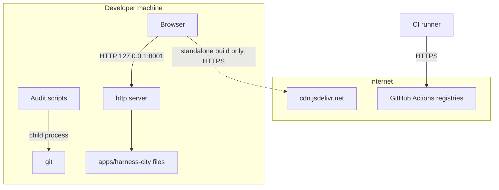
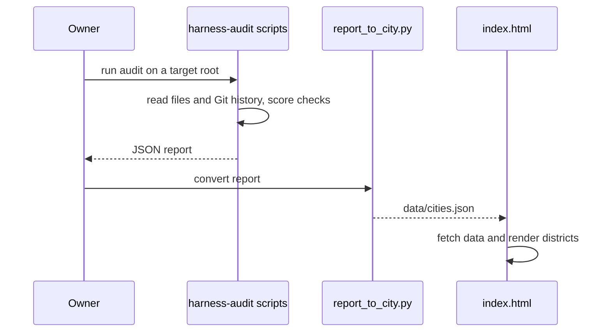

# Standalone Extraction: As-Built Boundaries

Evidence basis: the tree of commit `23251df` (2026-10-27), read with `git show 23251df:<path>`.
Statements about later behavior are labeled as current-tree facts.

## System Design

The extraction produced three independent parts and one provenance layer. The audit skill is
a Python pipeline that reads a target repository's files and Git metadata and writes a JSON
report. The city is a static browser application that loads `data/cities.json` and renders
it with a vendored three.js module. The tools directory holds the local checks, the synthetic
demo generator, the font-inlining step and the standalone packager. The extraction manifest
ties every copied file back to its source path and checksum.

<!-- atlas:diagram=system-design -->



## Components

| Component | Role at extraction |
| --- | --- |
| skills/harness-audit | Read-only audit pipeline, schema, catalog, prompts and tests |
| apps/harness-city | Static visualization, adapter, assets and vendor modules |
| extraction-manifest.json | Allowlisted source/target mappings and checksums |
| tools and Taskfile | Local checks, synthetic demo and standalone packaging |
| docs/0002-v0.2-harness-audit-as-built-adoption | Relocated source as-built records, not a new execution request |
| docs/0003-v0.1-harness-roadmap-evidence-matched | Owner-provided future roadmap |

## Trust and Data Flow

Repository files feed the static audit; reports feed the city adapter; synthetic data
feeds the public demo. The audit never runs audited code. Standalone HTML embeds its
selected data and must be reviewed before sharing.

The source repository's commit/tree pins remain in [EXTRACTION.md](../../EXTRACTION.md).
Only `23251df` is the local initial-extraction anchor. Source prehistory, private local
stores and report datasets were not imported.

## Ingress and Egress

At `23251df` no component listens on a network interface except the optional local preview
server. The table lists every edge the tree shows, with its evidence.

<!-- atlas:table=ingress-egress -->

| Edge | Direction | Protocol | Port | Authn and encryption | Evidence |
| --- | --- | --- | --- | --- | --- |
| Target repository files to audit scripts | in | local file read | none | none, local only | `skills/harness-audit/scripts`; no `urllib`, `requests`, `socket` or `http` import at line start under `skills/` |
| Audit scripts to `git` | out | child process | none | none | `git_signals.py` runs `git -C <root> ...` |
| Audit scripts to other child processes | out | child process | none | none | `calibrate.py` and `detect_stack.py` call `subprocess`; their commands were not inspected here |
| Browser to local preview server | in | HTTP | 8001 by default | none, plaintext, bound to `127.0.0.1` | `Taskfile.yml` task `serve`: `python3 -m http.server ${PORT:-8001} --bind 127.0.0.1` |
| Browser to `tools/serve.py` | in | HTTP | 8000 by default | none, plaintext, bound to `127.0.0.1` | `apps/harness-city/tools/serve.py` |
| City page to its own assets | in | HTTP, same origin | the preview port | none | `index.html` calls `fetch("assets/assets.json")` |
| Standalone page to a CDN | out | HTTPS | 443 | TLS, no integrity attribute recorded | `build_standalone.py` writes an import map for `three@0.160.0` on `cdn.jsdelivr.net` |
| CI runner to action registries | out | HTTPS | 443 | TLS | `.github/workflows/check.yml` |

Trust boundaries: the audited repository is untrusted input and is only read. The browser
sees only synthetic data in the public demo. The CDN edge exists only in the standalone
build, so a reviewer must treat that file as network-dependent.

## Network Topology

<!-- atlas:diagram=network -->



## Code Logic

The critical path is audit to report to city data. The adapter step name and file come from
the tree; internal function names were not inspected for this retrospective.

<!-- atlas:diagram=code-logic -->



## Data and Storage

No database exists at this commit. State is files: the report JSON, `cities.json`, the
vendored `three.module.js`, assets under `apps/harness-city/assets` and the manifest.
`reports/`, `build/`, `dist/`, `.data/`, `.env` and caches are ignored by `.gitignore`.

```text
repo/
  skills/harness-audit/   code, checks, schema, prompts, tests, uv.lock
  apps/harness-city/      index.html, data/cities.json, assets/, vendor/, tools/
  tools/                  check.py, make_demo.py, offline_fonts.py
  extraction-manifest.json
  docs/0001/.gitkeep      empty scaffold
  docs/0002/              relocated source records
```

## Files Touched

<!-- atlas:table=files-touched -->

| Slice | Path | Change |
| --- | --- | --- |
| Skill import | `skills/harness-audit/` | added |
| City import | `apps/harness-city/` | added, 75 files |
| Provenance | `extraction-manifest.json`, `EXTRACTION.md` | added |
| Checks | `tools/check.py`, `Taskfile.yml` | added |
| Demo | `tools/make_demo.py`, `apps/harness-city/data/cities.json` | added |
| CI | `.github/workflows/check.yml` | added |
| Relocated records | `docs/0002/` | added |
| Scaffold | `docs/0001/.gitkeep` | added, empty |

## Component Layers

<!-- atlas:table=component-layers -->

| Component | Layer | Path | Kind | Depends on |
| --- | --- | --- | --- | --- |
| Audit scripts | domain | `skills/harness-audit/scripts` | python package | git |
| Audit catalog and schema | data | `skills/harness-audit/checks`, `skills/harness-audit/schema` | config | none |
| City adapter | integration | `apps/harness-city/tools/report_to_city.py` | script | audit report |
| City page | presentation | `apps/harness-city/index.html` | static app | `cities.json`, `vendor/` |
| Local checks | tooling | `tools/check.py` | script | manifest |
| Manifest | provenance | `extraction-manifest.json` | data | none |

## Runtime and Storage

The skill is Python-based; the city is a static browser application. No new database or
cloud deployment is inferred. Generated reports/builds/caches remain ignored. Original
licenses and [third-party notices](../../THIRD_PARTY_LICENSES.md) are retained.

Runtime versions at `23251df`: the skill declares `requires-python = ">=3.11"` in
`skills/harness-audit/pyproject.toml`, and CI pins Python `3.14` in
`.github/workflows/check.yml`. No Node package manifest exists at that commit; the one Node
script, `apps/harness-city/tools/convert_assets.mjs`, has a Node version that is
`Not recorded`. Container images and a Dev Container are `Not recorded`: a search of the
commit tree for Dockerfile, compose and devcontainer files found none.

Later `adapted-runtime` entries preserve the original source hash separately from the
current reviewed hash. This is intentional evolution, not proof the current tree is
byte-identical to the initial snapshot. See [Plan](Plan.md) and [Implementation](Implementation.md).