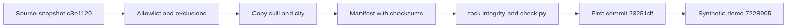

# Standalone Extraction: Reconstructed Intent

## Context

Retrospective reconstruction, not an original pre-implementation session. Commit
`23251df` introduced the standalone repository and reserved this folder as an empty
scaffold. The owner later requested basic documents in the named folders; this folder
now records that initial extraction while preserving its original `.gitkeep`.

## Problem and Goals

Make the existing audit skill and city usable independently of the source monorepo.
Keep the imported implementation traceable, publish only allowlisted material, and
provide synthetic demonstrations rather than private reports or invented findings.

## Decisions and Limits

- Clean snapshot, not an import of the source repository's complete Git history.
- Original source hashes are provenance; do not assume those commits exist locally.
- Imported 0039 documents live in 0002 and retain their historical evidence limits.
- Runtime integrity and publication checks are useful, not security certification.
- No historical interview, missing requirement or original pass result is invented here.

## Goal Alignment Evaluation

Target goal: publish the audit skill and the city as a standalone repository that anyone
can check without access to the source monorepo.

Verdict: strong fit. Reviewer judgment inferred from the recorded outcomes, not from a
recorded session. The evidence for each part of the goal:

- Independence: `Taskfile.yml` and `.github/workflows/check.yml` provide `task setup` and
  `task check`, so the repository builds and checks itself ([EXTRACTION.md](../../EXTRACTION.md),
  "Standalone Validation").
- Traceability: `extraction-manifest.json` maps each copied file to its source path and
  checksum, and `task integrity` verifies the copies.
- Safe publication: the Excluded list removes datasets, reports, credentials, environments
  and the monorepo history; `tools/check.py` exists at the commit, and in today's tree it adds
  publication pattern checks.
- Demonstrability: four authored synthetic profiles cover all four city tiers, so the city
  can be shown without auditing a real project.

Where the fit is partial: the checks are pattern checks and the document says so; they are
not a guarantee that no confidential content remains.

## Achievability Evaluation

Feasibility: high, because the work was a copy with an allowlist, not new design.

Assumptions recorded or inferred:

- The source commit `c3e1120` was a stable snapshot to copy from; its uncommitted work was
  left untouched.
- The skill's 137 tests and lint rules would run unchanged in a clean checkout. The
  provenance document records that they did.
- The city needs only a static file server, because the page fetches its data with
  `fetch()` from the same origin.

Dependencies: Python 3.11 or newer for the skill, a browser with WebGL for the city, Git for
the audit's history signals and for `tools/check.py`.

Blockers: none recorded. The one acknowledged gap is remote CI, which the provenance
document says was verified separately after the first push; no result is cited here.

Mitigations in the tree: the allowlist, the manifest checksums, the publication check and
the synthetic-only demo.

## Complexity Evaluation

Level: M. Reviewer judgment.

Drivers:

- 75 files under `apps/harness-city` at `23251df`, including vendored three.js and model
  assets that carry their own licenses.
- Two runtimes in one repository: Python for the skill, plain browser JavaScript for the
  city, with one Node script for asset conversion.
- A provenance layer that must stay correct as files later change, which is why the
  manifest distinguishes `unchanged-source` from `adapted-runtime`.

Delivery split: the first commit carried the import, the manifest, the checks and the CI
file; the follow-up `7228905` expanded the synthetic demo across all tiers.

## Visualizations

<!-- atlas:diagram=extraction-flow -->

## Risks

| Risk | Impact | Likelihood | Evidence or note |
| --- | --- | --- | --- |
| Confidential content published by mistake | high | low | Pattern checks run, but the document states they do not certify absence |
| Copied files drift from their source | medium | medium | `adapted-runtime` entries record the reviewed hash separately |
| Demo read as real findings | medium | low | Today's `tools/check.py` requires demo ids to end in `-demo`; the provenance document states no findings are fabricated |
| Vendored assets lose their license notices | medium | low | `THIRD_PARTY_LICENSES.md` and `apps/harness-city/NOTICE.md` are kept |
| Historical pass counts read as current | medium | medium | Every historical result is labeled historical in this folder |

## Decision Summary

Decision: proceed, which the commit `23251df` shows was done. Reason inferred from the
recorded exclusions: a clean snapshot keeps private history out, and a manifest keeps the
copy auditable. Alternatives such as importing the monorepo history are ruled out by the
Excluded list. No rejected-alternative discussion is recorded, so none is invented.

## Next Actions

- [x] Keep the empty `.gitkeep` and the provenance document unchanged.
- [x] Expand the synthetic demo across all tiers (`7228905`).
- [ ] Record remote CI results for the first push: `Not recorded` in this tree.
- [ ] Re-check the CDN import map in the standalone build against the offline build.

## Traceability

- Sources: `EXTRACTION.md`, `extraction-manifest.json`, commits `23251df` and `7228905`.
- Related folders: [0002](../0002-v0.2-harness-audit-as-built-adoption/README.md) holds the
  relocated source records; [0003](../0003-v0.1-harness-roadmap-evidence-matched/Plan.md)
  continues the roadmap.
- Backlog: see [WN-024](../Whats-Next.md) for the documentation alignment effort.

## References

- [Extraction provenance](../../EXTRACTION.md)
- [Extraction manifest](../../extraction-manifest.json)
- [Third-party notices](../../THIRD_PARTY_LICENSES.md)
- [History crosswalk](../History-Match.md)

## Source and Handoff

[Extraction provenance](../../EXTRACTION.md) owns the source pin, allowlist and exclusions.
Continue with [Plan](Plan.md), [Architecture](Architecture.md) and
[Implementation](Implementation.md). The [history crosswalk](../History-Match.md)
separates this topic from later roadmap and airport work.