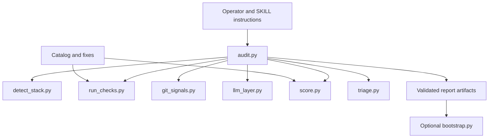
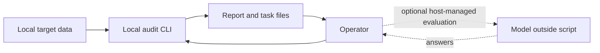
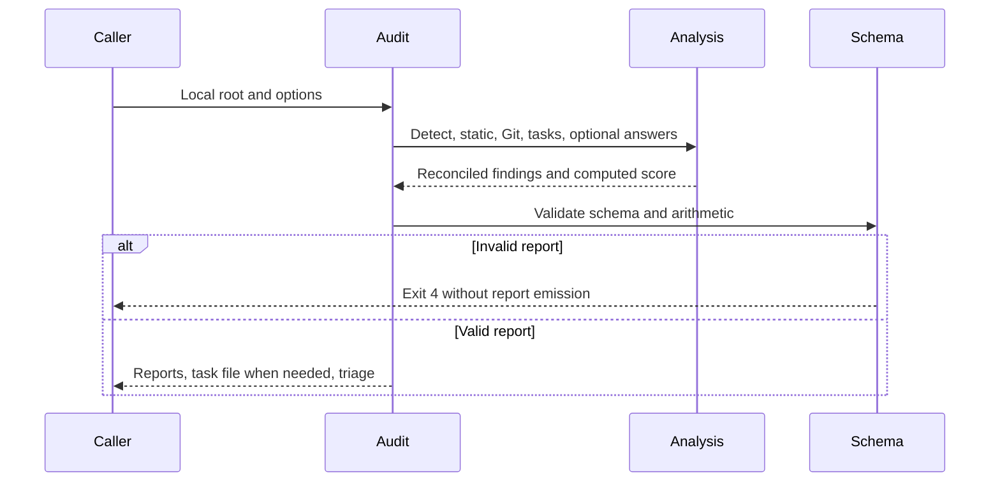
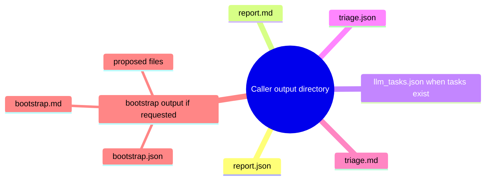

<!-- markdownlint-disable-next-line MD025 -->
# Frozen Harness Audit Architecture

## 1. Overview And Inputs

Plan AC-1 through AC-14 define documentation/adoption acceptance. This is a
local CLI and agent-operated workflow, not a service, new implementation or
runtime qualification engine. Source pin and scope are in the research record.

## 2. Criterion Traceability

| Criteria | Owning sections |
| --- | --- |
| AC-1, AC-12, AC-13, AC-14 | 6, 10, 11 |
| AC-2, AC-3, AC-4 | 4, 5, 8 |
| AC-5, AC-6 | 5, 8, 9 |
| AC-7, AC-8, AC-9 | 4, 8, 9 |
| AC-10, AC-11 | 5, 8, 10 |

<!-- atlas:part=system-design -->
## 4. System Design

<!-- atlas:diagram=components -->


<!-- atlas:table=component-layers -->
| Component | Layer | Path | Kind | Depends on |
| --- | --- | --- | --- | --- |
| Operator | Interaction | skills/harness-audit/SKILL.md | files | Audit |
| Audit | Orchestration | skills/harness-audit/scripts/audit.py | script | Detection, Checks, Git, Agent evidence, Scoring, Triage |
| Detection | Analysis | skills/harness-audit/scripts/detect_stack.py | script | |
| Checks | Analysis | skills/harness-audit/scripts/run_checks.py | script | Catalog |
| Git | Analysis | skills/harness-audit/scripts/git_signals.py | script | Checks |
| Agent evidence | Analysis | skills/harness-audit/scripts/llm_layer.py | script | Checks |
| Scoring | Analysis | skills/harness-audit/scripts/score.py | script | Catalog |
| Triage | Analysis | skills/harness-audit/scripts/triage.py | script | Scoring |
| Bootstrap | Proposal | skills/harness-audit/scripts/bootstrap.py | script | Detection |
| Catalog | Reference | skills/harness-audit/checks/catalog.yaml | files | |

<!-- atlas:part=ingress-egress -->
## 5. Ingress, Egress And Trust

<!-- atlas:table=ingress-egress-matrix -->
| Source | Destination | Protocol / Port | Boundary And Effects |
| --- | --- | --- | --- |
| Operator | CLI | Local argv / none | Root, output path, catalog and optional answer file |
| Audit | Repository | Files / none | Reads code/config as data; never executes target code |
| Git layer | Local Git metadata | Subprocess / none | Read-only metadata queries; no clone/fetch in audit.py |
| Operator | Model | Host-managed / unspecified | Script does not call a model; operator handles excerpts |
| Answers | Quote validation | JSON and file reads / none | Text occurrence checked; meaning not certified |
| Audit | Output directory | Files / none | Reports, tasks and triage written after validation |
| Bootstrap | Proposal directory | Files / none | Writes generated proposals |
| Bootstrap --apply | Target missing files | Files / none | Explicit create-only path; skips existing files |

No network client, server port or credential store is implemented in this
pipeline. A caller/model integration may have its own exposure; none is inferred
or approved here. Quote checks are not a complete prompt-injection defense.

## 6. Runtime And Infrastructure

As built: Python >=3.11, PyYAML >=6, jsonschema >=4; developer dependencies pytest
and ruff; Taskfile invokes uv. Versions are source-declared on 2026-10-27, not
fresh upstream recommendations. Tool VERSION is 0.1.0. No new Dev Container,
image, database, daemon or cloud resource is selected for this documentation run.
The skill is retained unchanged despite differing from repo stdlib conventions.

Logging: N/A for new production instrumentation because this effort authors
documentation and a declared throwaway source probe only. Existing CLI print/
stderr behavior is documented as-is, not retrofitted with lean-logging.

<!-- atlas:part=network -->
## 7. Network And Deployment View

<!-- atlas:diagram=trust -->


No deployment or model call occurs during this docs run.

<!-- atlas:part=code-logic -->
## 8. Code Logic

<!-- atlas:diagram=report-flow -->


No supported component yields exit 3; invalid root yields exit 2. LLM answers
replace specialized check IDs in assembly. Missing/invalid evidence remains
unknown. Scoring is a deterministic calculation from resulting findings.

<!-- atlas:part=data-model -->
## 9. Data Contracts

The authoritative report shape is
[report.schema.json](../../skills/harness-audit/schema/report.schema.json).
No database is required. Report entities are repo, stack, pillars, findings,
score, entropy, top_gaps and limitations. A finding has check_id, pillar, level,
status, source, confidence, gate and evidence, plus optional component/note.
Finding status is pass/fail/unknown/not_applicable/error; source distinguishes
script/LLM-derived evidence. Entropy verdict is a separate field and vocabulary.
Triage is counterfactual; bootstrap metadata contains proposed/skipped/applied
paths, not the digest approval record from the retired solution.

## 10. Local Storage

The adopted CLI uses caller-selected `--out` (audit default `.`); bootstrap
defaults to `build/bootstrap`. Document these actual defaults rather than
claiming a migration to the shared layout. Any operational adoption must also
review the shared storage policy (historical source reference).
No audit output or private target data is created by this documentation run.

<!-- atlas:diagram=outputs -->


```text
<out>/
  report.json
  report.md
  llm_tasks.json       # when tasks exist
  triage.json
  triage.md
<bootstrap-out>/
  proposed/
  bootstrap.json
  bootstrap.md
```

<!-- atlas:part=files-touched -->
## 11. Files Touched Per Slice

These are documentation-adoption changes only. Frozen implementation files are
inputs, not planned operations. No source path under harness-audit may appear
in the generated change set.

<!-- atlas:table=files-touched-per-slice -->
| Slice | Path | Change |
| --- | --- | --- |
| M1 | docs/skills/0036-v0.1-agent-harness-setup/Implementation.md | change |
| M1 | docs/skills/0036-v0.1-agent-harness-setup/Workflow-Report.md | change |
| M1 | docs/skills/0036-v0.1-agent-harness-setup/Plan.md | change |
| M1 | docs/skills/0036-v0.1-agent-harness-setup/Architecture.md | change |
| M1 | docs/skills/0036-v0.1-agent-harness-setup/Map.md | change |
| M1 | sync.config.example.json | change |
| M1 | agents/skills/AGENTS.md | change |
| M1 | agents/skills/engineering/agent-harness-setup/SKILL.md | remove |
| M1 | agents/skills/engineering/agent-harness-setup/assets/approval-table.md | remove |
| M1 | agents/skills/engineering/agent-harness-setup/references/client-adapters.md | remove |
| M1 | agents/skills/engineering/agent-harness-setup/references/evidence-states.md | remove |
| M1 | agents/skills/engineering/agent-harness-setup/references/integration-candidates.md | remove |
| M1 | agents/skills/engineering/agent-harness-setup/scripts/apply.py | remove |
| M1 | agents/skills/engineering/agent-harness-setup/scripts/assess.py | remove |
| M1 | agents/skills/engineering/agent-harness-setup/scripts/common.py | remove |
| M1 | agents/skills/engineering/agent-harness-setup/scripts/fixtures/__init__.py | remove |
| M1 | agents/skills/engineering/agent-harness-setup/scripts/handoff.py | remove |
| M1 | agents/skills/engineering/agent-harness-setup/scripts/lean_log.py | remove |
| M1 | agents/skills/engineering/agent-harness-setup/scripts/log_messages.py | remove |
| M1 | agents/skills/engineering/agent-harness-setup/scripts/propose.py | remove |
| M1 | agents/skills/engineering/agent-harness-setup/scripts/test_adapter_proposals.py | remove |
| M1 | agents/skills/engineering/agent-harness-setup/scripts/test_apply.py | remove |
| M1 | agents/skills/engineering/agent-harness-setup/scripts/test_assess.py | remove |
| M1 | agents/skills/engineering/agent-harness-setup/scripts/test_handoff.py | remove |
| M1 | agents/skills/engineering/agent-harness-setup/scripts/test_infrastructure.py | remove |
| M1 | agents/skills/engineering/agent-harness-setup/scripts/test_logging_contract.py | remove |
| M1 | agents/skills/engineering/agent-harness-setup/scripts/test_verify.py | remove |
| M1 | agents/skills/engineering/agent-harness-setup/scripts/verify.py | remove |
| M2 | docs/0002/Plan.md | add |
| M2 | docs/0002/Architecture.md | add |
| M2 | docs/0002/Test-Plan.md | add |
| M3 | docs/0002/Implementation.md | add |
| M3 | docs/0002/Workflow-Report.md | change |

The actual Git diff is the exhaustive retirement/document inventory; this table
is the milestone view. There is no planned runnable-skill development slice.
