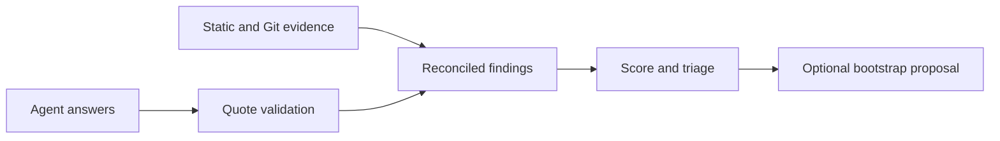
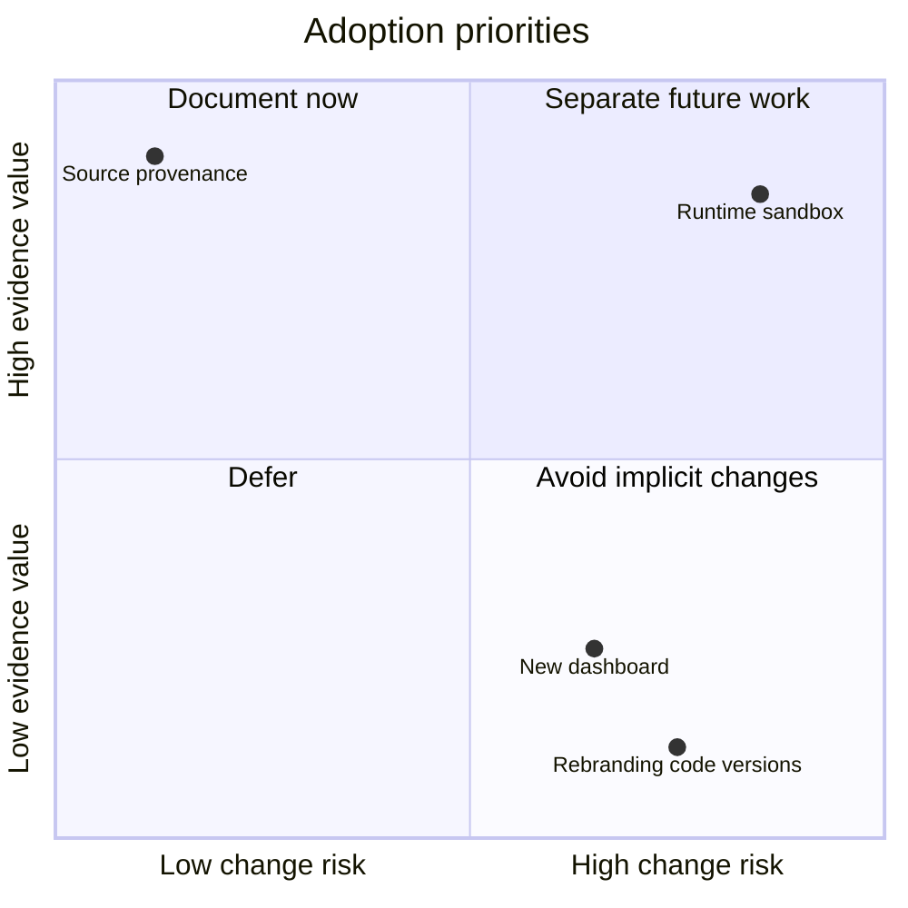

<!-- markdownlint-disable-next-line MD025 -->
# Adopt The Existing Harness Audit

## Contents

- [Context](#context)
- [Initial Idea](#initial-idea)
- [Evaluation](#evaluation)
- [Scope And Risks](#scope-and-risks)
- [Next Actions](#next-actions)
- [References](#references)

## Context

The original setup implementation produced thin instruction adapters and missed
the intended breadth of harness evaluation. The owner has now stopped that
implementation and selected the existing harness-audit solution, explicitly
prohibiting modifications to it. This document records adoption, not a proposal
to redesign its algorithm. See the [owner-directed map](Map.md).

## Initial Idea

Explain how an existing tool assesses a repository's harness with deterministic
configuration/Git checks and agent judgments, combines their evidence, ranks
gaps and proposes missing files. Keep the distinction between an audit result
and actual execution of repository checks. The current solution is the primary
source; the supplied research files establish history, not current behavior.

## Evaluation

Goal alignment: strong for evidence-backed audit and remediation proposals;
limited for runtime qualification. The frozen audit never executes target code.
Its Enforced label describes a static classification, not observed enforcement.
Feasibility: high for reverse engineering because code, catalog, schema, tests
and historical notes are present. No implementation build is needed.
Complexity: medium for documentation; high if later expanded to sandboxed
execution, merging existing configuration or additional ecosystems. Those are
separate efforts, not implied by adoption.

The quadrant positions are qualitative editorial priorities, not measurements.

## Scope And Risks

In scope: stop 0036, remove its active skill source, reconstruct decisions and
the full as-built specification chain, reconcile historical research and prove
the replacement source stayed unchanged. Out of scope: editing harness-audit,
executing target projects, applying bootstrap, deployment and new features.

Risks: static heuristics may miss custom conventions; LLM quotes prove text
occurrence rather than correctness; historical backlog claims may be stale;
bootstrap does not merge existing files. Documentation v0.2 must not silently
change tool `0.1.0`, schema/catalog `0.1`, dependencies or weights.

## Next Actions

Produce source-grounded research and stakeholder summary, then acceptance
criteria, an as-built contract walkthrough, architecture, test/mock/dataset
mapping, ontology and a documentation-only adoption handoff. Preserve all
unexecuted verification as a visible limit. The earlier discovery spike remains
historical feasibility evidence; it does not validate the replacement.

## References

- [Frozen source and measurements](research/As-Built-Findings.md).
- [Adopted skill](../../skills/harness-audit/SKILL.md).
- [Historical backlog](research/BACKLOG.md) and [catalog](research/catalog.yaml).
- Shared OKF template (historical source reference), repository policy consulted 2026-10-27; no new upstream retrieval claimed.
