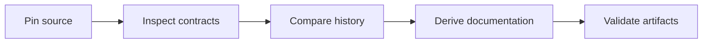
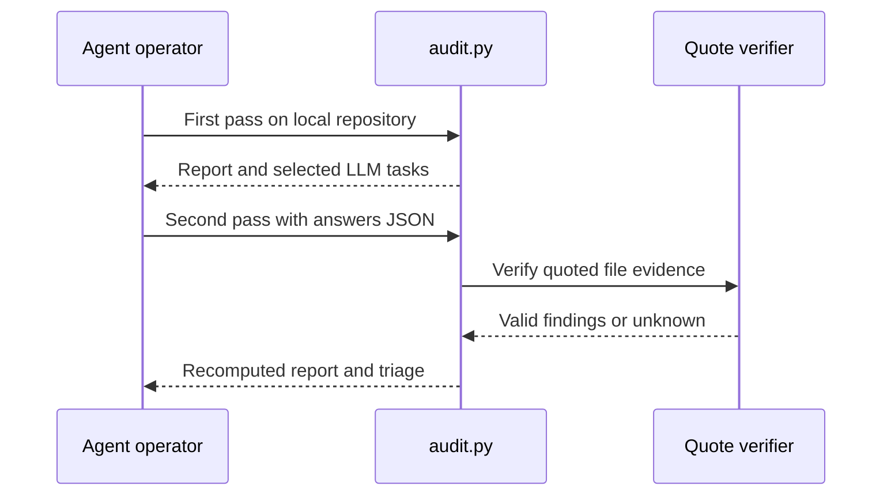
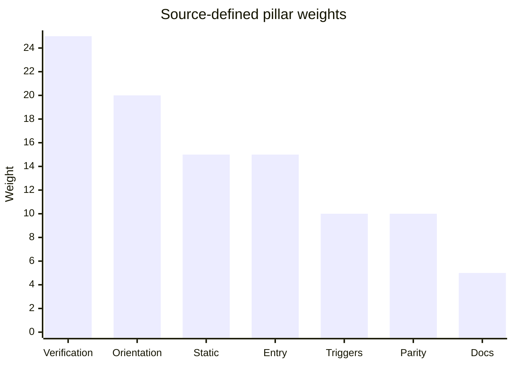
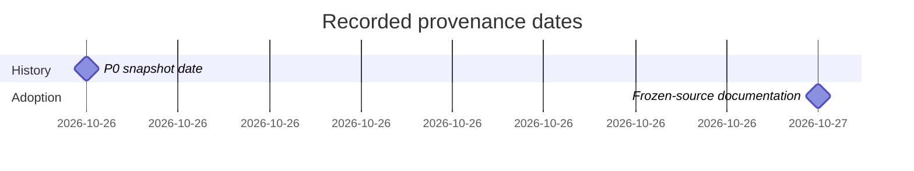
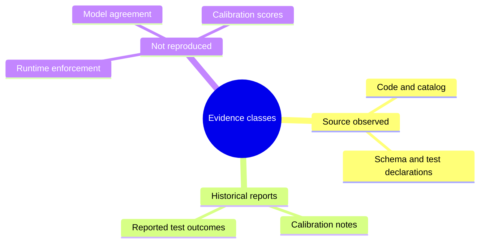

<!-- markdownlint-disable-next-line MD025 -->
# Reconstructing A Static And Agent-Assisted Harness Audit

Audience: maintainers. Study date: 2026-10-27. Primary source: the frozen skill
selected by the owner; the historical research snapshots are supporting inputs.

## Contents

- [Abstract](#abstract)
- [Introduction And Related Work](#introduction-and-related-work)
- [Methodology](#methodology)
- [Experimental Setup And Results](#experimental-setup-and-results)
- [Threats To Validity](#threats-to-validity)
- [Conclusion And Reproducibility](#conclusion-and-reproducibility)
- [References](#references)

## Abstract

This source-inspection study reconstructs an existing Python/Node harness audit
without changing it. It distinguishes deterministic checks, local Git evidence,
quote-validated agent answers and derived scores. The contribution is traceable
documentation, not a claim that audit scores prove safe or effective agents.

## Introduction And Related Work

The superseded 0036 plan (historical source reference) describes the
earlier setup workflow. The adopted implementation has broader configuration
analysis but deliberately does not run target code. The supplied
[historical backlog](research/BACKLOG.md) records P0 intentions; the
[live backlog](../../skills/harness-audit/BACKLOG.md)
contains subsequent reported fixes and calibration. Neither is silently treated
as a fresh experiment. No external-library or client compatibility study is
performed in this source-only run.

## Methodology

Pin source, inspect controlling functions, compare historical/live artifacts,
and record behaviors with explicit limitations. The source pin and hashes are
in [As-Built Evidence](research/As-Built-Findings.md#source-pin).

Reconciliation is implemented by check-ID replacement in `audit.assemble`;
the agent is not an unrestricted second scanner and the script does not invoke
a model. Re-running source detection on the second pass does not establish a
cryptographic source-baseline protocol for answers.

## Experimental Setup And Results

No target audit, calibration, mutation test or runtime experiment was run.
Observed inventories were counted from source, not test collection.

| Observation | Result | Method |
| --- | --- | --- |
| Top-level catalog check entries | 56 | Anchored catalog source-line count |
| Test function declarations | 137 | Anchored `def test_` count across eight test modules |
| Catalog identity | Different hashes | SHA-256 of historical and live YAML |
| Tool/schema versions | 0.1.0 / 0.1 | Source constants and report assembly |
| Replacement changes | Must remain zero | Git worktree comparison against pinned tree |

The chart reproduces configured weights, not measured effectiveness.

## Threats To Validity

Text heuristics can misattribute indirect commands. Per-component aggregation
uses tracked-file weighting and can hide small weak components. Quote occurrence
is weaker than semantic correctness; bounded excerpts can omit context. An L2
static classification does not establish hook activation, CI success or actual
test execution. Historical scores and holdout claims are source-reported only.
The live backlog records deferred dependency usage analysis and runtime modes.

## Conclusion And Reproducibility

The adopted solution supports broader audit and remediation analysis than the
retired adapter workflow, but is not a runtime qualification system. Reproduce
source inspection at the pinned commit, use the live catalog for current rules,
and keep historical research distinct. Behavioral reproduction, if later
approved, uses the skill's `task check` entry point and isolated fixtures.

- Source and versions pinned: yes.
- Source tests inspected: declarations only; execution not claimed.
- New target data or network access: none.
- Frozen source modification: prohibited and checked at handoff.
- Human review and live-client proof: not claimed.

## References

- [Pipeline source](../../skills/harness-audit/scripts/audit.py), `assemble`, `validate`, `main`.
- [Agent evidence source](../../skills/harness-audit/scripts/llm_layer.py), `plan`, `verify_evidence`, `apply_answers`.
- [Scoring source](../../skills/harness-audit/scripts/score.py), `build`, `verify_arithmetic`.
- [Historical reconciliation](research/As-Built-Findings.md).
- Shared OKF policy (historical source reference), consulted locally 2026-10-27; upstream specification was not re-fetched.
