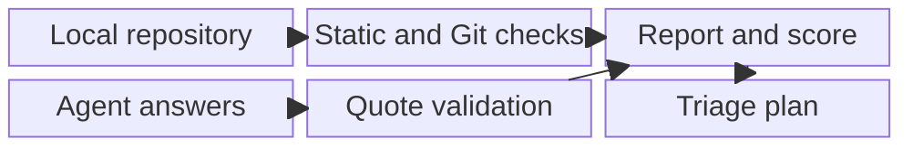
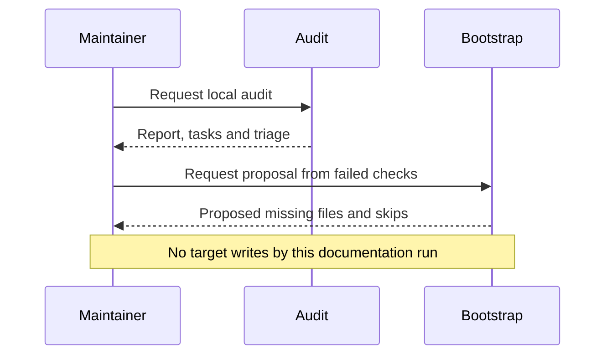
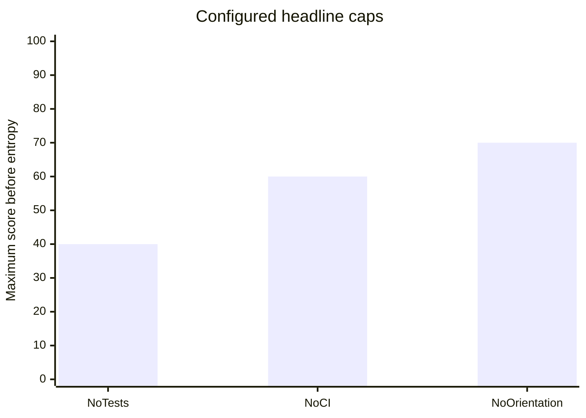
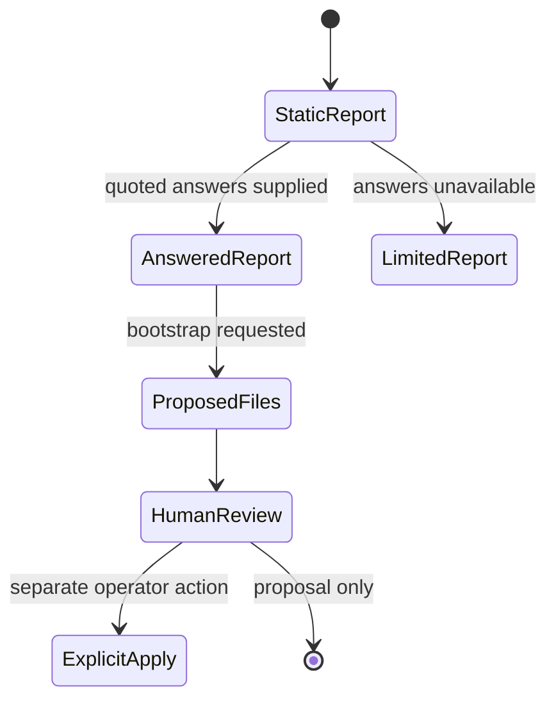

<!-- markdownlint-disable-next-line MD025 -->
# Adopting Harness Audit Without Rewriting It

Audience: maintainers and architects. Objective: adopt the existing solution
with an accurate contract, not expand its scope by documentation.

## Contents

- [Executive Summary](#executive-summary)
- [Architecture](#architecture)
- [Operations](#operations)
- [Evaluation And Trade-Offs](#evaluation-and-trade-offs)
- [Next Steps And References](#next-steps-and-references)

## Executive Summary

Stop the old setup implementation and document the existing harness-audit as
the successor. It examines configuration and local history, requests bounded
agent judgments, validates their evidence and produces scored gaps and a fix
plan. It does not execute target tests or certify runtime enforcement.

## Architecture

The first pass identifies Python/Node components and produces configuration
findings. Agent tasks use selected excerpts and facts. The second pass validates
answers and recomputes findings, pillars and limitations. Scoring uses gates,
ratios, component weighting, caps and entropy; details belong to the Plan and
Architecture rather than an invented new implementation.

## Operations

The tool needs Python 3.11+, PyYAML and jsonschema. Development uses the existing
Taskfile/uv environment. The skill instructs use of its task runner; this run
does not install tools or change the environment. Model invocation is performed
by the agent operator, not a model SDK inside the audit script.

Bootstrap is opinionated, proposal-first and create-only. Existing alternatives
are skipped for human handling. Explicit `--apply` can create missing target
files, but it does not merge changes, activate local hooks or prove they reject
bad commits. Unknown project details produce `TODO(human)` placeholders.

## Evaluation And Trade-Offs

| Concern | Adopted behavior | Not established |
| --- | --- | --- |
| Breadth | Seven pillars across Python/Node configuration | Every custom convention |
| Agent review | Selected, quote-validated judgment tasks | Independent complete-repository review |
| L2 Enforced | Static catalog classification | Observed activation or check success |
| Remediation | Counterfactual triage and missing-file proposals | Business priority or safe automatic merging |
| Preservation | Frozen implementation retained unchanged | Approval to deploy or run on private checkouts |

These are source-defined rules and process states, not measured improvement or
an approved apply transaction. The tool has no digest-bound merge protocol.

## Next Steps And References

Derive checkable as-built criteria, record the mandatory prototype walkthrough
with its execution limits, then map architecture, tests, datasets and vocabulary.
Future improvements need explicit authorization outside this frozen adoption.

- [Source inventory and limitations](research/As-Built-Findings.md).
- [Implemented workflow](../../skills/harness-audit/SKILL.md).
- [Pipeline](../../skills/harness-audit/scripts/audit.py).
- [Bootstrap implementation](../../skills/harness-audit/scripts/bootstrap.py).
- Shared OKF policy (historical source reference), consulted locally 2026-10-27; no new upstream retrieval claimed.
