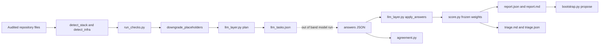
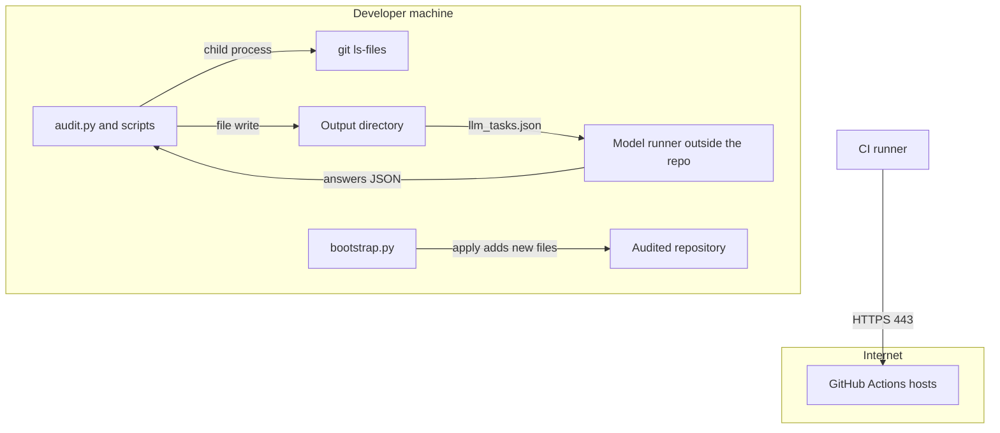
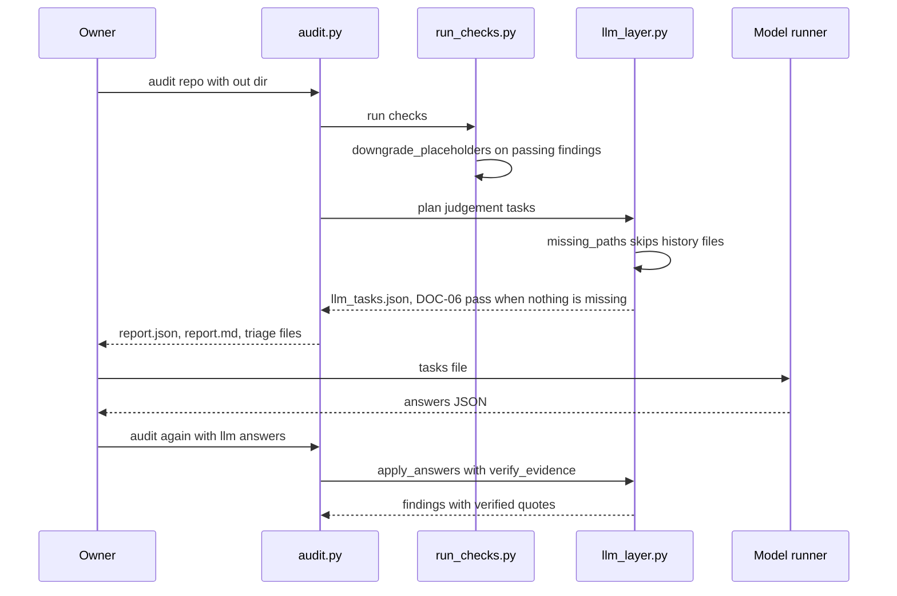

# Harness Roadmap: Change Boundaries

Evidence basis: the owner's roadmap text at commit `23251df` (2026-10-27, stored then as
`docs/0003/Repo Harness Next Steps.md`, now [research/Repo Harness Next Steps.md](research/Repo%20Harness%20Next%20Steps.md))
and the audit skill as built at commit `37e006f` (2026-10-27), the last of the four commits
that this folder matches to the roadmap (`7fddcc3`, `54babe0`, `37e006f`, with `b470917`
recording agreement evidence). Commit-time facts were read with `git show <commit>:<path>`.
Anything labeled "today's tree" was read from the working tree on 2026-11-04.

## System Design

The roadmap does not add a system. It changes the behavior of four parts of the existing
read-only audit pipeline in `skills/harness-audit/scripts`, and it adds one comparison tool.
At `37e006f` the pipeline is: `detect_stack.py` and `detect_infra.py` list the audited
repository's files; `run_checks.py` runs the mechanical checks; `llm_layer.py` plans the
judgement tasks and later verifies the answers; `score.py` computes the frozen score;
`triage.py` ranks fixes; `audit.py` orchestrates and writes the outputs; `bootstrap.py`
proposes missing files. `agreement.py` (added in `7fddcc3`) compares two answer sets.

<!-- atlas:diagram=system-design -->



## Components

| Owner | Roadmap responsibility |
| --- | --- |
| Check engine | Mechanical placeholder/path checks; evidence remains quoted and attributable |
| Judgment preparation | Bounded excerpts and runner candidates; missing support yields unknown |
| Quote validation | Recheck model answers against repository files before accepting them |
| Scoring | Frozen weights, gates, caps and documented uncertainty |
| Agreement tooling | Compare independent model runs without treating them as human calibration |
| Bootstrap preview | Proposed missing files/patches; separate explicit application boundary |

## Data and Trust

Files and Git history are untrusted inputs; the audit does not execute them. Judgment
answers are untrusted until their quotes verify. Calibration datasets and raw reports
are local evidence, not fixtures to publish automatically.

The roadmap does not introduce a database, service or cloud deployment. External Project
sync and human ratings cannot be inferred from local file presence. A proposal branch
or patch is not evidence that hooks were installed or CI ran.

## Component to Roadmap Mapping

Reviewer judgment inferred from the commit diffs: each roadmap item lands in one script, which
is why the change boundary is small.

| Roadmap item | Owner script at `37e006f` | Recorded change |
| --- | --- | --- |
| TODO placeholders (B-150) | `run_checks.py` | `7fddcc3` adds `PLACEHOLDER = "TODO(human)"` and `downgrade_placeholders`; `90e9a52` later adds `placeholder_count` |
| DOC-06 by script (B-127, B-142) | `llm_layer.py` | `7fddcc3` adds `HISTORY_DOC` skipping and a script pass when no candidate path is missing |
| Bigger excerpts (B-129) | `llm_layer.py` | `7fddcc3` raises `MAX_FILE_LINES` 250 to 400, `MAX_TASK_LINES` 700 to 1000, runner targets 80 to 200 |
| STA-09 decision (B-128) | `checks/catalog.yaml`, `llm_layer.py` | `54babe0` changes the detector from `llm` to `key_present` and removes the STA-09 judgement branch |
| Second opinion (B-122, B-134) | `agreement.py` | `7fddcc3` adds it; `b470917` updates the recorded report |
| Node hooks (B-151) | `bootstrap.py` | `37e006f` adds `gen_husky`, `gen_husky_patch` and an `apply` flag |

## Trust Boundaries

| Boundary | Who may write | Enforcement shown in the tree |
| --- | --- | --- |
| Audited repository | nobody during an audit | the audit scripts read it; `git_signals.py` calls `git -C <root>`, and whether every argument is read-only was not inspected (`Not recorded`) |
| Audit output directory `--out` | the audit run | `audit.py` writes `report.json`, `report.md`, `llm_tasks.json`, `triage.json`, `triage.md` |
| Model answers | an external model run | `llm_layer.verify_evidence` accepts a quote only if it is in the file near the claimed line; failures are noted as "could not be verified against the files" |
| Frozen scoring files | reviewed commits only | `references/FROZEN.sha256` lists hashes for `catalog.yaml`, `score.py`, `run_checks.py`, `llm_layer.py`, `git_signals.py` and two prompts; `7fddcc3` and `54babe0` both modify it |
| Audited repository on `--apply` | `bootstrap.py` only | new files only; `package.json.patch` carries `apply: False`, and `test_apply_never_writes_the_patch_into_the_repository` pins it |

The audit never executes audited code: the scripts under `skills/` contain no network or
server import at `37e006f`, and their only child processes are `git` and the tool's own
`audit.py` (see the table below).

## Ingress and Egress

Scope: the audit skill as changed by the roadmap commits. The table lists every edge the code
at `37e006f` shows. No component of this folder's scope listens on a port.

<!-- atlas:table=ingress-egress -->

| Edge | Direction | Protocol | Port | Authn and encryption | Evidence |
| --- | --- | --- | --- | --- | --- |
| Audited repository files to the audit scripts | in | local file read | none | none, local only | `run_checks.Ctx.text` and `detect_stack.list_files`; `git grep` for `urllib`, `requests`, `socket`, `http`, `httpx`, `aiohttp` or `ssl` imports under `skills/` returns nothing at `37e006f` |
| Audit scripts to `git` | out | child process | none | none | `detect_stack.py` runs `git -C <root> ls-files -z`; `git_signals.py` runs `git -C <root> <args>` with a 60 second timeout |
| `calibrate.py` to `audit.py` | out | child process | none | none | `calibrate.py` `audit_one` runs `sys.executable -I audit.py <repo> --out <dir>` |
| Audit to model runner | out | JSON file, `llm_tasks.json` | none | none | `audit.py` writes it; the scripts contain no model API client, only an unrelated `apikey` regex in `infra_checks.py` |
| Model runner to audit | in | JSON file, `--llm-answers` | none | none, answers re-verified against files | `audit.py` argument `--llm-answers`; `llm_layer.apply_answers` |
| Audit to output directory | out | local file write | none | none | `audit.py` writes the five output files named above |
| Bootstrap to proposals and repository | out | local file write | none | none, additive only | `bootstrap.write` writes under `out/proposed/` and, with `--apply`, only files that do not exist |
| Browser to local preview server | in | HTTP | 8001 by default | none, plaintext, `127.0.0.1` | ABSENT from this scope: `Taskfile.yml` task `serve` serves the city, and none of `7fddcc3`, `54babe0`, `b470917` or `37e006f` changes a file under `apps/` |
| CI runner to action and package hosts | out | HTTPS | 443 | TLS | `.github/workflows/check.yml` runs `task setup` and `task check` on `ubuntu-latest` with SHA-pinned actions; the package index host is `Not recorded` |

Absent edges: no inbound listener, no outbound call to a model provider, no call to an
external Project or package registry, and no database connection. The `pytest` marker
`slow` in `skills/harness-audit/pyproject.toml` reads "tests that clone or hit the network
(none today)".

## Network Topology

<!-- atlas:diagram=network -->



The model runner is drawn outside the repository because the scripts only exchange files with
it. Whether the runner reaches the internet is `Not recorded`.

## Code Logic

The path that carries the Phase 1 fixes is: audit, mechanical checks with placeholder
downgrade, judgement planning, answer verification, scoring. Function names come from the
diffs of `7fddcc3` and the function list of `llm_layer.py` at `37e006f`.

<!-- atlas:diagram=code-logic -->



`downgrade_placeholders` turns a passing finding into a fail when its evidence file still holds
`TODO(human)` and appends a note naming the file. `placeholder_count` (added in `90e9a52`,
after this roadmap's matched commits) counts only comments, docstrings and
`NotImplementedError` calls in Python files, so quoted fixture strings no longer erase test
presence.

## Data and Storage

No database exists in this scope. State is files: the five audit outputs, the optional
`proposed/` directory from bootstrap, `references/FROZEN.sha256`, `checks/catalog.yaml`, and
`BACKLOG.md` in the skill directory. Answer files and raw reports are not committed: the
[agreement report](../0004-v0.1-audit-release-retrospective/research/Agreement-Report-v1.2.md)
states "Answer files are not committed (see AGENTS.md)". Retention is `Not recorded`.

```text
skills/harness-audit/
  scripts/      run_checks.py llm_layer.py score.py bootstrap.py agreement.py ...
  checks/       catalog.yaml
  references/   FROZEN.sha256
  tests/        test_run_checks.py test_llm_layer.py test_agreement.py test_bootstrap.py ...
  BACKLOG.md    B-numbers used by the roadmap
```

## Runtime and Infrastructure

At `37e006f`: `skills/harness-audit/pyproject.toml` declares `requires-python = ">=3.11"`,
dependencies `pyyaml>=6` and `jsonschema>=4`, and dev dependencies `pytest>=8` and `ruff>=0.6`;
`uv.lock` is present. CI pins Python `3.14` on `ubuntu-latest` through `astral-sh/setup-uv`
and runs `task setup` then `task check`. The skill needs no Node runtime to propose Node
hooks, because `gen_husky_patch` only returns text. Dockerfile, compose and devcontainer
files: a search of the `37e006f` tree found none, so container images are `Not recorded`.
A Node version for audited repositories is `Not recorded`.

## Files Touched

<!-- atlas:table=files-touched -->

| Commit | Path | Change |
| --- | --- | --- |
| `7fddcc3` | `skills/harness-audit/scripts/run_checks.py` | modified, placeholder downgrade |
| `7fddcc3` | `skills/harness-audit/scripts/llm_layer.py` | modified, DOC-06 and excerpt caps |
| `7fddcc3` | `skills/harness-audit/scripts/agreement.py`, `tests/test_agreement.py` | added |
| `7fddcc3` | `skills/harness-audit/scripts/audit.py`, `pyproject.toml` | `audit.py` `VERSION` changes from `0.1.0` to `1.2.0`; `pyproject.toml` modified |
| `7fddcc3` | `docs/0004/Agreement-Report-v1.2.md`, `Release-Notes-v1.2.md`, `README.md` | added |
| `b470917` | `docs/0004/Agreement-Report-v1.2.md`, `skills/harness-audit/BACKLOG.md` | modified |
| `54babe0` | `skills/harness-audit/checks/catalog.yaml`, `scripts/llm_layer.py` | STA-09 mechanical |
| `37e006f` | `skills/harness-audit/scripts/bootstrap.py`, `tests/test_bootstrap.py` | Node hook proposal |
| each of the four | `extraction-manifest.json`, `references/FROZEN.sha256` where listed | reviewed baseline update |

## Component Layers

<!-- atlas:table=component-layers -->

| Component | Layer | Path | Kind | Depends on |
| --- | --- | --- | --- | --- |
| Check engine | domain | `skills/harness-audit/scripts/run_checks.py` | python module | catalog, file tree |
| Judgement preparation and verification | domain | `skills/harness-audit/scripts/llm_layer.py` | python module | `run_checks`, file tree |
| Scoring | domain | `skills/harness-audit/scripts/score.py` | python module | findings, frozen weights |
| Agreement tooling | tooling | `skills/harness-audit/scripts/agreement.py` | python script | two answer sets |
| Bootstrap preview | integration | `skills/harness-audit/scripts/bootstrap.py` | python script | report, repository facts |
| Check catalog | data | `skills/harness-audit/checks/catalog.yaml` | config | none |
| Frozen hashes | provenance | `skills/harness-audit/references/FROZEN.sha256` | data | scored files |

## Current Authority

The original roadmap defines historical intent. [Implementation](Implementation.md)
matches its realized pieces; current [skill guidance](../../skills/harness-audit/SKILL.md)
owns present execution boundaries. Later quality work is in 0008, not backdated here.