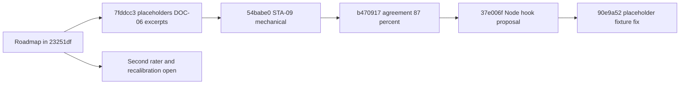

# Harness Roadmap: Reconstructed Intent

## Context

Retrospective reconstruction, not an original pre-implementation session. The roadmap note is
dated 2026-10-27 and was committed in `23251df` as `docs/0003/Repo Harness Next Steps.md`; the
folder's four basic documents were added later in `1b15eeb` (2026-10-28). No session record,
interview or chat transcript for the roadmap is retained: `Not recorded: the conversation that
produced the roadmap`.

## Problem and Goals

The [owner's roadmap](research/Repo%20Harness%20Next%20Steps.md) identifies three trust gaps:
placeholder files earning points, calibration relying on one rater, and unresolved
judgments caused by path checking and excerpt limits. It then proposes more useful
bootstrap and fix-plan behavior. This is reconstructed intent, not a new interview.

## Decisions

Phase 1 addresses obvious trust defects before recalibration. Weights remain frozen
until the proposed calibration gate is met. Bootstrap writes remain separate from the
read-only audit, and proposed merge behavior is not permission to overwrite files.

## Goal Alignment Evaluation

Target goal, from the roadmap's "Where we are": make the 0-100 score trustworthy enough to
act on, by closing three trust gaps, then make bootstrap useful on the owner's own repositories.

Verdict: partial fit. Reviewer judgment inferred from the commits and the skill's
`BACKLOG.md` at `37e006f`, not from a recorded review. Evidence per goal:

- Trust gap 1, placeholders: `7fddcc3` adds `downgrade_placeholders` in `run_checks.py`, with
  `PlaceholderTests`. The backlog records the express copy going 45 to 38 ("the Taskfile still
  counts, correctly"). The roadmap's done-when said "stays near 33, not 45", so the intent is
  met in direction and not literally in number.
- Trust gap 3, DOC-06 and excerpts: `7fddcc3` resolves DOC-06 by script when every backticked
  path resolves and raises excerpt caps. The backlog records "8 of 12 calibration repos and 2
  of 6 holdout repos now have a script verdict"; the rest "still go to the model and are
  mostly `unknown`". The roadmap's done-when said "most of the 18 repos", which is 10 of 18
  by that count.
- Trust gap 2, single rater: not closed. `b470917` records a second model-to-model
  agreement run (47 of 54 answers, 87 percent, kappa 0.768; the first run was 33 of 49,
  67 percent, kappa 0.36). The roadmap asks for a second human rater; the
  [release notes](../0004-v0.1-audit-release-retrospective/research/Release-Notes-v1.2.md)
  list "One rater" under known limits.
- Bootstrap: `37e006f` adds a Node hook proposal (B-151). Azure DevOps (B-155), monorepos
  (B-152) and pinned actions (B-153, B-154) are still open in the same backlog.

## Achievability Evaluation

Feasibility: high for Phase 1, low-to-unknown for Phase 2 and 3 on the evidence available.

Recorded or inferred assumptions:

- Weights stay frozen. Recorded: `references/FROZEN.sha256` is modified by both `7fddcc3` and
  `54babe0`, and the release notes say weights, caps and the level rule are pinned by a test.
- The roadmap estimated Phase 1 at "about two to three days in total". Commit `7fddcc3` carries
  the placeholder, DOC-06, excerpt and agreement-tool changes together, dated 2026-10-27, the
  same date as the roadmap. Elapsed working time is `Not recorded`.
- Detector fixes may change findings but not scores: the backlog records "Scores unchanged on
  all 18 repos" after Phase 1.

Dependencies: Python 3.11 or newer, `pyyaml`, `jsonschema`, `uv.lock`; a model run outside the
repository for judgement answers; a second human rater for Phase 2, who is `Not recorded`.

Blockers recorded: the second rater and a fresh holdout set. The backlog states that the
"independent second pass is still open and must happen before weights change".

## Complexity Evaluation

Level: M for Phase 1, unknown for Phase 2. Reviewer judgment inferred from the diffs.

Drivers:

- `7fddcc3` changes 17 paths across scripts, tests, documents, `uv.lock` and the manifest.
- Every change to a scored file must refresh `references/FROZEN.sha256` and
  `extraction-manifest.json` (`7fddcc3`, `54babe0` and `37e006f` each touch the manifest).
- Re-scoring 18 repositories after each fix is a manual regression step recorded in the backlog.
- A fixture false positive appeared after the fact: `90e9a52` fixes quoted Python fixture
  strings that triggered a false "no tests" cap, which the plain string count added in
  `7fddcc3` had produced.

## Visualizations

<!-- atlas:diagram=roadmap-timeline -->

## Historical Versus Current

`23251df` preserves the roadmap. `7fddcc3` later implements the recorded v1.2 trust
fixes; `54babe0` makes STA-09 mechanical; `37e006f` adds Node hook patch proposals.
Those matches do not establish a second human rater or complete every roadmap phase.

The original open decisions remain preserved. See [Plan](Plan.md),
[Architecture](Architecture.md), [Implementation](Implementation.md) and the
[crosswalk](../History-Match.md#roadmap-match-0003-to-later-work).

## Risks

| Risk | Impact | Likelihood | Evidence or note |
| --- | --- | --- | --- |
| Score trusted though calibrated by one rater | high | medium | Release notes: "One rater"; "tool runs 3-5 points high on mature open-source repos" |
| Model-to-model agreement read as human calibration | high | medium | `b470917` records model runs only; backlog B-190 states "a model is not an independent rater" |
| Placeholder detection erases a real pass | medium | low | `90e9a52` fixed quoted Python fixture strings; other file types still use a plain `TODO(human)` count |
| Script DOC-06 pass over-credited | medium | medium | Backlog B-157: only backticked relative paths with an extension are checked |
| Bootstrap proposal mistaken for applied hooks | medium | low | `package.json.patch` carries `apply: False`; a test pins that `--apply` does not write it |
| Phase counts read as fresh test results | medium | medium | Commit message of `7fddcc3` says 145 passing; release notes and the backlog say 141; neither is re-run here |

## Decision Summary

Recorded dispositions of the roadmap's open decisions, from `skills/harness-audit/BACKLOG.md`
as committed:

- Node hooks before Azure DevOps: B-151 is marked "Done (decision: Node hooks before Azure
  DevOps)" in `37e006f`.
- Formatter-only repositories: B-144 reads "Decided (user, 2026-10-27): a formatter without a
  linter gets no credit for STA-01; rich stays L0", added in `37e006f`. `54babe0`
  adds `test_formatter_only_fails` for STA-09.
- Go: section 4w, added in `20b21f2`, reads "Go is out of scope. B-156 (Go in bootstrap) is
  dropped."
- Second rater: `Not recorded`. Nothing names the person or shows ratings for the 18
  repositories.

The roadmap note itself is preserved unchanged, so its checkboxes stay open. No rejected
alternative or discussion is recorded for these decisions, so none is invented.

## Next Actions

- [x] Phase 1 trust fixes: `7fddcc3`, with the later fixture correction in `90e9a52`.
- [x] STA-09 decision: `54babe0` makes it mechanical.
- [x] Independent model-agreement run: `b470917`.
- [x] Node hook proposal: `37e006f`.
- [ ] Second independent human rater and fresh holdout: `Not recorded`.
- [ ] Azure DevOps pipeline proposal (B-155) and monorepo support (B-152): open in the backlog;
  B-188 is noted there as superseding the B-151 to B-156 scope with a diff-based merge mode.
- [ ] Reconcile the Implementation checklist's "formatter" and "platform-scope" open items
  with the backlog decisions above in a reviewed change; this folder does not rewrite them.

## References

- [Roadmap note](research/Repo%20Harness%20Next%20Steps.md)
- [Plan](Plan.md), [Architecture](Architecture.md), [Implementation](Implementation.md)
- [Release notes v1.2](../0004-v0.1-audit-release-retrospective/research/Release-Notes-v1.2.md)
- [Agreement report v1.2](../0004-v0.1-audit-release-retrospective/research/Agreement-Report-v1.2.md)
- [Harness-audit backlog](../../skills/harness-audit/BACKLOG.md)
- [Extraction retrospective](../0001-v0.1-standalone-extraction-retrospective/Plan.md)
- [Infrastructure overlay record](../0005-v0.1-infrastructure-overlay-matched/Plan.md)
- [History crosswalk](../History-Match.md)