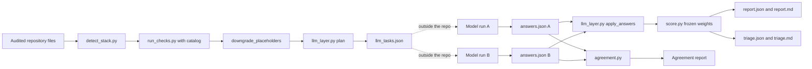
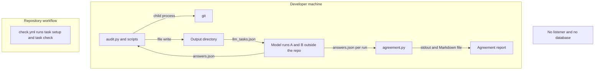
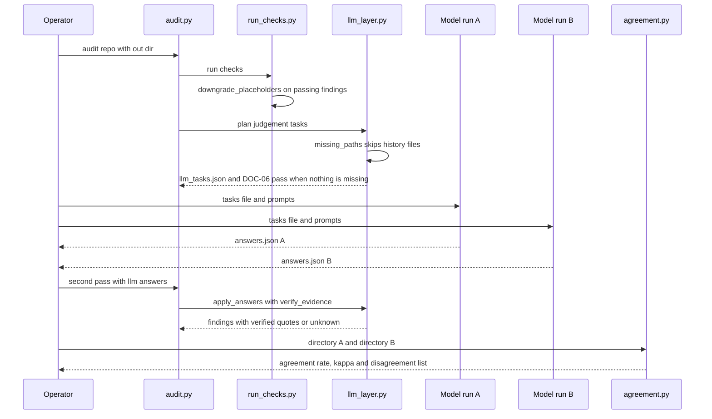

# Audit v1.2: Processing and Evidence Boundaries

Evidence basis: the audit skill as committed at `b470917` (2026-10-27 16:25:58 +0000), the last
of the three release commits this folder covers. The other two are `7fddcc3` (16:00:13, the v1.2
import) and `8c9342f` (16:11:28, judgement prompt rules). Commit `54babe0` (16:09:58, STA-09
becomes mechanical) lies between them, belongs to the roadmap record in
[0003](../0003-v0.1-harness-roadmap-evidence-matched/Architecture.md), and is read here only
because the `b470917` tree contains it. Commit-time facts were read with
`git show <commit>:<path>`; anything labeled "today's tree" was read from the working tree on
2026-11-04. The release notes are original evidence and sit in
[research/Release-Notes-v1.2.md](research/Release-Notes-v1.2.md).

## System Design

v1.2 does not add a service. It tightens an existing read-only pipeline in
`skills/harness-audit/scripts` and adds one comparison script. At `b470917`, `detect_stack.py`
lists the audited repository's files, `run_checks.py` evaluates the catalog checks,
`git_signals.py` adds history signals, `llm_layer.py` plans and later verifies the judgement
tasks, `score.py` computes the frozen score, `triage.py` ranks fixes and `audit.py` orchestrates
and writes outputs (layout from `skills/harness-audit/AGENTS.md` at `b470917`). `agreement.py`
(94 lines, added in `7fddcc3`) reads two answer sets and compares them.

<!-- atlas:diagram=system-design -->



## Processing Roles

| Component | Responsibility |
| --- | --- |
| Mechanical check engine | File/config facts and placeholder handling |
| Judgment preparation | Bounded source excerpts and candidate commands |
| Answer validator | Verify quoted evidence and retain unknowns when unsupported |
| Scoring/triage | Frozen arithmetic, gates/caps and counterfactual fix ranking |
| Agreement tool | Compare independent answers and resulting score differences |
| Report/schema | Stable machine-readable findings and explicit limitations |

The flow is files to mechanical findings/judgment tasks, verified answers to findings,
then scoring/reporting. Agreement reads independent results; it does not manufacture
missing answers or turn model agreement into human ground truth.

The first sentence matches the code: `agreement.compare` builds its pairs only from repositories
and task ids present in both answer sets, and `test_only_shared_repos_and_tasks` pins that
(`7fddcc3`). A missing answer is therefore left out, never filled in.

## Components at the Release

Reviewer judgment inferred from the diffs of `7fddcc3` and `8c9342f`: each v1.2 change lands in
one place, which keeps the change boundary small.

| Release item | Owner at `b470917` | Recorded change |
| --- | --- | --- |
| Placeholder downgrade | `run_checks.py` | `7fddcc3` adds `PLACEHOLDER = "TODO(human)"` and `downgrade_placeholders`, which turns a passing finding into a failing one when evidence of kind `found` points at a file that still holds the marker |
| DOC-06 by script | `llm_layer.py` | `7fddcc3` adds `HISTORY_DOC` skipping in `missing_paths` and a script `pass` when no candidate path is missing |
| Larger excerpts | `llm_layer.py` | `7fddcc3` raises `MAX_FILE_LINES` 250 to 400, `MAX_TASK_LINES` 700 to 1000 and runner targets 80 to 200 |
| Agreement tool | `agreement.py` | `7fddcc3` adds `load`, `kappa`, `compare`, `render` and `main` |
| Judgement prompt rules | `prompts/orientation_quality.md`, `prompts/instruction_drift.md` | `8c9342f` adds rule 7 (status must match the note) and rule 8 (what counts as pointing to `AGENTS.md`) |
| Version label | `audit.py`, `pyproject.toml` | `7fddcc3` changes `VERSION` and the project version from `0.1.0` to `1.2.0` |

## Trust Boundaries

| Boundary | Who may write | Enforcement shown in the tree at `b470917` |
| --- | --- | --- |
| Audited repository | nobody during an audit | `skills/harness-audit/AGENTS.md` says "Static analysis only. Never execute, import or install anything from an audited repository." The only child processes in `scripts/` are `git` (`git_signals.py` and `detect_stack.py`) and `calibrate.py` starting `audit.py`. `detect_stack.py` passes `ls-files -z`; whether every `git_signals.py` argument is read-only was not inspected: `Not recorded` |
| Audit output directory `--out` | the audit run | `audit.py` writes `report.json`, `report.md`, `triage.json`, `triage.md` and, when tasks exist, `llm_tasks.json` |
| Model answers | an external model run | `llm_layer.verify_evidence` accepts a quote only if the file is part of the task excerpts and the normalized quote appears within two lines of the claimed line; a `pass` or `fail` with no verified quote becomes `unknown` with the note "quotes could not be verified against the files" |
| Frozen scoring files | reviewed commits only | `references/FROZEN.sha256` lists seven files; `7fddcc3` rewrites the `run_checks.py` and `llm_layer.py` lines and `8c9342f` the two prompt lines; the `score.py` line (`eaa299d1`) is the same at `b470917` as before `7fddcc3` |
| Scored weights and caps | reviewed commits only | `FrozenWeightsTests.test_weights_and_caps_are_frozen` in `tests/test_score.py` pins pillar weights 25, 20, 15, 15, 10, 10, 5, caps 40, 60, 70, pass ratio 0.6 and entropy maximum 10; `7fddcc3` does not touch the file |
| Extraction baseline | reviewed commits only | `7fddcc3` adds a "Reviewed Updates" section to `EXTRACTION.md`; changed runtime files carry kind `reviewed-update` in `extraction-manifest.json`, and `task integrity` verifies only `unchanged-source` records |
| Answer files and raw reports | nobody in the repository | `AGENTS.md` at `b470917`: "Never commit audit reports, agent answers, private datasets, secrets, generated bundles, environments or caches" |

Judgement rule 8 of `instruction_drift.md` (added in `8c9342f`) is a trust rule of its own: a
tool-specific file counts as pointing to `AGENTS.md` only when a quote shows a symlink, an
identical copy, an import or a "generated" marker. "Identical content" without a quote is
`unknown`.

## Ingress and Egress

Scope: the audit skill and the agreement tool as of `b470917`, plus the repository workflow that
runs the checks. The table lists every edge the code and configuration show. No component of this
scope listens on a port.

<!-- atlas:table=ingress-egress -->

| Edge | Direction | Protocol | Port | Authn and encryption | Evidence |
| --- | --- | --- | --- | --- | --- |
| Audited repository files to the audit scripts | in | local file read | none | none, local only | `run_checks.Ctx.text`, `detect_stack.py`; a `git grep` for `urllib`, `requests`, `socket`, `http`, `httpx`, `aiohttp` and `ssl` imports under `skills/` at `b470917` returns nothing |
| Audit scripts to `git` | out | child process | none | none | `git_signals.py` line 134 runs `git -C <root> <args>` with a 60 second timeout; `detect_stack.list_files` runs `git -C <root> ls-files -z` with a 120 second timeout |
| `calibrate.py` to `audit.py` | out | child process | none | none | `calibrate.audit_one` runs `sys.executable -I audit.py <repo> --out <dir>` |
| Audit to the model runner | out | JSON file `llm_tasks.json` | none | none | `audit.py` writes it; `skills/harness-audit/SKILL.md` step 3 has the model read it outside the scripts |
| Model runner to audit | in | JSON file `answers.json`, passed with `--llm-answers` | none | none, quotes re-verified against files | `audit.py` argument `--llm-answers`; `llm_layer.apply_answers` |
| Two answer sets to `agreement.py` | in | local file read, `A_DIR/<repo>/answers.json` and `B_DIR/<repo>/answers.json` | none | none | `agreement.load` globs `*/answers.json` in each directory |
| `agreement.py` to report | out | stdout and optional `--out` Markdown file | none | none | `agreement.main` prints the rendered text and writes it when `--out` is given |
| Audit to output directory | out | local file write | none | none | `audit.py` writes the five files named above |
| Bootstrap to proposals | out | local file write | none | none, additive only | `SKILL.md` Bootstrap section: files go to `<dir>/bootstrap/proposed/` and `--apply` never overwrites an existing file |
| CI runner to action and tool hosts | out | Not recorded | Not recorded | Not recorded | `.github/workflows/check.yml` names SHA-pinned actions and tool versions but no URL, protocol or port |
| Browser to local preview server | in | HTTP | 8001 by default | none, plaintext, bound to `127.0.0.1` | ABSENT from this scope: root `Taskfile.yml` task `serve` belongs to Harness City, and none of `7fddcc3`, `8c9342f` or `b470917` changes a path under `apps/` |

Absent edges: no inbound listener, no outbound call to a model provider (the only runtime
dependencies are `pyyaml` and `jsonschema`), no call to a package registry from the scripts, and
no database connection. `SKILL.md` says "No network access is needed" and `pyproject.toml` marks
the `slow` tests as "tests that clone or hit the network (none today)". Which model or tool
produced runs A and B, and over what protocol, is `Not recorded`: the agreement report says only
"independent subagents".

## Network Topology

<!-- atlas:diagram=network -->



The model runs are drawn outside the repository because the scripts only exchange files with
them. The workflow box has no edges because the workflow file names no host: `Not recorded`.
The last node states the absent edges instead of drawing them.

## Code Logic

The path that carries the v1.2 changes is: first audit pass, placeholder downgrade, judgement
planning with the DOC-06 script check, two independent answer runs, second audit pass with quote
verification, then the agreement comparison. Function names come from the diffs of `7fddcc3`
and the code at `b470917`.

<!-- atlas:diagram=code-logic -->



`kappa` in `agreement.py` computes Cohen's kappa over the labels `pass`, `fail` and `unknown`
from observed agreement and the per-label counts of both runs; with no pairs it returns `None`,
and `test_empty` pins that. The section "Effect on scores" of the committed report is not
produced by `agreement.render`, which writes only the header line, the per-task table and the
disagreement table. How the score differences (13 of 15 repositories identical, n8n 78 versus
85, opencode 42 versus 48) were computed is `Not recorded`.

## Data and Storage

No database exists in this scope. State is files, in JSON and Markdown. Per audited repository
the run writes `report.json`, `report.md`, `triage.json`, `triage.md` and, when tasks exist,
`llm_tasks.json`; the operator writes `answers.json`. Committed state is limited to the skill,
its tests, `references/FROZEN.sha256`, `BACKLOG.md` and the three development records that
`7fddcc3` added under `docs/0004/`. Answer files, scan JSON and per-repository reports are not
committed; today's [research README](research/README.md) says so. Retention: `Not recorded`, no
retention rule appears in the tree at `b470917`.

```text
skills/harness-audit/
  scripts/      audit.py run_checks.py llm_layer.py agreement.py score.py ...
  prompts/      orientation_quality.md instruction_drift.md
  references/   FROZEN.sha256 WEIGHTS-FROZEN.md
  tests/        test_agreement.py test_llm_layer.py test_run_checks.py test_score.py ...
  BACKLOG.md    sections 4s, 4t, 4u record the v1.2 work
docs/0004/      Release-Notes-v1.2.md Agreement-Report-v1.2.md README.md (paths at b470917)
```

The release notes name a package `harness-audit.skill` and a table `scans/results-table.md`.
A search of every file name in the history of all refs for a `.skill` file, a `scans/` path and
`results-table` returns nothing, so the package and the table are `Not recorded` as artifacts.

## Runtime and Storage

The audit remains local static Python processing. It does not import or execute audited
code. Raw repository reports, answer arrays and human calibration data stay outside the
public documentation set. No database or deployed service is implied by these records.

## Runtime and Infrastructure Evidence

At `b470917`: `skills/harness-audit/pyproject.toml` declares `requires-python = ">=3.11"`,
dependencies `pyyaml>=6` and `jsonschema>=4`, dev dependencies `pytest>=8` and `ruff>=0.6`, and
ruff target `py311` with line length 140; `uv.lock` is present. The release notes repeat the
Python 3.11 requirement. The repository workflow `.github/workflows/check.yml` runs on
`ubuntu-latest` with a 10 minute timeout and `contents: read` permission, pins its three actions
by commit hash, installs `uv` 0.11.23 with Python 3.14 and `go-task` 3.51.1, then runs
`task setup` and `task check`. The root `Taskfile.yml` sets `UV_FROZEN: '1'`. A search of the
`b470917` tree found no Dockerfile, compose file or devcontainer, so container images are
`Not recorded`. A Node runtime is not needed to audit Node repositories, because the audit reads
files only; the Node version of audited repositories is `Not recorded`. The CI result of any
release commit is `Not recorded`; `EXTRACTION.md` at `7fddcc3` says remote results are verified
separately after the first push.

Who may write where: the audit writes only to its `--out` directory; bootstrap writes new files
to `<dir>/bootstrap/proposed/`, and into the audited repository only with `--apply`; both rules
come from the `SKILL.md` text at `b470917`.

## Files Touched

Line counts come from `git show --numstat` for each commit.

<!-- atlas:table=files-touched -->

| Commit | Path | Change |
| --- | --- | --- |
| `7fddcc3` | `skills/harness-audit/scripts/agreement.py`, `tests/test_agreement.py` | added, 94 and 52 lines |
| `7fddcc3` | `skills/harness-audit/scripts/run_checks.py`, `tests/test_run_checks.py` | modified, +23 and +17, placeholder downgrade |
| `7fddcc3` | `skills/harness-audit/scripts/llm_layer.py`, `tests/test_llm_layer.py` | modified, DOC-06 script check and excerpt caps |
| `7fddcc3` | `skills/harness-audit/scripts/audit.py`, `pyproject.toml`, `uv.lock`, `README.md` | version label `1.2.0`; README status line now names v1.2 and `B-1 to B-158` |
| `7fddcc3` | `skills/harness-audit/BACKLOG.md`, `references/FROZEN.sha256` | sections 4s and 4t added; two hash lines refreshed |
| `7fddcc3` | `EXTRACTION.md`, `extraction-manifest.json` | "Reviewed Updates" section; manifest records for changed files |
| `7fddcc3` | `docs/0004/Release-Notes-v1.2.md`, `Agreement-Report-v1.2.md`, `README.md` | added, 44, 48 and 19 lines |
| `8c9342f` | `skills/harness-audit/prompts/orientation_quality.md`, `instruction_drift.md` | +3 and +5 lines, rules 7 and 8 |
| `8c9342f` | `skills/harness-audit/BACKLOG.md`, `references/FROZEN.sha256`, `extraction-manifest.json` | section 4u added; hashes and manifest refreshed |
| `b470917` | `docs/0004/Agreement-Report-v1.2.md` | 23 lines replaced, second run |
| `b470917` | `skills/harness-audit/BACKLOG.md`, `extraction-manifest.json` | B-164 and B-165 added; manifest refreshed |
| `1b15eeb`, `b745e58` | `docs/0004-v0.1-audit-release-retrospective/` | the four basic documents added, the research files moved, then the folder renamed (today's tree) |

## Component Layers

<!-- atlas:table=component-layers -->

| Component | Layer | Path | Kind | Depends on |
| --- | --- | --- | --- | --- |
| Check engine | domain | `skills/harness-audit/scripts/run_checks.py` | python module | catalog, file tree |
| Judgement preparation and verification | domain | `skills/harness-audit/scripts/llm_layer.py` | python module | `run_checks`, file tree |
| Judgement prompts | domain | `skills/harness-audit/prompts/*.md` | prompt text | none |
| Scoring | domain | `skills/harness-audit/scripts/score.py` | python module | findings, frozen weights |
| Agreement tool | tooling | `skills/harness-audit/scripts/agreement.py` | python script | two answer directories |
| Check catalog | data | `skills/harness-audit/checks/catalog.yaml` | config, 56 checks in seven pillars plus entropy items at `7fddcc3` | none |
| Frozen hashes | provenance | `skills/harness-audit/references/FROZEN.sha256` | data | scored files |
| Release records | documentation | `docs/0004/*.md` at `b470917` | Markdown | audit runs |

The catalog count is a reviewer count of the `pillar:` entries in `catalog.yaml` at `7fddcc3`
(6, 6, 10, 7, 9, 11 and 7, total 56), which agrees with the release notes.

## Historical Limits

The original release describes Python/Node support and GitHub bootstrap proposals.
That does not establish support for all future platforms or detector ideas. The later
current implementation and [Implementation](Implementation.md) supply the change boundary.