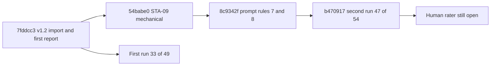

# Audit v1.2: Reconstructed Intent

## Context and Goals

The v1.2 record responds to the roadmap's false-placeholder credit, unresolved path
judgments and bounded-excerpt gaps. Its goal is more trustworthy existing measurements,
not a new scoring system or permission to execute audited repositories.

The [release notes](research/Release-Notes-v1.2.md) describe the release; the
[agreement report](research/Agreement-Report-v1.2.md) records independent model comparison.
They are original evidence, preserved beside this retrospective.

## Decisions and Risks

Keep weights/caps pinned, verify model quotes, and resolve mechanical facts by script
where possible. Independent model agreement can reveal judgment variability but is
not proof of agreement with independent human raters or of a repository's security.

`7fddcc3` introduces the local v1.2 records; `b470917` updates the agreement report.
Its 87% result belongs to that historical run, not to this documentation pass.

Continue with [Plan](Plan.md), [Architecture](Architecture.md) and
[Implementation](Implementation.md). No retrospective discovery interview was invented.

## Evidence Basis

This is a retrospective reconstruction, not a recorded work session. The four basic documents of
this folder were added in `1b15eeb` (2026-10-28); the release records they describe came from
`7fddcc3`, `8c9342f` and `b470917`, all dated 2026-10-27 and carrying the same `Claude-Session`
trailer. No chat transcript, interview or decision meeting is retained:
`Not recorded: the conversation that led to the v1.2 scope`. Rationale below is marked
"Inferred from <commit>" or "Reviewer judgment", never presented as a recorded statement.

## Goal Alignment Evaluation

Target goal, from the first section: make the existing measurements more trustworthy without a
new scoring system and without executing audited repositories. Verdict: fit, with one gap.
Reviewer judgment inferred from the commit diffs and `skills/harness-audit/BACKLOG.md` as
committed.

- Placeholders: `7fddcc3` adds `downgrade_placeholders` with two tests; BACKLOG section 4s
  records the express copy with unfilled bootstrap stubs going 45 to 38 ("the Taskfile still
  counts, correctly").
- DOC-06 and excerpts: `7fddcc3` resolves DOC-06 by script when every backticked path
  exists; section 4s counts "8 of 12 calibration repos and 2 of 6 holdout repos" with a script
  verdict, that is ten of 18; the rest "still go to the model and are mostly `unknown`".
- No new scoring system: the `score.py` hash line in `FROZEN.sha256` (`eaa299d1`) is the same
  before `7fddcc3` and at `b470917`, and section 4s records "Scores unchanged on all 18 repos".
- Agreement: the report committed in `7fddcc3` records 33 of 49 answers in agreement (67 percent,
  kappa 0.356) over 12 repositories. The report as updated in `b470917` records 47 of 54
  (87 percent, kappa 0.768) over 15 repositories.
- Gap: the two runs are not like for like. The first has nine task ids including STA-09 (ten
  comparisons) and 12 DOC-06 comparisons; the second has eight task ids, no STA-09 and nine
  DOC-06 comparisons. STA-09 became mechanical in `54babe0` and DOC-06 partly script-resolved in
  `7fddcc3`, so part of the rise may come from fewer open judgement tasks rather than from
  clearer prompts. How much: `Not recorded`, no controlled comparison exists.

## Achievability Evaluation

Feasibility: high for the recorded scope. Reviewer judgment inferred from the commit data.

- The three release commits span 25 minutes 45 seconds, from 16:00:13 to 16:25:58 on
  2026-10-27; the prompt fix `8c9342f` and the second report `b470917` are 14 minutes 30 seconds
  apart; if the two blind runs over 15 repositories happened in that window, they were quick,
  but run times are `Not recorded`. Working time before the first commit: `Not recorded`.
- Assumptions recorded in the tree: weights stay frozen (`FrozenWeightsTests` in
  `tests/test_score.py`); answer sets are not comparable after a prompt change (BACKLOG B-163);
  every changed scored file needs a refreshed `FROZEN.sha256` line and manifest record.
- Dependencies: Python 3.11 or newer, `pyyaml`, `jsonschema`, `uv.lock`; a model runner outside
  the repository for judgement answers; the audited repositories themselves, whose checkout
  location is `Not recorded`.
- Blockers recorded: an independent human rater. The release notes list "One rater" under known
  limits.

## Complexity Evaluation

Level: S for code, M for process. Reviewer judgment inferred from the diffs.

- Code: `agreement.py` is 94 lines with standard-library imports only (`argparse`, `json`, `sys`,
  `collections`, `pathlib`); `run_checks.py` gains 23 lines and `llm_layer.py` 17 added and 6
  removed lines in `7fddcc3`.
- Process: `7fddcc3` touches 17 paths, `8c9342f` five and `b470917` three; each scored change
  repeats the same hash and manifest refresh.
- Coupling: a prompt change in `8c9342f` made every earlier answer set stale (B-163), so the
  second run had to repeat the answering work rather than reuse the first.
- Unknown: the effort of producing the 15 repository answer sets. `Not recorded`.

## Visualizations

<!-- atlas:diagram=release-timeline -->

## Risks

| Risk | Impact | Likelihood | Evidence or note |
| --- | --- | --- | --- |
| Model agreement read as human calibration | high | medium | The report names "two blind runs by independent subagents"; today's BACKLOG B-190, added after this release for infrastructure ratings, says "a model is not an independent rater" |
| Small samples read as stable rates | medium | high | The 54 answers include tasks with 1 or 2 comparisons (TRG-06 1 of 1, ORI-08 1 of 2) |
| Rise from 67 to 87 percent credited to prompts alone | medium | medium | Task mix and repository count differ between the runs; see Goal Alignment Evaluation |
| Release figures treated as fresh test results | medium | high | Commit message says 145 passing; release notes and BACKLOG say 141; neither re-run here |
| Release package and score table assumed present | low | medium | `harness-audit.skill` and `scans/results-table.md` appear in no ref |
| ORI-09 remains unstable | medium | medium | B-165 names it "the least stable judgement"; the second report shows it agreeing 5 of 7, the lowest rate among tasks with more than two comparisons |

## Decision Summary

All rationale is inferred; no alternative or discussion is recorded for any of these.

- Keep weights and caps pinned and refresh hashes with every scored change. Inferred from
  `7fddcc3` and `8c9342f`, which each rewrite `FROZEN.sha256`.
- Resolve a mechanical fact by script when possible, here DOC-06. Inferred from `7fddcc3`.
- Make the model's `status` match its own `note`, and define what counts as pointing to
  `AGENTS.md`. Inferred from `8c9342f` and BACKLOG B-162, which names vite ENT-05 and
  home-assistant-core ORI-08 as the two real pass-versus-fail splits.
- Report agreement together with the first run's figures and a score-difference section, rather
  than replace the first result. Inferred from `b470917`, whose report keeps "33/49 agree (67%)".
- Rejected alternatives: `Not recorded`.

## Next Actions

- [x] Trust fixes and agreement tool: `7fddcc3`.
- [x] Prompt tightening for ENT-05 and ORI-08: `8c9342f`.
- [x] Second agreement run: `b470917`.
- [ ] Reconcile three historical figures that disagree: tests 145 (commit message) versus 141
  (release notes, BACKLOG); "34 of 51" in `SKILL.md` versus 33 of 49 and 47 of 54 in the
  reports; BACKLOG B-160 "11 of 16" versus 14 of 16 counted from the first report's table.
  Quoted, not changed, in [Implementation](Implementation.md#decision-log).
- [ ] Record how the "Effect on scores" figures were computed: `Not recorded`.
- [ ] Second independent human rater and a fresh holdout: `Not recorded`.
- [ ] Fix today's BACKLOG B-164 path, which omits the `research/` folder, in a reviewed change to
  the skill; this folder does not edit runtime or backlog files.

## References

- [Release notes v1.2](research/Release-Notes-v1.2.md)
- [Agreement report v1.2](research/Agreement-Report-v1.2.md)
- [Plan](Plan.md), [Architecture](Architecture.md), [Implementation](Implementation.md)
- [Roadmap record](../0003-v0.1-harness-roadmap-evidence-matched/Plan.md)
- [Harness-audit backlog](../../skills/harness-audit/BACKLOG.md)
- [Harness-audit skill](../../skills/harness-audit/SKILL.md)
- [Extraction retrospective](../0001-v0.1-standalone-extraction-retrospective/Plan.md)
- [History crosswalk](../History-Match.md)
