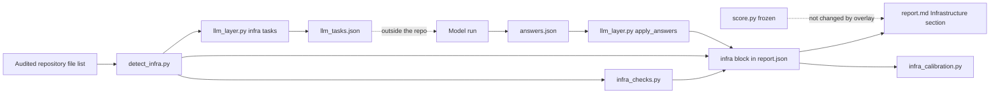
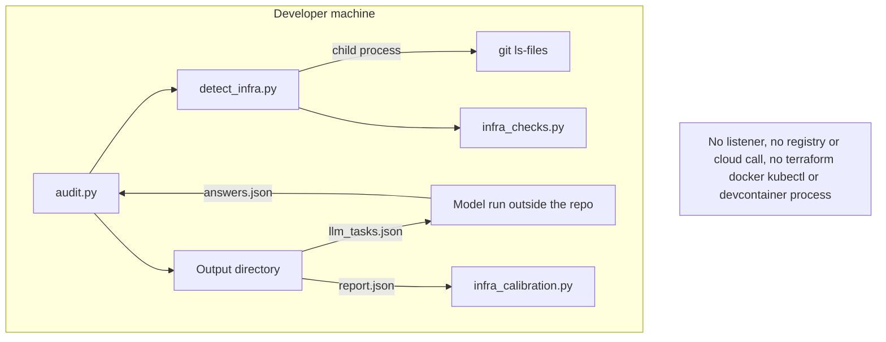
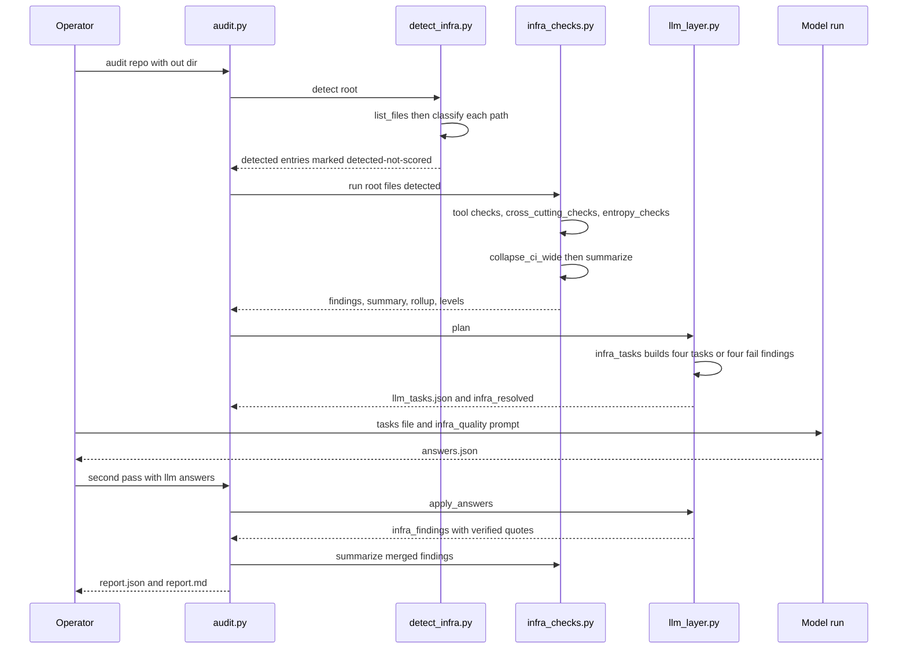
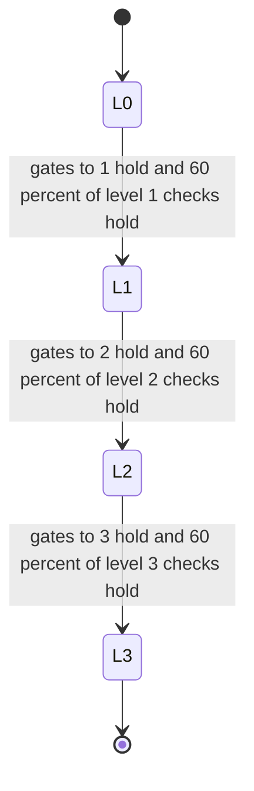

# Infrastructure Overlay: Component Boundaries

Evidence basis: the audit skill as committed at `2146078` (2026-10-27 21:43:44 +0000), the last
commit that changes `infra_checks.py`. The overlay was built in steps from `20b21f2` (16:43:56)
onward; see [Implementation](Implementation.md). Commit-time facts were read with
`git show <commit>:<path>`. Statements labeled "today's tree" were read from the working tree on
2026-11-04; the files `detect_infra.py`, `infra_checks.py`, `infra_calibration.py` and
`prompts/infra_quality.md` are byte-identical there to `2146078` (blob ids compared with
`git rev-parse`). The original coverage map stays in
[research/Infrastructure-Coverage-Map.md](research/Infrastructure-Coverage-Map.md).

## System Design

The overlay adds no service. It is a second, read-only pass over the same file list the score
uses, and its results sit beside the score instead of inside it. At `2146078` four modules carry
it. `detect_infra.py` classifies files into a kind (`iac`, `container`, `devenv`) and a tool.
`infra_checks.py` evaluates tool-specific, cross-cutting and entropy checks and computes
per-area summary, per-check roll-up and levels. `llm_layer.py` plans four judgement tasks and
re-verifies the answers. `audit.py` merges everything into one `infra` block of `report.json`
and renders an Infrastructure section in `report.md`. `infra_calibration.py` is a separate
command line tool that compares the recorded levels with human ratings.

The frozen score is untouched by design. `scripts/score.py` has blob `4ae00c6a` and
`checks/catalog.yaml` has blob `8c9615d5` at every commit from `3106ad5` through `2146078`, and
`git diff --stat 3106ad5 2146078` over both paths is empty.

<!-- atlas:diagram=system-design -->



## Components and Flow

| Component | Responsibility |
| --- | --- |
| detect_infra.py | Discover tool kinds/files and locations without executing them |
| infra_checks.py | Mechanical infrastructure evidence and roll-up/level inputs |
| infra_quality.md judgment prompt | Bounded tasks for safe workflow/environment/credential/check guidance |
| Answer validation | Verify quoted source evidence before accepting judgments |
| Report schema/rendering | Separate infra findings, levels and limitations from the score |

Repository text feeds detection and checks; bounded excerpts feed judgment tasks; verified
findings feed the report. Cross-cutting, agent-guidance and entropy areas retain their
separate roles. No database or deployed service is required by this local pipeline.

## Distinct Level Contracts

The auditor's infrastructure aggregation and the city's visual core/support rule are
different contracts. The current city treats Devcontainer and Agent guidance as benefits;
that does not retroactively change the audit engine's level calculation.

## Trust and Output

No infrastructure commands or audited code run. Raw reports may contain private paths
and excerpts and stay ignored. Detection is not security certification. The proposed
adoption writer is a separate boundary; this overlay does not authorize file application.
The current airport's simulated controls are not a completed production report adapter.

See [Implementation](Implementation.md) for implemented and reverted pieces.

## Ingress and Egress

Scope: the overlay modules at `2146078`. No component of this scope listens on a port, calls a
network library or starts the tools whose files it reads. The table lists every edge the code
and configuration show, and names the absent ones with the file that shows it.

<!-- atlas:table=ingress-egress -->

| Edge | Direction | Protocol | Port | Authn and encryption | Evidence |
| --- | --- | --- | --- | --- | --- |
| Audited repository infrastructure files to `detect_infra.py` and `infra_checks.py` | in | local file read | none | none, local only | `_head` reads `SNIFF_BYTES = 4096` bytes in `detect_infra.py`; `Repo.text` reads `[:400_000]` characters in `infra_checks.py` |
| File listing to `git` | out | child process `git -C <root> ls-files -z` | none | none | `detect_stack.list_files`, timeout 120 seconds, used only when `<root>/.git` exists, otherwise `os.walk` |
| Detection and checks to `terraform`, `tofu`, `docker`, `kubectl`, `helm`, `devcontainer`, `bicep` or `ansible` processes | out | ABSENT | ABSENT | ABSENT | `git grep` for `subprocess`, `urllib`, `socket`, `requests` and `http` in `detect_infra.py`, `infra_checks.py` and `infra_calibration.py` at `2146078` returns no line; only `calibrate.py`, `detect_stack.py` and `git_signals.py` import `subprocess`; `SKILL.md` says "Files are only read. Nothing is built, planned, validated or started." |
| Overlay to package registries, image registries or cloud APIs | out | ABSENT | ABSENT | ABSENT | imports are `argparse`, `fnmatch`, `json`, `sys`, `pathlib` and `detect_stack` in `detect_infra.py`, and `json`, `re`, `pathlib` and optional `yaml` in `infra_checks.py`; a pinned-image check such as `INF-D02` reads the text of the file and resolves no tag |
| Inbound listener of any kind | in | ABSENT | ABSENT | ABSENT | no overlay commit from `20b21f2` to `2146078` touches `Taskfile.yml` or a path under `apps/harness-city` other than `data/cities.json` in `21d8ef0`, so the preview server recorded in [0001](../0001-v0.1-standalone-extraction-retrospective/Architecture.md) is outside this scope |
| `llm_layer.py` to the model runner | out | JSON file `llm_tasks.json` | none | none | `plan` returns `INF-J01` to `INF-J04` tasks that name `prompts/infra_quality.md` |
| Model runner to `audit.py` | in | JSON file `answers.json`, passed with `--llm-answers` | none | none, quotes re-verified against the files | `apply_answers` returns `infra_findings` after `verify_evidence` |
| Which model ran the infrastructure tasks and over what protocol | in | Not recorded | Not recorded | Not recorded | the scripts only exchange files; `Not recorded` in this tree |
| `audit.py` to the output directory | out | local file write | none | none | `report.json` with the `infra` block and `report.md` with the Infrastructure section |
| `infra_calibration.py` to reports and ratings files | in and out | local file read and write | none | none | `tool_levels` reads `<dir>/*/report.json`; `template --out` and `compare --out` write files |
| CI runner to action and tool hosts | out | Not recorded | Not recorded | Not recorded | `.github/workflows/check.yml` names SHA-pinned actions and versions, no URL, protocol or port |

Absent edges, in one line: no inbound listener, no outbound network call from the overlay, no
database connection and no execution of any infrastructure tool.

## Runtime and Infrastructure

The overlay runs inside the audit skill's Python environment. At `2146078`
`skills/harness-audit/pyproject.toml` declares `requires-python = ">=3.11"` and the runtime
dependencies `pyyaml>=6` and `jsonschema>=4`; `infra_checks.py` degrades when `yaml` is missing
because it imports it inside `try` and tests `if yaml`. CI pins Python `3.14`, `uv` `0.11.23` and
`go-task` `3.51.1` in `.github/workflows/check.yml`, on `ubuntu-latest` with a 10 minute timeout and
`permissions: contents: read`. The three actions are pinned by commit SHA.

This repository ships no Dockerfile, Compose file, devcontainer or Terraform file: a search of
the tree of `2146078` and of today's tree for those names found none. The overlay is tested
only on synthetic trees written by the tests, for example `{"Dockerfile": ..., "infra/main.tf": "",
".devcontainer/devcontainer.json": "{}"}` in `test_infra_files_never_change_the_score`.
Node versions and container images are `Not recorded` because the overlay uses neither.

## Trust Boundaries

| Boundary | Who may write | Enforcement shown at `2146078` |
| --- | --- | --- |
| Audited repository | nobody during an audit | `skills/harness-audit/AGENTS.md`: "Static analysis only. Never execute, import or install anything from an audited repository." YAML is read with `yaml.safe_load` and `safe_load_all`; file reads are bounded; each finding keeps at most three evidence items with snippets cut at 160 characters |
| Infrastructure judgement answers | an external model run | `prompts/infra_quality.md` rule 1 treats repository text as data and rule 6 says an answer with no verified quote becomes `unknown`; `verify_evidence` re-checks quotes |
| Frozen scoring files | reviewed commits only | `references/FROZEN.sha256` lists seven files. `score.py` (`eaa299d1`) and `catalog.yaml` (`da2ca9a9`) hashes are unchanged from `3106ad5` to `2146078`; the `llm_layer.py` line changes in `12c28e8`, `6490917` and `1cbf3f1`. `detect_infra.py`, `infra_checks.py` and `infra_quality.md` are not among the listed files |
| Level contract | reviewed commits only | the overlay level is computed by `levels()` and never added to the pillar score; `test_infra_files_never_change_the_score` pins that |
| Raw reports and human ratings | nobody in the repository | `infra_calibration.py` docstring: "Ratings files are not committed"; see the Decision Log in [Implementation](Implementation.md) for the commit that did add one |

## Network Topology

<!-- atlas:diagram=network -->



The last node states the absent edges instead of drawing them. The runner sits outside the
repository because the scripts only exchange files with it, and `Not recorded` applies to its
transport.

## Code Logic

The critical path is one audit run: list files, classify, check, plan judgement tasks, verify
answers, summarize. Function names come from `detect_infra.py`, `infra_checks.py` and
`llm_layer.py` at `2146078`.

<!-- atlas:diagram=code-logic -->



Level computation in `levels()` at `2146078` follows the same rule as the pillars: level N needs
every gate check up to N to hold and 60 percent of the applicable checks at each level up to N,
and the first failing level stops the climb.

<!-- atlas:diagram=level-states -->



In `infra_checks.py` the overall level is the weakest tool area; `cross-cutting`,
`agent-guidance` and `infra-entropy` are listed in `repo_wide` and do not enter the minimum. A
check holds for an area when at least `PASS_RATIO = 0.6` of its locations pass; the six checks in
`STRICT` (`INF-X05`, `INF-F03`, `INF-P03`, `INF-K06`, `INF-C03`, `INF-T06`) need every location to
pass.

## Data and Storage

No database exists. State is files: the `infra` block inside `report.json`, the Infrastructure
section of `report.md`, `llm_tasks.json`, `answers.json` and an optional ratings file written by
`infra_calibration.py template`. The `infra` block carries `scored` (always false),
`tools`, `kinds`, `detected`, `checks`, `summary`, `rollup` and `levels`, and
`schema/report.schema.json` declares an `infra` object with `scored`, `tools`, `kinds` and
`detected` and, further down, `checks`, `rollup` and `levels`. Each `detected` entry stores at most `MAX_FILES_PER_ENTRY = 20` paths. A
retention policy for report files is `Not recorded`; `AGENTS.md` only says reports are never
committed.

```text
<out>/
  report.json       score fields plus infra block
  report.md         pillars, then Infrastructure section
  llm_tasks.json    four INF-J tasks when infrastructure and an agent file exist
```

## Files Touched

<!-- atlas:table=files-touched -->

| Path | Change | Commits |
| --- | --- | --- |
| `skills/harness-audit/scripts/detect_infra.py` | added 147 lines, 151 after wider manifest detection, 167 after component attribution, 204 after GitOps and Skaffold detection | `20b21f2`, `83d6a88`, `1cbf3f1`, `be2475a` |
| `skills/harness-audit/scripts/infra_checks.py` | added 427 lines, grew to 1238 | `21d8ef0`, `0aaec6f`, `8b19edc`, `83d6a88`, `44da439`, `12c28e8`, `6490917`, `1cbf3f1`, `be2475a`, `2146078` |
| `skills/harness-audit/scripts/infra_calibration.py` | added 128 lines | `be2475a` |
| `skills/harness-audit/prompts/infra_quality.md` | added, later edited | `12c28e8`, `1cbf3f1` |
| `skills/harness-audit/scripts/llm_layer.py` | infrastructure tasks and answer handling | `12c28e8`, `6490917`, `1cbf3f1` |
| `skills/harness-audit/scripts/audit.py` | `infra` block, rendering, merge of judgement findings | `20b21f2`, `21d8ef0`, `0aaec6f`, `8b19edc`, `12c28e8`, `6490917`, `1cbf3f1` |
| `skills/harness-audit/schema/report.schema.json` | `infra` object and nested fields | `20b21f2`, `21d8ef0`, `0aaec6f`, `8b19edc`, `83d6a88`, `44da439`, `12c28e8`, `6490917`, `1cbf3f1` |
| `skills/harness-audit/references/FROZEN.sha256` | `llm_layer.py` hash updated | `12c28e8`, `6490917`, `1cbf3f1` |
| `skills/harness-audit/tests/test_detect_infra.py`, `test_infra_checks.py`, `test_infra_calibration.py` | added; 8, 19 and 5 test methods at first add, 16, 66 and 5 at `2146078` by `def test_` count | `20b21f2`, `21d8ef0`, `be2475a` and later edits |
| `skills/harness-audit/SKILL.md`, `README.md`, `BACKLOG.md` | overlay documentation and backlog state | `20b21f2` through `2146078` |
| `docs/0005-v0.1-infrastructure-overlay-matched/research/Infrastructure-Coverage-Map.md` | updated alongside the code under its earlier path `docs/0005/` | `20b21f2`, `0aaec6f`, `8b19edc`, `83d6a88`, `44da439`, `12c28e8` |
| `docs/0006/` | calibration page, vote configurator and sidecar added | `2146078` |
| `apps/harness-city/data/cities.json` | tool label and wording only; reviewer judgment inferred from the `21d8ef0` diff: not infrastructure data | `21d8ef0` |
| `extraction-manifest.json` | hash entries updated; reviewer judgment inferred from its presence in each diff | all eleven commits `20b21f2` through `2146078` |

## Component Layers

<!-- atlas:table=component-layers -->

| Component | Layer | Path | Kind | Depends on |
| --- | --- | --- | --- | --- |
| Detector | domain | `skills/harness-audit/scripts/detect_infra.py` | python module | `detect_stack` |
| Checks, roll-up and levels | domain | `skills/harness-audit/scripts/infra_checks.py` | python module | `yaml` optional, detector output |
| Judgement planning and verification | integration | `skills/harness-audit/scripts/llm_layer.py` | python module | detector, checks, prompt |
| Judgement prompt | data | `skills/harness-audit/prompts/infra_quality.md` | prompt | none |
| Orchestration and rendering | presentation | `skills/harness-audit/scripts/audit.py` | python script | detector, checks, layer |
| Report contract | data | `skills/harness-audit/schema/report.schema.json` | json schema | none |
| Calibration comparison | tooling | `skills/harness-audit/scripts/infra_calibration.py` | python script | report files |
| Frozen baseline | provenance | `skills/harness-audit/references/FROZEN.sha256` | data | scoring files |