# Infrastructure Overlay: Reconstructed Intent

## Problem and Goal

The seven-pillar harness score does not describe the maturity of Terraform, containers,
deployment manifests and development environments. The goal is attributable static
infrastructure evidence without changing the frozen 0-100 score or executing infrastructure.

## Decisions

The [coverage map](research/Infrastructure-Coverage-Map.md) records overlay-first design and
tool ordering. It mixes its starting proposal with later "done so far" updates.
Its blanket proposal-only language is therefore not a reliable current completion claim.
Original text remains preserved; this set supplies the reconciled interpretation.

## Scope and Risks

Detect locations, evaluate tool-specific/cross-cutting checks, prepare quote-validated
judgments, and expose separate report levels/roll-ups. Text detection is heuristic;
presence of a tool or config is not proof a plan/build/check ran. Generalized adoption
and multi-rater calibration are separate proposals, not automatic consequences of detection.

See [Plan](Plan.md), [Architecture](Architecture.md), [Implementation](Implementation.md)
and the [commit crosswalk](../History-Match.md#coverage-tracks-0005).

## Context

Retrospective reconstruction, not an original ideation session. The coverage map arrived in
`3106ad5` (2026-10-27 16:31:14 +0000) together with the ORI-09 command candidates; detection
followed in `20b21f2` at 16:43:56 and the last calibration-related commit in the overlay stack
is `2146078` at 21:43:44. No interview, chat or review record for the design exists in this
repository: `Not recorded: the owner conversation that produced decisions D1 to D4`. What
survives is the map's own text, the commit messages and the code. Rationale below is marked
"Inferred from <evidence>" and is never presented as a recorded discussion.

## Goal Alignment Evaluation

Target goal, taken from the map's scope paragraph: say what the audit must detect, check and
report for infrastructure as code, containers, Compose and devcontainers, and how that reaches
the scan JSON, without executing anything and without changing the frozen 0-100 score.

Verdict: strong fit. Reviewer judgment inferred from the evidence for each part:

- Attribution by kind and location: `detect_infra.detect` returns entries with `kind`, `tool`,
  `scope`, `file_count`, `files` and `sample`, all marked `detected-not-scored` (`20b21f2`).
  `1cbf3f1` adds `owner` and `attribute`, which attach a `component` to each location.
- Separation from the score: `scripts/score.py` and `checks/catalog.yaml` have identical blobs
  from `3106ad5` to `2146078`, and the test `test_infra_files_never_change_the_score` in
  `test_audit.py` pins that adding a Dockerfile, a Terraform file and a devcontainer leaves the
  score unchanged and the report's `infra["tools"]` equal to `["devcontainer", "docker",
  "terraform"]`.
- No execution: a `git grep` of the three overlay scripts at `2146078` finds no `subprocess` or
  network import; see the ingress and egress table in [Architecture](Architecture.md).
- Report visibility: `20b21f2` adds the `infra` block and an Infrastructure section; `21d8ef0`
  adds checks; `0aaec6f` adds the per-check roll-up; `8b19edc` adds levels.
- Judgement: `12c28e8` adds four tasks `INF-J01` to `INF-J04` that go through the existing
  quote re-verification.

Where the fit is partial: the checks use text matching over all CI text, not the job for one
directory (`SKILL.md` at `2146078`: "use them as a list of leads"); the levels were
uncalibrated when built (BACKLOG B-202 at `2146078`); and the city adapter part of the goal was
tried in `a620cd5` and reverted in `f2154c2`, so it is not met by this overlay.

## Achievability Evaluation

Feasibility: high, because the pieces reuse existing seams. Inferred from the commits:
detection reuses `detect_stack.list_files` and `is_sample_location`; checks use plain text and
`yaml.safe_load`; judgement reuses the existing task, prompt and quote-verification path in
`llm_layer.py`.

Assumptions recorded or inferred:

- The map's decision D1 (overlay, not a new pillar) holds; the map says the owner confirmed it
  on 2026-10-27. The confirmation itself is `Not recorded` beyond that sentence.
- A text-level reading of Terraform, Compose and Dockerfile content is good enough for a first
  level; the map's decision D4 says static parsing only.
- Synthetic trees suffice for tests: BACKLOG B-189 at `2146078` says the tests hold a pass and
  a fail case per tool and gate, so no separate fixture repositories were built.

Dependencies: Python 3.11 or newer, `pyyaml` and `jsonschema`, Git for the file listing.

Blockers: none recorded. The whole overlay stack of eleven commits lands within one calendar
day, 2026-10-27, from 16:43:56 to 21:43:44 +0000 (4 hours 59 minutes 48 seconds between the
first and last).

Mitigations in the tree: `test_detect_infra.py`, `test_infra_checks.py` and
`test_infra_calibration.py` carry 16, 66 and 5 test methods at `2146078` (counted by
`def test_`); `384e691` records a real-repository check of the judgement tasks (B-214) and
`be2475a` carries "real-repo fixes".

## Complexity Evaluation

Level: L. Reviewer judgment inferred from size and breadth.

Drivers:

- Breadth: 12 areas in `CHECKS` at `2146078`: nine tool areas (`dockerfile`, `compose`,
  `devcontainer`, `terraform`, `bicep`, `kubernetes`, `ansible`, `cloudformation`, `pulumi`) and
  three repo-wide areas (`cross-cutting`, `agent-guidance`, `infra-entropy`), 60 entries by AST
  count.
- Three computation layers over the findings: per-check findings, per-check roll-up across
  locations, and levels per area with gates and a 60 percent rule.
- One module of 1238 lines at `2146078` plus a 204-line detector.
- A frozen-file interaction: `llm_layer.py` is listed in `FROZEN.sha256`, so each judgement
  change needs a reviewed hash update (`12c28e8`, `6490917`, `1cbf3f1`).

Delivery split: the map's seven tracks (A to G) are served by eleven commits that touch the
overlay code; the table in
[Implementation](Implementation.md) gives each commit's time and subject.

## Visualizations

```mermaid
flowchart LR
  A[3106ad5 coverage map] --> B[20b21f2 detection]
  B --> C[21d8ef0 Docker Compose devcontainer Terraform checks]
  C --> D[0aaec6f roll-up]
  D --> E[8b19edc levels]
  E --> F[83d6a88 Bicep and Kubernetes]
  F --> G[44da439 Ansible CloudFormation Pulumi cross-cutting]
  G --> H[12c28e8 judgement tasks]
  H --> I[6490917 and 1cbf3f1 entropy and attribution]
  I --> J[be2475a GitOps detection and calibration tool]
  J --> K[2146078 majority rule and 0006 bundle]
  K -.-> L[a620cd5 harbor then f2154c2 revert]
```

<!-- atlas:diagram=overlay-build-order -->

## Risks

| Risk | Impact | Likelihood | Evidence or note |
| --- | --- | --- | --- |
| A detected tool or config read as proof that a plan, build or check ran | high | high | `SKILL.md` says checks use text matching and are leads; findings carry quoted evidence |
| The overlay level added to or compared with the score | medium | medium | `SKILL.md`: "Do not add the two together"; the report limitation reads "Infrastructure found but not part of the score" |
| Levels read as calibrated truth | medium | medium | BACKLOG B-202: uncalibrated; the later single-rater result is in [0006](../0006-v0.1-infrastructure-calibration-retrospective/Plan.md) |
| Check counts quoted from three disagreeing sources | low | high | see the conflict logged in Next Actions below |
| Stale "everything is a proposal" wording read as current | medium | medium | the map's opening paragraphs; [History-Match](../History-Match.md) resolves it |
| A future adoption skill executes infrastructure tools | high | low | the map's Track F row B-187 states "never runs apply, destroy, `docker run` or any deploy"; no such skill exists |
| The reverted city adapter counted as delivered | medium | low | `a620cd5` then `f2154c2`, "B-182, B-183 reopened" |

## Decision Summary

Decision: build the infrastructure checks as an overlay beside the frozen score, with its own
levels, and keep the audit static. This is what the commits show. Reason recorded in the map's
D1 row: "Weights are frozen; adding checks to existing pillars changes scores of repos that
ship a Dockerfile (immich, n8n, home-assistant-core) and would invalidate the calibration".
The rejected alternatives named in that row, folding checks into the 0-100 score and adding an
eighth pillar, are listed by the map itself; no other rejected-alternative discussion is
recorded, so none is invented. D4 (never run `terraform validate` or `docker compose config`)
is stated as a recommendation in the map and is reflected in the code, but the map does not mark
it "decided".

Observed departure from the map's "Suggested order": steps 4 (judgement and entropy) come
before step 5 (Bicep, Kubernetes, other IaC) in the map, while `83d6a88` and `44da439` (17:45:32
and 17:50:27) precede `12c28e8` (17:59:47) and the entropy work in `6490917`. Why the order
changed is `Not recorded`.

## Next Actions

- [x] Detection, first four tool areas, roll-up, levels, wider IaC coverage, judgement tasks
  (`20b21f2` to `12c28e8`).
- [x] Entropy checks, component attribution and GitOps detection (`6490917`, `1cbf3f1`,
  `be2475a`).
- [ ] Conflict, check count: the map says "56 checks (B-171 to B-178)" at `44da439` and
  `12c28e8`; counting `CHECKS` keys with `ast` gives 53 at `44da439`, 57 at `12c28e8` including
  four judgement entries, and 60 from `6490917` on; `SKILL.md` at `2146078` says "59 script
  checks" plus 4 judgement, while the code has 56 script entries plus 4. Keep all three
  statements as historical; do not merge them.
- [ ] Conflict, status words: the map says the component model (B-170) and infra entropy (B-179)
  are `todo`, while BACKLOG at `2146078` calls both "Done in part" and `6490917` and `1cbf3f1`
  add them.
- [ ] Conflict, ratings: `infra_calibration.py` and BACKLOG B-215 say ratings files are not
  committed, while `2146078` commits `infra-levels-evaluation.json`; [History-Match](../History-Match.md)
  records it as intentional at owner request.
- [ ] Record which model produced the infrastructure judgement answers: `Not recorded`.
- [ ] Track F adoption skill and multi-rater calibration remain proposals.

## Traceability

- Sources: `skills/harness-audit/scripts/detect_infra.py`, `infra_checks.py`,
  `infra_calibration.py`, `prompts/infra_quality.md`, the coverage map, and commits `3106ad5`,
  `20b21f2`, `21d8ef0`, `0aaec6f`, `8b19edc`, `83d6a88`, `44da439`, `12c28e8`, `6490917`,
  `1cbf3f1`, `be2475a`, `2146078`.
- Related folders: [0003](../0003-v0.1-harness-roadmap-evidence-matched/Plan.md) holds the
  roadmap this work followed, [0006](../0006-v0.1-infrastructure-calibration-retrospective/Plan.md)
  holds the calibration, and [0007](../0007-v0.1-airport-overlay-evidence-matched/Plan.md) holds
  the airport that replaced the reverted harbor.

## References

- [Infrastructure coverage map](research/Infrastructure-Coverage-Map.md)
- [History crosswalk](../History-Match.md)
- [Architecture](Architecture.md), [Plan](Plan.md), [Implementation](Implementation.md)
- [0004 audit release](../0004-v0.1-audit-release-retrospective/Architecture.md) for the
  pipeline this overlay extends