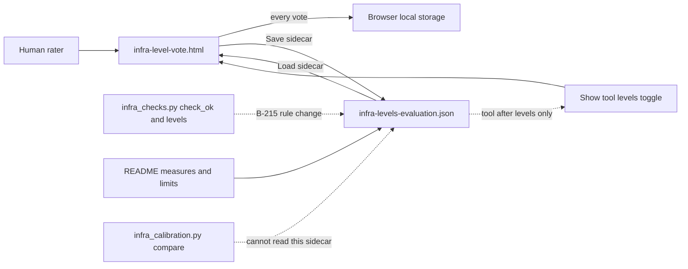
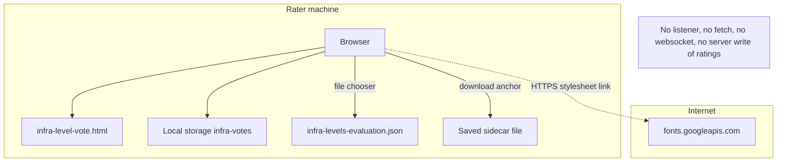
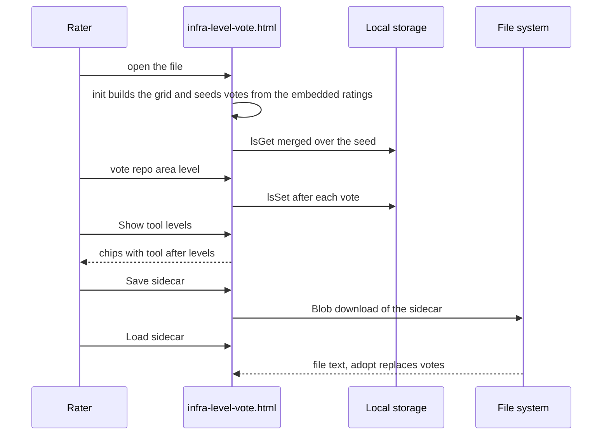
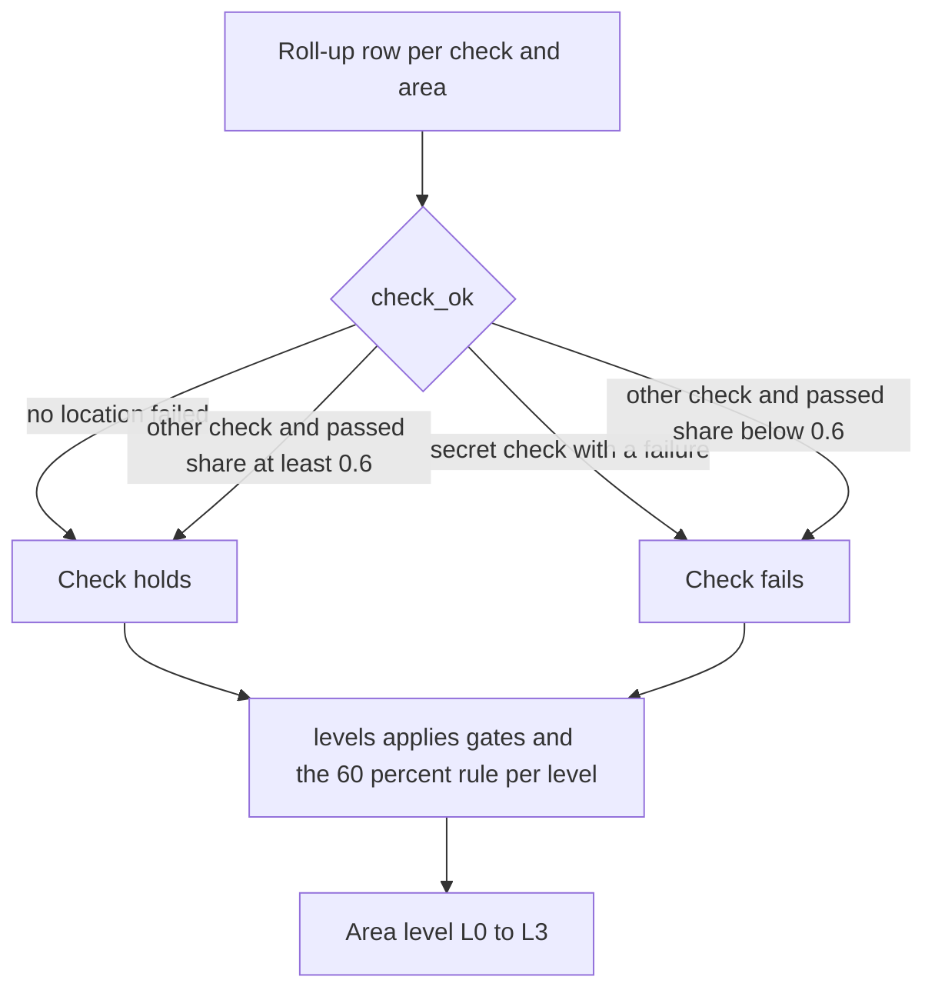
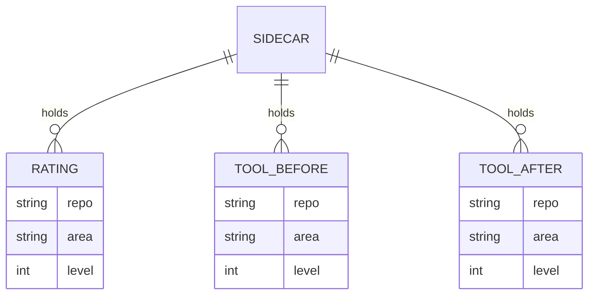

# Infrastructure Calibration: Evaluation Architecture

Evidence basis: the tree of commit `2146078` (2026-10-27 21:43:44 +0000), read with
`git show 2146078:<path>` and `git ls-tree`. At that commit the three research files lived under
`docs/0006/`; commit `1b15eeb` moved them to `docs/0006/research/` and `b745e58` moved them to
this folder, both as `R100` renames in `git show -M --name-status`. The blob ids of the page
(`28c0f5cb`), the sidecar (`69b7a905`) and the README (`05f9c994`) are the same at `2146078` and
in today's tree (`cmp` found no difference). Statements labelled "today's tree" were read on
2026-11-04. The page's behaviour below is read from its source; nothing here was observed by
running it in a browser.

## System Design

Four parts make up the calibration. The standalone page `infra-level-vote.html` shows each
infrastructure area with its checks per level and lets one rater pick a level per repository and
area. The sidecar `infra-levels-evaluation.json` holds the rater's 35 ratings plus the tool's
levels before and after the rule change. The README reports the measures and the limits. The
rule change itself sits in `skills/harness-audit/scripts/infra_checks.py` (`check_ok`, `STRICT`,
`levels`) and in the gate list, and was committed together with the evidence in `2146078`. The
older comparison command `skills/harness-audit/scripts/infra_calibration.py` (added in `be2475a`,
unchanged by `2146078`) is a separate tool with its own rating format.

<!-- atlas:diagram=system-design -->



## Components and Data Flow

| Component | Responsibility |
| --- | --- |
| infra-level-vote.html | Standalone rating UI with check lists and optional tool-level reveal |
| Browser local storage | Local draft votes until an explicit sidecar save |
| infra-levels-evaluation.json | Historical ratings and before/after comparison state |
| Audit level logic | Separately implemented location aggregation and gate rules |
| README | Reported measures, changes and interpretation limits |

The recorded flow is human votes to sidecar, tool levels to comparison, then documented
rule evaluation. The voting page does not certify the audit's runtime enforcement or
replace report evidence. There is no required database, server or deployment service.

## Trust and Preservation

The sidecar is intentionally tracked historical evidence under the owner's documented
exception. That is not blanket permission to commit new reports, private datasets or
new human ratings. Do not silently normalize or replace the original values.

Before/after calibration results are distinct observations. One rater and check-list
anchoring remain limits; a source commit is not proof of independent reproduction.
See [Plan](Plan.md) and [Implementation](Implementation.md).

## Ingress and Egress

Scope: the three research files and the two scripts that touch levels and ratings at `2146078`.
The page is a static file with one external stylesheet link. No file in scope listens on a port
or sends data to a server. The table lists every edge the sources show, names the absent edges
with the file that shows it, and writes `Not recorded` where the tree is silent.

<!-- atlas:table=ingress-egress -->

| Edge | Direction | Protocol | Port | Authn and encryption | Evidence |
| --- | --- | --- | --- | --- | --- |
| Rater's browser opens `infra-level-vote.html` | in | local file read by the browser | none | none, local only | [README](research/README.md) says "Open it in a browser; no server needed"; `Taskfile.yml` task `serve` at `2146078` runs `--directory apps/harness-city`, so the preview server does not expose `docs/0006` |
| Page to the Google Fonts stylesheet | out | HTTPS | 443 by the `https` scheme, reviewer judgment inferred from the URL scheme because the file names no port | TLS by scheme; no `integrity` attribute on the link | line 8 of [the page](research/infra-level-vote.html) is `<link rel="stylesheet" href="https://fonts.googleapis.com/css2?family=IBM+Plex+Mono...`; the CSS variables `--sans` and `--mono` list system fallbacks |
| Page to browser local storage | in and out | Web Storage API, key `infra-votes` | none | none; readable by any script of the same origin; not encrypted | `lsGet` runs at init, `lsSet` runs after every vote and after a sidecar load |
| Rater to page, sidecar load | in | local file read through a file chooser | none | none | `Load sidecar` button, `input type=file` with `accept="application/json,.json"`, `f.text()`, then `adopt` |
| Page to the download folder, sidecar save | out | local file write through a `Blob` and an anchor with `download="infra-levels-evaluation.json"` | none | none | `Save sidecar` button and `sidecar()`; which folder the browser used is `Not recorded` |
| Page to any server through `fetch`, XHR, WebSocket or beacon | out | ABSENT | ABSENT | ABSENT | a search of the page for `fetch(`, `XMLHttpRequest`, `WebSocket` and `sendBeacon` returns no line; the only other `http` string is `http://localhost:3000/health` inside a sample Dockerfile shown in a `pre` block |
| Inbound listener of any kind | in | ABSENT | ABSENT | ABSENT | the page, the sidecar and the README hold no server code; `infra_calibration.py` imports only `argparse`, `json`, `sys` and `pathlib` |
| Sidecar to `infra_calibration.py compare` | in | ABSENT | ABSENT | ABSENT | `load_ratings` reads a `repos` mapping, the sidecar has a `ratings` list; running `load_ratings` on the byte-identical sidecar in today's tree returns `{}` |
| `infra_calibration.py` to report files and output | in and out | local file read and write | none | none | `tool_levels` reads `<dir>/*/report.json`; `template --out` and `compare --out` write files |
| `calibrate.py` to `audit.py` | out | child process through `subprocess.run` with `-I` | none | none | lines 32 and 37 of `skills/harness-audit/scripts/calibrate.py`; whether it produced the reports behind the 15 repositories is `Not recorded` |
| Rule change in `infra_checks.py` to network or infrastructure tools | out | ABSENT | ABSENT | ABSENT | imports are `json`, `re` and `pathlib` (lines 11 to 13 at `2146078`) |
| CI runner to action hosts | out | Not recorded | Not recorded | Not recorded | `.github/workflows/check.yml` names SHA-pinned actions and no URL, protocol or port; `tools/check.py` has no line with `0006`, `infra-level` or `evaluation` at `2146078` or today, so CI does not read the sidecar |
| Delivery of the cell list to the rater | in | Not recorded | Not recorded | Not recorded | BACKLOG B-190 at `2146078` names `infra-ratings-tool-areas.json`; that file is in neither the tree at `2146078` nor today's tree |

Absent edges, in one line: no server, no network request carrying ratings, no database, and no
path from the sidecar into the comparison script.

## Runtime and Infrastructure

The page needs a browser and nothing else. It is one HTML file with one inline `script` and no
`script src`, no build step and no package manifest. The browser product and version are
`Not recorded`. Reviewer judgment inferred from the source: it relies on `File.text()`, `Blob`,
CSS grid, `prefers-color-scheme` and `env(safe-area-inset-*)`, so a current evergreen browser is
assumed.

The rule change and the comparison script run in the audit skill's Python environment.
`skills/harness-audit/pyproject.toml` at `2146078` declares `requires-python = ">=3.11"` and
`dependencies = ["pyyaml>=6", "jsonschema>=4"]`. CI in `.github/workflows/check.yml` runs on
`ubuntu-latest` with `timeout-minutes: 10` and `permissions: contents: read`, pins `uv` `0.11.23`,
Python `3.14` and `go-task` `3.51.1`, pins the three actions by commit SHA, then runs `task setup`
and `task check`. A search of the tree at `2146078` for Dockerfile, Compose, devcontainer and
Terraform names found none, so container images and a Dev Container are `Not recorded` as inputs
of this folder. A retention policy for the sidecar and any hosting of the page are `Not recorded`.

## Trust Boundaries

| Boundary | Who may write | What the sources show |
| --- | --- | --- |
| Ratings in the sidecar | the named rater, by hand through the page or an editor | the file records `rater: "Andreas Elser"` and `date: "2026-10-27"`; the README says it was "committed on purpose at the owner's request" |
| Blindness to tool levels | the rater's procedure, not the page | the tool's after levels are embedded in the page source (`SIDE.comparison.tool_after`) and the chips carry the `hidden` attribute until the toggle runs, so the page hides them and cannot keep them secret |
| Which artifact the rater used | not enforced | the page and the sidecar first appear together in `2146078`; the `template` command of `infra_calibration.py` is documented to hide tool levels; which of the two the rater used is `Not recorded` |
| Frozen score files | reviewed commits only | `scripts/score.py` (`4ae00c6a`) and `checks/catalog.yaml` (`8c9615d5`) have the same blob ids at `b71d7db` and at `2146078` |
| Local draft in the browser | the browser profile | `infra-votes` is merged over the embedded ratings at init (`Object.assign(votes, lsGet())`), so a stale draft shadows the embedded values |

The page does not enforce who rates, does not time-stamp votes and does not authenticate the
rater. Do not read the sidecar as an audited record.

## Network Topology

The only remote edge is the stylesheet link. The diagram shows it and states the absent edges as
a node instead of drawing them.

<!-- atlas:diagram=network -->



## Code Logic

The critical path is one voting session in the page. Function names come from the page source:
`init`, `build`, `paint`, `vote`, `lsGet`, `lsSet`, `toolLevel`, `paintTool`, `sidecar` and
`adopt`. Two details follow from reading the code. The reveal chips are built once in `init`
from the embedded `tool_after` list, so `adopt` does not rebuild them and a loaded sidecar does
not change them. The field `tool_before` appears only once in the page, inside the embedded JSON,
and no function reads it.

<!-- atlas:diagram=code-logic -->



The level rule that the same commit changed is a second path. `check_ok(row)` returns true when
`row["failed"] == 0`, and otherwise when the check is not in `STRICT` and
`row["passed"] / total >= PASS_RATIO` with `PASS_RATIO = 0.6`. `levels` then counts a check as
held when `check_ok` is true and blocks a level on any gate that does not hold.

<!-- atlas:diagram=level-rule -->



## Data and Storage

No database is required. State is three tracked files and one browser key. The sidecar schema is
`infra-level-evaluation/0.1`. Its top-level keys are `schema`, `tool` (`harness-audit 1.2.0
infrastructure overlay`), `rater`, `date`, `scale`, `ratings` and `comparison`. `ratings` holds 35
records of `repo`, `area` and `level`; `comparison` holds `note`, `tool_before` and `tool_after`,
each a 35-entry list over the same cells. The copy embedded in the page equals the file (parsed
and compared). Recomputed by the reviewer from the file: 15 repositories; areas `dockerfile` 12,
`devcontainer` 7, `compose` 6, `kubernetes` 3, `terraform` 3, `ansible` 2, `cloudformation` 1 and
`pulumi` 1; rater levels 24 times L2 and 11 times L1, none L0 or L3.



```text
docs/0006/                       at 2146078, later moved into this folder
  README.md                      results, changes and limits, 49 lines
  infra-level-vote.html          page with the embedded DATA and SIDE, 239 lines
  infra-levels-evaluation.json   sidecar, 546 lines
browser: localStorage["infra-votes"]   {"repo|area": 0..3}
```

The saved file keeps `rater`, `date` and `comparison` from the embedded copy and replaces only
`ratings`, so an edited save would still carry the original rater and date. That is a reading of
`sidecar()`, not a recorded incident.

## Recorded Conflicts and Gaps

Existing statements stay as they are; this section quotes both sides.

- Ratings committed. The `infra_calibration.py` docstring says "Ratings files are not committed",
  and the B-215 line that `2146078` writes into BACKLOG still says "ratings are not committed"
  before ending with "Ratings, the configurator and the sidecar are in `docs/0006/`". The README
  says the sidecar is "committed on purpose at the owner's request".
- No rating exists. BACKLOG B-190 at `2146078` says "no rating exists yet" and B-202 says "no
  human rated any repo's infrastructure"; `2146078` changed neither, and B-202 reads the same in
  today's tree.
- Page catalogue against the rule. The page's embedded check lists mark `INF-D01` and `INF-V03`
  as level-1 gates and place the Ansible check at level 1. At `2146078` `infra_checks.py` puts
  `INF-D01`, `INF-V03` and `INF-A01` at level 2 and removes the first two from `GATES`. The
  README says they were demoted. The tool levels the page reveals are the after levels.
- Format. The sidecar cannot be loaded by `infra_calibration.py compare`. How the README's
  percentages were computed is `Not recorded`: no script in the tree writes the sidecar schema
  or the page. The reviewer recomputed 8 of 35 exact before and 15 of 35 after, matching the
  README's 23% and 43%.

## Files Touched

<!-- atlas:table=files-touched -->

| Path | Change at `2146078` | Note |
| --- | --- | --- |
| `docs/0006/README.md` | added, 49 lines | now [research/README.md](research/README.md) |
| `docs/0006/infra-level-vote.html` | added, 239 lines | now [research/infra-level-vote.html](research/infra-level-vote.html) |
| `docs/0006/infra-levels-evaluation.json` | added, 546 lines | now [research/infra-levels-evaluation.json](research/infra-levels-evaluation.json) |
| `skills/harness-audit/scripts/infra_checks.py` | 21 lines added, 10 removed | `STRICT`, `check_ok`, `levels`, gate list, three level moves |
| `skills/harness-audit/tests/test_infra_checks.py` | 28 lines added, 7 removed | gate and majority tests |
| `skills/harness-audit/SKILL.md` | 3 added, 3 removed | level rule and gate list wording |
| `skills/harness-audit/BACKLOG.md` | 1 added, 1 removed | the B-215 line |
| `extraction-manifest.json` | 4 added, 4 removed | hash entries |
| `skills/harness-audit/scripts/infra_calibration.py` | not changed | added in `be2475a`, blob `4719dc1f` at `2146078` and today |
| `skills/harness-audit/scripts/calibrate.py` | not changed | byte-identical today |

## Component Layers

<!-- atlas:table=component-layers -->

| Component | Layer | Path | Kind | Depends on |
| --- | --- | --- | --- | --- |
| Voting page | presentation | `docs/0006-v0.1-infrastructure-calibration-retrospective/research/infra-level-vote.html` | static html and script | a browser |
| Ratings sidecar | data | `docs/0006-v0.1-infrastructure-calibration-retrospective/research/infra-levels-evaluation.json` | json | none |
| Results README | documentation | `docs/0006-v0.1-infrastructure-calibration-retrospective/research/README.md` | markdown | the sidecar |
| Level rule | domain | `skills/harness-audit/scripts/infra_checks.py` | python module | `pathlib`, optional `yaml` |
| Comparison command | tooling | `skills/harness-audit/scripts/infra_calibration.py` | python script | report files |
| Batch runner | tooling | `skills/harness-audit/scripts/calibrate.py` | python script | `audit.py` |
| Rule tests | test | `skills/harness-audit/tests/test_infra_checks.py` | python unittest | `infra_checks.py` |