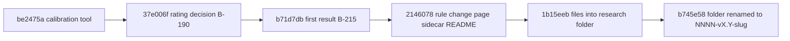

# Infrastructure Calibration: Reconstructed Intent

## Problem and Goal

Infrastructure levels needed comparison with human interpretation before confidence in
their meaning could increase. The recorded exercise compares one rater's area-level
votes with tool outputs and investigates aggregation/gate sensitivity, not new score weights.

## Decisions

Keep infrastructure separate from the main score. Use a standalone voting interface and
explicit sidecar, distinguish before/after rules, and disclose single-rater/anchoring
limits. The original README says the rater did not see tool levels while voting but
could see check lists; that remains a historical account, not a new verification claim.

## Evidence and Risks

`2146078` introduces the README, page and JSON together. The sidecar has 35 rating
records across the README's stated 15 repositories. This reconstruction preserves those
owner-approved historical artifacts and does not invent a second rater or new votes.

See [Plan](Plan.md), [Architecture](Architecture.md), [Implementation](Implementation.md)
and the original [results and limitations](research/README.md).

## Context

This is a retrospective reconstruction, not an original ideation session. Commit times below are
all 2026-10-27 `+0000`, read with `git show -s`. `be2475a` (19:15:31) added
`skills/harness-audit/scripts/infra_calibration.py` and its tests as the "calibration tool".
`37e006f` (21:02:52) rewrote BACKLOG B-190: "the user rates the tool areas himself (decision
2026-10-27; a second human may follow, a model is not an independent rater): 15 repos, 35 cells
in `infra-ratings-tool-areas.json`". `b71d7db` (21:30:40) recorded the first result in B-215 and
listed the changes as "Proposed, not yet applied". `2146078` (21:43:44) applied them, re-ran the
same 35 cells and added the page, the sidecar and the README. The whole span is 2 hours 28
minutes by subtraction; the rating session itself, its length and its date within that span are
`Not recorded`, because the sidecar's `date` is the day only.

## Goal Alignment Evaluation

Target goal: learn whether the infrastructure levels L0 to L3 match what a person reading the
same repository would call its level, before anyone relies on them. BACKLOG B-202 at `2146078`
states the starting point: "Levels are uncalibrated: no human rated any repo's infrastructure.
Do not compare them across tool versions or treat them as audited truth".

Verdict: partial fit. Reviewer judgment inferred from the README and BACKLOG B-215, not from a
recorded session. What supports the fit:

- The exercise produced measures and named causes. B-215 lists four causes of the two-level gaps
  and maps each to a rule change, and the README reports the before and after figures.
- The change reached the code in the same commit. `infra_checks.py` gained `check_ok` and
  `STRICT`, and the test file gained a majority test and a secret-checks test.
- The frozen score stayed out of it. `scripts/score.py` and `checks/catalog.yaml` have the same
  blob ids at `b71d7db` and `2146078`, matching the goal "not new score weights".
- Recomputed from the sidecar by the reviewer: 12 of 35 tool levels changed, 11 of those moved
  closer to the rater and none moved farther.

Where the fit is partial: one rater, ratings only at L1 and L2, check lists visible while voting,
and changes chosen after looking at the same 35 cells, so the after figures are in-sample. The
README names the last point by leaving three two-level gaps "to avoid fitting the tool to a
single rater".

## Achievability Evaluation

Feasibility: high for the mechanical part, because the code change is small. `infra_checks.py`
changed by 21 added and 10 removed lines and `test_infra_checks.py` by 28 added and 7 removed at
`2146078`. The evidence files are static, with no build step.

Assumptions recorded or inferred:

- The 15 repositories were public ones. The README says the sidecar is "the rater's own judgement
  of public repositories". Their names are in the sidecar; their commit ids are `Not recorded`.
- Tool reports existed for each repository when the levels were compared. The reports are not
  tracked (`reports/` is in `.gitignore` and the tree at `2146078` has no path under `reports/`),
  so the exact reports and the command that produced them are `Not recorded`.
- A modern browser opens the page. The browser version is `Not recorded`.

Dependencies: Python 3.11 or newer for `infra_checks.py` (`pyproject.toml` at `2146078`),
a browser for the page, and the owner as rater.

Blockers: a second independent rater. BACKLOG B-215 ends with "Next: second rater". No second
rating exists in the tree.

Mitigations in the tree: the roll-up still lists failing locations, secret checks stay
all-or-nothing, and the README states the limits next to the numbers.

## Complexity Evaluation

Level: S for the code change and M for the evidence bundle. Reviewer judgment.

Drivers:

- 35 cells over 15 repositories and 8 areas, each with a rater level and two tool levels.
- A 239-line page whose embedded `DATA` has 9 areas and 48 check entries and whose `SIDE` copy
  equals the sidecar.
- Two rating formats: the page's `ratings` list and the `repos` mapping that
  `infra_calibration.py` reads.
- State merged from three places in the page: embedded ratings, local storage and a loaded file.

Delivery split: four commits in order, then two documentation commits: `1b15eeb` added the four
topic documents and moved the research files, and `b745e58` renamed the folder.

## Visualizations

<!-- atlas:diagram=calibration-timeline -->

## Risks

| Risk | Impact | Likelihood | Evidence or note |
| --- | --- | --- | --- |
| One rater read as validation | high | medium | README Limits: "the numbers show direction, not accuracy"; likelihood is reviewer judgment |
| Check lists anchored the votes | medium | medium | README: "The rater could see the check lists while voting" |
| Changes fitted to the rated sample | medium | medium | the changes follow the first result on the same cells; three cells were left unfitted on purpose |
| Page catalogue differs from the rule | medium | high | the page lists `INF-D01` and `INF-V03` as level-1 gates; `infra_checks.py` at the same commit does not |
| Blindness depends on procedure | medium | medium | tool after levels are in the page source behind a `hidden` attribute |
| Sidecar cannot feed the compare command | low | high | `load_ratings` returns `{}` for it, run on today's identical file |
| Ratings tracked against the written rule | medium | high | docstring and B-215 say "not committed"; the sidecar is committed |
| External font stylesheet | low | high | `https://fonts.googleapis.com/css2?...` in line 8 of the page; system fallbacks exist, offline rendering is `Not recorded` |

## Decision Summary

Decision: keep infrastructure levels outside the 0-100 score and apply three rule changes. Reason
inferred from the four causes in B-215: the location-majority rule answers cause 1 (one weak
location fails a check), demoting `INF-D01` and `INF-V03` from gates answers causes 2 and 4 in
part, and moving `INF-A01` to level 2 answers cause 3. The Terraform lock and constraint gates
(`INF-T01`, `INF-T02`) and the Pulumi lock check stay, which the README attributes to avoiding a
fit to one rater. No discussion of other thresholds or rejected alternatives is recorded, so none
is invented; whether a value other than `PASS_RATIO = 0.6` was tried is `Not recorded`.

## Next Actions

- [x] Record the first result and apply the changes (`b71d7db`, `2146078`).
- [ ] Obtain a second independent rating on the same cells. Open in the README and B-215; no
  protocol is recorded.
- [ ] Reconcile the written rules with the committed sidecar: the "not committed" wording in the
  `infra_calibration.py` docstring and in B-215, and B-190 and B-202 saying no rating exists.
  Undecided; none is corrected here.
- [ ] Reconcile the page's embedded check lists with `infra_checks.py` (`INF-D01`, `INF-V03`,
  `INF-A01`). Undecided.
- [ ] Decide whether the sidecar and the `repos` format of `infra_calibration.py` should be one
  format. Undecided.
- [ ] Decide whether `INF-D06` and `INF-A03`, secret checks by title, belong in `STRICT`; neither
  is a gate. Undecided; `Not recorded` whether the omission was intended.
- [ ] Record how the README percentages were computed: `Not recorded`, since no script in the tree
  writes the sidecar.

## References

- [Results and limitations](research/README.md)
- [Ratings sidecar](research/infra-levels-evaluation.json)
- [Voting page](research/infra-level-vote.html)
- [Level rule and checks](../../skills/harness-audit/scripts/infra_checks.py)
- [Comparison command](../../skills/harness-audit/scripts/infra_calibration.py)
- [Audit backlog B-190, B-202, B-215](../../skills/harness-audit/BACKLOG.md)
- [Overlay architecture, 0005](../0005-v0.1-infrastructure-overlay-matched/Architecture.md)
- [History crosswalk](../History-Match.md)