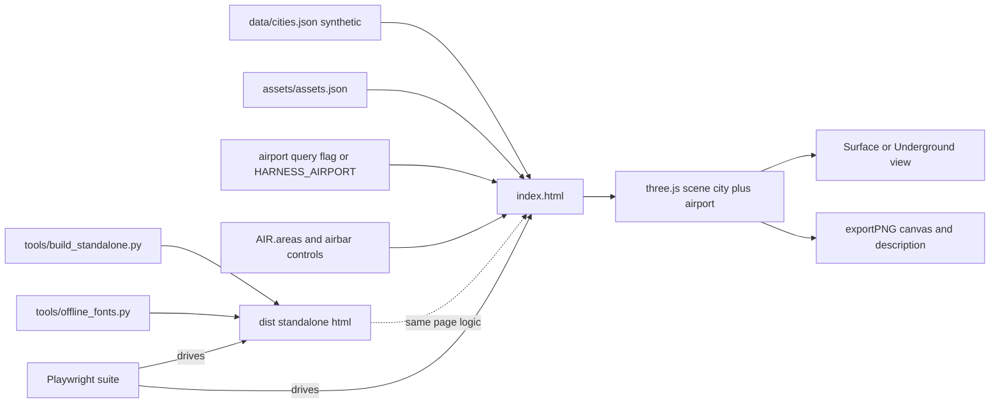
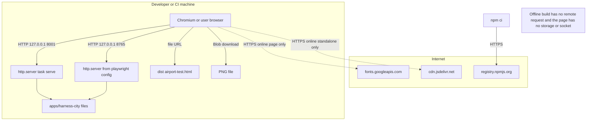
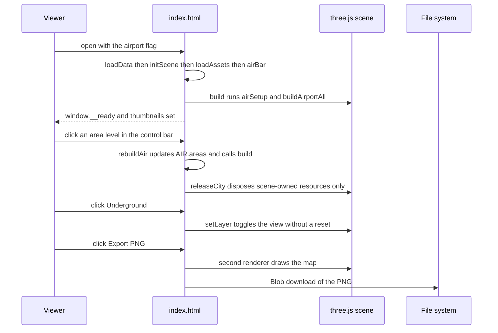
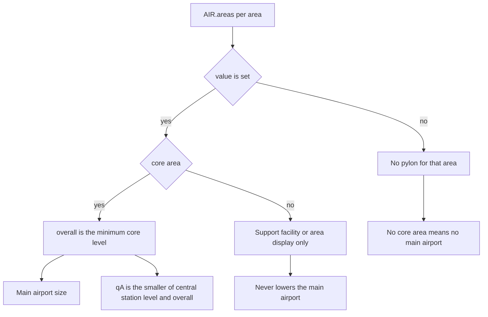

# Airport Overlay: Current Evaluation Architecture

## Components

| Component | Role |
| --- | --- |
| App index.html and scene builders | Single city/airport implementation; real orthographic camera and shared assets |
| Airport control state | Explicit simulated area levels, variants and container requests |
| Core/support classification | Core minimum separate from optional developer terminal and guidance office |
| Transit builders and permanent display state | Weaker-endpoint service plus independent surface/underground mode |
| Renderer/material ownership | Restore shared material baselines; release scene-owned GPU resources only |
| PNG compositor | Separate render plus labels and wrapped descriptions, without changing the live camera |
| Standalone builder | Derive the offline evaluator from app source and selected synthetic data |
| Playwright suite | Trusted local desktop/mobile and network-blocked offline verification |

## Data and Trust

The evaluator's control state feeds deterministic scene construction. It does not
write an audit score or imply that a real report contains those simulated levels.
The original asset document's proposed infra adapter is not current converter behavior.
The auditor's own infrastructure aggregation is not changed by the city's visual rule.

No database or cloud deployment is required. Kit models remain shared; new procedural
objects follow [app design](../../apps/harness-city/DESIGN.md) and license notices.
Generated standalone HTML embeds data and remains local build output, not source to edit.

## Authority and Supersession

Current DESIGN.md and later explicit decisions supersede early two-runway and L3-only
metro ideas. The old separate prototype is historical; the current app is authoritative.
See [Implementation](Implementation.md) for the corresponding commits and remaining gaps.

## Evidence Basis

The sections below were added by a retrospective deepening pass on 2026-11-04. They read the
tree of commit `90e9a52` (2026-10-28 14:09:55 `+0100`) with `git show 90e9a52:<path>` and
`git grep`, plus the earlier airport commits `3bfdf2b`, `f85a36d`, `489457f`, `38fab47`,
`3f450d5`, `c2a342f` and `8deb536` (all 2026-10-27, `+0000`). `git diff --quiet 90e9a52 HEAD`
over `apps/harness-city/index.html`, `package.json`, `playwright.config.js`,
`apps/harness-city/tests`, `tools/build_standalone.py`, `tools/serve.py`, `Taskfile.yml` and
`.github/workflows/check.yml` reports no difference, so a statement about `90e9a52` for those
files is also true of today's tree. Nothing below was observed by running the app or the
browser tests; the recorded test results are historical statements from the `90e9a52` commit
message and from the 0008 [implementation record](../0008-v0.1-harness-history-and-quality/Implementation.md).

## System Design

The airport is not a separate program. At `90e9a52` it is code inside the one static page
`apps/harness-city/index.html`, switched on by the query flag `?airport` or by the standalone
build flag `--airport`, which writes `window.HARNESS_AIRPORT=true` into the page. The page
reads the synthetic city dataset, builds a three.js scene with an orthographic camera, and
adds the airport next to the east edge of the city when the flag is set. The airport level is
not read from an audit report. It comes from an in-page control state, `AIR.areas`, whose
default is the preset "n8n-like (Compose + Docker)". Core areas are Terraform, Compose and
Dockerfile; Devcontainer and Agent guidance are support areas; Cross-cutting has its own
display. The weakest applicable core area sets the main airport level through `airInfra`, and
the central station level joins it through `Math.min(hub, L)`. The scene is rebuilt on every
control change, and a PNG exporter draws a second render plus the text description into a new
canvas. Three build and test helpers sit around the page: `tools/build_standalone.py`,
`tools/offline_fonts.py` and the Playwright suite.

<!-- atlas:diagram=system-design -->



## Ingress and Egress

Scope: the app, its serve and build tools, and the browser test setup at `90e9a52`. Every
listener binds `127.0.0.1`. Edges the code does not have are listed as ABSENT with the file
that shows it. `Not recorded` marks a fact the tree does not state.

<!-- atlas:table=ingress-egress -->

| Edge | Direction | Protocol | Port | Authn and encryption | Evidence |
| --- | --- | --- | --- | --- | --- |
| Browser to the preview server | in | HTTP | 8001 by default, `PORT` overrides | none, plaintext, bound to `127.0.0.1` | `Taskfile.yml` task `serve` runs `python3 -m http.server ${PORT:-8001} --bind 127.0.0.1 --directory apps/harness-city`, identical at `8deb536` and `90e9a52` |
| Browser to `tools/serve.py` | in | HTTP | 8000 by default, first argument overrides | none, plaintext, bound to `127.0.0.1` | `ThreadingHTTPServer(("127.0.0.1", port), H)` with extra MIME types for `.js`, `.mjs`, `.glb` |
| Test browser to the test server | in | HTTP | 8765 by default, `CITY_TEST_PORT` overrides, accepted range 1024 to 65535 | none, plaintext, bound to `127.0.0.1` | `playwright.config.js` sets `baseURL` to `http://127.0.0.1:${port}` and `webServer.command` to `python3 -m http.server ${port} --bind 127.0.0.1 --directory .` with `reuseExistingServer: false`; the working directory is the app folder, reviewer judgment inferred from `npm --prefix apps/harness-city test` in `Taskfile.yml` |
| Page to its own data and assets | in | HTTP, same origin | the serving port | none | `index.html` calls `fetch("assets/assets.json")` unless `window.HARNESS_CITY_ASSETS` is set, and fetches the `data` query parameter or else `data/cities.json` unless `window.HARNESS_CITY_DATA` is set |
| Page to a URL named in the `data` query parameter | in | HTTP or HTTPS by the URL given | Not recorded, set by the URL | none by the page; cross-origin access depends on the remote server, reviewer judgment | the `fetch` of `new URLSearchParams(location.search).get("data")` in `loadData`; the tests never pass this parameter |
| Page to the Google Fonts stylesheet | out | HTTPS | 443 by the scheme, reviewer judgment inferred from the URL because the file names no port | TLS by scheme; no `integrity` attribute | lines 3 and 4 of `index.html`: a `preconnect` and a `stylesheet` link to `fonts.googleapis.com`; `tests/fixtures.js` fulfils `https://fonts.googleapis.com/**` with an empty stylesheet |
| Online standalone page to a CDN | out | HTTPS | 443 by the scheme | TLS by scheme; no `integrity` attribute | `build_standalone.py` default import map points `three` and `three/addons/` at `cdn.jsdelivr.net/npm/three@0.160.0` |
| Offline standalone page to any remote host | out | ABSENT | ABSENT | ABSENT | `--offline` writes three.js, the GLTF loader and its utility as `data:` URLs; `offline_fonts.py` removes `link` elements for `fonts.googleapis.com` and `fonts.gstatic.com`; `tests/export.spec.js` aborts every `https?://` request and asserts `attempted` equals an empty list |
| Earlier separate prototype to a CDN | out | HTTPS | 443 by the scheme | TLS by scheme | `38fab47:apps/harness-city/prototypes/airport.html` line 36 import map to `three@0.160.0`; the file was deleted by `8deb536` |
| PNG export to the download folder | out | local file write by Blob URL and an anchor with `download` | none | none | `exportPNG` in `index.html`; file name `<city id>-surface.png` or `-underground.png`; which folder the browser used is `Not recorded` |
| Page to browser storage, cookies or session storage | in and out | ABSENT | ABSENT | ABSENT | a `git grep` of `index.html` at `90e9a52` for `localStorage`, `sessionStorage`, `WebSocket`, `XMLHttpRequest` and `sendBeacon` returns no line; the only history write is `history.replaceState` with `#<city id>` |
| Airport to real audit report data | in | ABSENT | ABSENT | ABSENT | `git grep -c -i infra` over `apps/harness-city/tools/report_to_city.py` finds no match at `90e9a52` or today; the airport reads `AIR.areas` presets only |
| Package install to the npm registry | out | HTTPS | 443 by the scheme | TLS by scheme; lockfile pins version `1.64.1` | `package-lock.json` `resolved` fields are `https://registry.npmjs.org/...`; `Taskfile.yml` runs `npm --prefix apps/harness-city ci --ignore-scripts` |
| Chromium download by Playwright | out | Not recorded | Not recorded | Not recorded | `Taskfile.yml` runs `npm exec ... playwright install chromium`; CI runs `playwright install --with-deps chromium`; the download host is not named in the repository |
| CI runner to action hosts and artifact upload | out | Not recorded | Not recorded | Not recorded | `.github/workflows/check.yml` names SHA-pinned actions and an `upload-artifact` step on failure with `retention-days: 7`; no URL, protocol or port is written |

Absent edges in one line: no inbound listener beyond the three loopback servers, no outbound
request in the offline build, no persistence in the browser, and no path from an audit report
into the airport.

## Runtime and Infrastructure

The app is a browser program. The page needs WebGL, and the tests run Chromium with
`--use-angle=swiftshader --enable-unsafe-swiftshader`, which is software rendering. The vendored
three.js file reports `REVISION = '160'` in today's tree and was last changed by `23251df`; the
CDN pin in the standalone builder is `three@0.160.0`.

| Item | Value | Source and date |
| --- | --- | --- |
| Node | `engines.node` is `>=22`; CI `setup-node` uses `node-version: '24'`; the terminal that ran this pass reports `v24.21.0` | `apps/harness-city/package.json` and `.github/workflows/check.yml` at `90e9a52`, unchanged today; `node -v` on 2026-11-04 |
| Node before the airport tests | no `package.json` or Playwright file in the tree | `git ls-tree -r --name-only 8deb536` |
| Python | CI `python-version: '3.14'` through `astral-sh/setup-uv` with uv `0.11.23`; the app's Python tools import only the standard library | `check.yml` at `8deb536` and `90e9a52`; imports of `build_standalone.py`, `offline_fonts.py`, `serve.py` |
| Task runner | go-task `3.51.1` | `check.yml` |
| Test framework | `@playwright/test` `1.64.1`, exact, `lockfileVersion` 3 | `package.json` and `package-lock.json` at `90e9a52` |
| CI runner | `ubuntu-latest`, `timeout-minutes: 20` at `90e9a52` (it was 10 at `8deb536`), `permissions: contents: read`, `concurrency` group per ref | `check.yml` |
| Test limits | per test 90000 ms, whole run 900000 ms, 1 worker, 0 retries, `reducedMotion: reduce` | `playwright.config.js` |
| Test projects | `desktop-chromium` 1280 by 900; `mobile-chromium` 390 by 844 with `isMobile` and `hasTouch` | `playwright.config.js` |
| Containers, Dev Container, Terraform | none | `git ls-tree -r --name-only 90e9a52` matched no Dockerfile, compose, devcontainer or `.tf` name |

The `task app:test` recipe builds `dist/airport-test.html` with `--offline --airport`, strips the
font links with `tools/offline_fonts.py`, then runs `npm --prefix apps/harness-city test`. The
offline test opens that file through a `file://` URL, so it is the only test that does not use the
loopback server. `dist/`, `playwright-report/` and `test-results/` are ignored by `.gitignore`
(the last two were added by `90e9a52`).

## Trust Boundaries

| Boundary | Who may write | What the sources show |
| --- | --- | --- |
| Dataset shown by the city | the repository's own synthetic `data/cities.json`; a `data` query parameter can name another source | the tests use the default dataset and require `thriving-demo`, `prosperous-demo`, `working-demo` and `absent-demo` |
| Airport levels | the viewer, through the control bar | `AIR.areas` is seeded from the preset and edited in memory; the exported image states synthetic data and simulated overrides, per `DESIGN.md` and `airport-assets.md` |
| Test hooks on the page | any script in the page | `window.__air` is assigned at top level and `window.__t` in the boot code, with no flag check; `tools/check_city.js` is a separate file and the README says it is not embedded in the offline build |
| Build outputs | the build recipes in `Taskfile.yml` | `dist/` is listed in `.gitignore`; the recipes write only under `apps/harness-city/dist/` |
| Tracked simulator copy | commit `7d892f6` | the file `research/city-airport-prototype.html` is tracked, see Recorded Conflicts and Gaps |
| Frozen scoring | reviewed commits only | the airport reads no score; `0008` records the same boundary for the audit |

No authentication or authorization exists in the app. The only network boundary the page
crosses by default is the Google Fonts request, and the offline build removes it.

## Network Topology

<!-- atlas:diagram=network -->



## Code Logic

One session in the page, with function names read from `index.html` at `90e9a52`: boot runs
`loadData`, `initScene`, `loadAssets`, `airBar` and `build`. `build` calls `airSetup`, removes the
previous scene through `releaseCity`, then calls `buildOutskirts`, `buildRoads`, `buildRail`,
`buildGrid`, `buildTransit` and, when the flag is set, `buildAirportAll`. `rebuildAir` is the
entry point for a control change. `exportPNG` renders a second `WebGLRenderer` and does not move
the live camera; the export test compares the camera target and zoom before and after.

<!-- atlas:diagram=code-logic -->



The level rule is a second path. `airInfra` keeps the areas whose value is not null, takes the
core ones (Terraform, Compose, Dockerfile) and returns their minimum as `overall`. When no core
area applies, `overall` is null and the page draws no main airport. `buildAirportAll` computes
the station link as `qA = overall == null ? 0 : Math.min(hub, L)`.

<!-- atlas:diagram=level-rule -->



## Data and Storage

No database is required, and no `erDiagram` is drawn because the evidence shows no persistence.
State lives in memory: `AIR` (`variant` default `"C"`, `cont` default 6, `areas`), `DISPLAY.under`,
the camera `view` and the current city. The only URL state is the `#<city id>` hash. Files at
`90e9a52`:

```text
apps/harness-city/
  index.html            page, scene builders, airport code, PNG export
  data/cities.json      synthetic cities
  assets/assets.json    packed kit models
  vendor/               three.js 160 and loaders
  tools/                build_standalone.py, serve.py, check_city.js, report_to_city.py
  tests/                airport.spec.js, city.spec.js, export.spec.js, fixtures.js
  playwright.config.js, package.json, package-lock.json
  dist/ playwright-report/ test-results/   ignored output
docs/0007/               airport-assets.md at 90e9a52 (now research/)
```

Retention: ignored outputs are never tracked; a retention policy for downloaded PNG files is
`Not recorded`.

## Recorded Conflicts and Gaps

Existing statements above and in other files stay as written; this section quotes both sides.

- Simulator tracking. This document says "Generated standalone HTML embeds data and remains
  local build output, not source to edit", and the [Implementation](Implementation.md) says
  "The local generated simulator has no tracked originating commit at its docs path". The
  [History-Match](../History-Match.md) table calls it "Untracked generated output". Git shows
  `7d892f6` (2026-10-28 22:41:30 `+0100`, "City Harness Airport Prototype") adding
  `docs/0007/research/city-airport-prototype.html` with 1008 lines. `git ls-files` lists the
  renamed path today, the blob id `25c88a38` is the same at `7d892f6` and today, the file is
  4,722,659 bytes, and `git check-ignore` does not ignore it. The `90e9a52` message says the
  generated simulator is excluded; `7d892f6` came after it. Both sides stay as historical
  statements.
- Runways. The tier table in [airport-assets.md](research/airport-assets.md) lists "2 runways" at
  L3, and `38fab47` contains a `// second runway at L3` comment, while the same document's
  prototype decisions and `AP.rw:1` at `90e9a52` give one runway at every level.
- Report adapter. The "Panel and data" section proposes an `infra` block built by
  `tools/report_to_city.py`; the script has no match for `infra` at `90e9a52` or today.
- Camera. `38fab47` builds a `THREE.PerspectiveCamera`; `c2a342f` and `DESIGN.md` require the
  orthographic camera. The perspective version is history, not current behavior.
- Remote CI. A GitHub Actions result for `90e9a52` is `Not recorded` in this tree; the 0008
  record cites a local `task check` only.

## Files Touched

<!-- atlas:table=files-touched -->

| Slice | Path | Change |
| --- | --- | --- |
| `3bfdf2b`, `f85a36d` | `docs/0007/airport-assets.md` | added 76 lines, then 24 lines |
| `489457f` | `apps/harness-city/DESIGN.md`, `apps/harness-city/AGENTS.md`, `CLAUDE.md`, `AGENTS.md`, `tools/check.py` | design contract, 116 lines in `DESIGN.md`, plus a `design` check in `tools/check.py` |
| `38fab47`, `3f450d5`, `c2a342f` | `apps/harness-city/prototypes/airport.html` | added 300 lines, then mobile layout, then orthographic camera |
| `8deb536` | `apps/harness-city/index.html`, `tools/build_standalone.py`, `prototypes/airport.html` | 190 changed lines in the page, the `--airport` flag added, the prototype file deleted |
| `90e9a52` | `apps/harness-city/index.html` | 267 changed lines: stable rebuilds, permanent underground, L2 metro, support facilities, PNG export |
| `90e9a52` | `apps/harness-city/tests/*.spec.js`, `fixtures.js`, `playwright.config.js`, `package.json`, `package-lock.json`, `tools/check_city.js` | added 50, 32, 74, 32, 46, 16, 63 and 159 lines |
| `90e9a52` | `Taskfile.yml`, `.github/workflows/check.yml`, `.gitignore` | `app:setup`, `app:test`, Node setup, three ignore lines |
| `7d892f6` | `docs/0007/research/city-airport-prototype.html` | added 1008 lines |
| `1b15eeb`, `b745e58` | `docs/0007/*` | four retrospective files added, then folder renamed to this path |

## Component Layers

<!-- atlas:table=component-layers -->

| Component | Layer | Path | Kind | Depends on |
| --- | --- | --- | --- | --- |
| Page and scene builders | presentation | `apps/harness-city/index.html` | static app | `data/cities.json`, `assets/assets.json`, `vendor/` |
| Airport control state | domain | `AIR` and `AIR_AREAS` in `index.html` | in-memory object | presets |
| PNG exporter | integration | `exportPNG` in `index.html` | browser code | canvas, second renderer |
| Standalone builder | tooling | `apps/harness-city/tools/build_standalone.py` | python script | `index.html`, `vendor/`, data |
| Font stripper | tooling | `tools/offline_fonts.py` | python script | built html |
| Loopback servers | tooling | `Taskfile.yml` task `serve`, `apps/harness-city/tools/serve.py` | `http.server` | app files |
| Browser tests | test | `apps/harness-city/tests/`, `playwright.config.js` | playwright | Node, Chromium, offline build |
| In-page check | test | `apps/harness-city/tools/check_city.js` | javascript module | the running page |
| Design contract | documentation | `apps/harness-city/DESIGN.md` | markdown | `tools/check.py` design check |