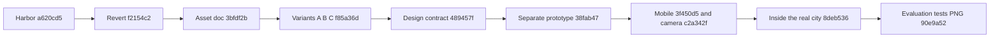

# Airport Overlay: Reconstructed Intent

## Problem and Goal

Make infrastructure readiness understandable next to the seven scored districts without
turning the overlay into an eighth scored pillar. The airport should look appropriate
at every maturity level and make its link to the city legible.

The [asset proposal](research/airport-assets.md) records the original idea and later decisions.
The separate harbor experiment was reverted; airport variants evaluate how station,
road, rail and underground connections communicate infrastructure reach.

## Current Decisions

Core infrastructure controls the main-airport level. Devcontainer is an independent
developer side-terminal and Agent guidance an independent guidance office; neither
is a blocker. Every applicable area retains its own display. Underground is a permanent
city view, metro starts at L2+ using the weaker endpoint, and PNG export includes descriptions.

## Limits

The airport remains opt-in. Simulated control values are not real audit findings. The
early two-runway proposal is superseded by the one-runway decision. This retrospective
does not invent a production report-data integration or a historical design interview.

Continue with [Plan](Plan.md), [Architecture](Architecture.md) and [Implementation](Implementation.md).

## Reconstruction Context

Retrospective reconstruction, not an original pre-implementation session. The commit trail
shows a short sequence on 2026-10-27 (all times `+0000`): a harbor overlay was added by
`a620cd5` at 21:57:23 and reverted by `f2154c2` at 22:01:48; the airport asset definition
`3bfdf2b` followed at 22:09:16, the transit variants `f85a36d` at 22:14:31, the design contract
`489457f` at 22:17:42, the separate prototype `38fab47` at 22:41:50, mobile layout `3f450d5` at
23:00:01, the orthographic camera `c2a342f` at 23:05:46 and the move into the real city
`8deb536` at 23:21:37. The evaluation round `90e9a52` is dated 2026-10-28 14:09:55 `+0100`.
No interview, meeting note or issue discussion for any of these commits exists in the tree:
`Not recorded: the owner's spoken or written reasons behind each step`. The commit messages for
the harbor pair carry only the backlog ids B-182 and B-183.

## Goal Alignment Evaluation

Target goal, from the first lines of `research/airport-assets.md` at `3bfdf2b`: show the
infrastructure overlay (levels L0 to L3) next to the city "never part of the 0-100 score".

Verdict: strong fit for the visual goal, no fit yet for a production data goal. Reviewer
judgment inferred from the evidence below.

- Separate from scoring: `apps/harness-city/DESIGN.md` states the airport is "never part of the
  0-100 score", and the page defines the airport as its own object `AIRP` with key `"airport"`,
  apart from the `PILLARS` list that carries the seven districts (`index.html` at `90e9a52`).
- Legible at every level: the asset document has a tier table for L0 to L3, and the page holds
  `AIR_LADDER` text for each level plus per-area pylons that exist from L0 on.
- Legible link to the city: variants A, B and C in `f85a36d` are all about how the central
  station connects to the airport; `AIR_LINE` text states what runs at each station level.
- Recorded evolution of the size rule: `3bfdf2b` says "Size = overall infra level (weakest tool
  area)"; today's document says the weakest applicable core area controls it, with Devcontainer
  and Agent guidance as independent benefits. That change entered the file with the 2026-10-28
  evaluation update in `90e9a52`. Why the owner chose it is `Not recorded`.

Where the fit is partial: the airport reads preset control values, not an audit report. The
"Panel and data" section proposes a `report.infra` adapter; `report_to_city.py` has no such code.

## Achievability Evaluation

Feasibility: high for a prototype, shown by the fact that it was built in roughly 72 minutes of
commit time between `3bfdf2b` and `8deb536` (22:09:16 to 23:21:37). That span is a commit-time
fact, not an effort estimate.

Assumptions recorded or inferred:

- The kit has no aircraft, so planes, terminal and tower are generated in code; the asset
  document says this in "Assets" and compares it to the existing trains and cranes.
- The real city's roads, rail, lights, labels and side panel can host the airport. Inferred from
  `8deb536`, which deleted the 304-line separate page and added 190 changed lines to `index.html`.
- A static server and a WebGL browser are enough. The page runs with the loopback servers
  listed in the [Architecture](Architecture.md) ingress table.

Dependencies: vendored three.js `REVISION = '160'`, the synthetic dataset, and for tests Node
(`engines.node` is `>=22`, CI uses Node 24), Python 3.14 in CI, and `@playwright/test` `1.64.1`.

Blockers: none recorded. Mitigations in the tree: the opt-in flag, the design check added by
`489457f`, and the browser tests added by `90e9a52`.

## Complexity Evaluation

Level: L. Reviewer judgment inferred from the file stats.

Drivers:

- One file, `apps/harness-city/index.html`, carries the scene, the airport, the transit logic
  and the exporter: 190 changed lines in `8deb536` and 267 in `90e9a52`.
- Many interacting rules: core versus support areas, station link as the smaller of two levels,
  a permanent layer switch, scene rebuilds that must not leak GPU resources, and PNG export.
- Three runtimes: browser JavaScript, Python build tools, and Node for the tests.
- Software-rendered Chromium for tests, which the 0008 record says needed a 90-second per-test
  limit.

Delivery split: asset and variants on paper (`3bfdf2b`, `f85a36d`), a throwaway prototype
(`38fab47` to `c2a342f`), integration (`8deb536`), then evaluation fixes with tests (`90e9a52`).

## Visualizations

<!-- atlas:diagram=airport-evolution -->

## Risks

| Risk | Impact | Likelihood | Evidence or note |
| --- | --- | --- | --- |
| Simulated levels read as audit findings | high | medium | The exported image identifies synthetic data and simulated overrides; `History-Match.md` says the simulated values must not be presented as audited findings |
| A ninth pillar by accident | medium | low | The airport is outside `PILLARS`; `DESIGN.md` says it is never part of the score |
| A second prototype diverges from the app | medium | medium | `8deb536` deleted the separate page; `c2a342f` added the camera rule so new views match |
| Scene rebuilds leak GPU memory or change materials | medium | medium | `releaseCity` frees only scene-owned resources; `tests/airport.spec.js` asserts one distinct allocation count across rebuilds |
| Offline build reaches the network | medium | low | `tests/export.spec.js` blocks all `https?://` requests and expects none attempted |
| Proposal text read as current behavior | medium | medium | Two-runway tier, `report.infra` adapter and a tracked-simulator claim all disagree with later evidence, see Next Actions |

## Decision Summary

Decision: build the airport inside the real city as an opt-in overlay and keep it out of the
score. Reason inferred from `8deb536` and `489457f`: one implementation shares models, camera,
labels and the panel, and the design contract keeps later views consistent. Alternatives that
the tree shows: the harbor overlay (added then reverted within four minutes, reason `Not
recorded` beyond the reopened backlog ids), and a separate prototype page (replaced by
`8deb536`). The three station-link variants stayed switchable for evaluation; the document
recommends testing C with the underground toggle first. No rejected-alternative discussion is
recorded, so none is invented.

## Next Actions

- [x] Keep the opt-in flag and the synthetic-only boundary (current in `90e9a52`).
- [ ] Decide whether the airport becomes a default view: `Not recorded`.
- [ ] Record the reason the harbor overlay was reverted: `Not recorded`.
- [ ] Reconcile the simulator tracking conflict. This folder's [Architecture](Architecture.md)
  and [Implementation](Implementation.md) say the generated simulator is local output, while
  `7d892f6` tracks `research/city-airport-prototype.html` (1008 lines, 4,722,659 bytes today).
  The owner decides whether it stays tracked.
- [ ] Reconcile the runway statement: the tier table says two runways at L3, the later decision
  and `AP.rw:1` say one.
- [ ] Decide whether the unimplemented "Panel and data" adapter proposal stays open.

## Traceability

- Sources: `research/airport-assets.md`, `apps/harness-city/DESIGN.md`, `apps/harness-city/index.html`
  and the commits named above.
- Related folders: [0003](../0003-v0.1-harness-roadmap-evidence-matched/Plan.md) holds the
  roadmap; [0005](../0005-v0.1-infrastructure-overlay-matched/Plan.md) and
  [0006](../0006-v0.1-infrastructure-calibration-retrospective/Plan.md) hold the audit-side
  infrastructure overlay and its calibration; [0008](../0008-v0.1-harness-history-and-quality/Implementation.md)
  holds the browser-test results.
- Backlog: [WN-024](../Whats-Next.md) tracks the documentation alignment effort.

## References

- [Airport asset decisions](research/airport-assets.md)
- [Harness City design contract](../../apps/harness-city/DESIGN.md)
- [Harness City README](../../apps/harness-city/README.md)
- [History crosswalk](../History-Match.md)
- [Workflow report](Workflow-Report.md)