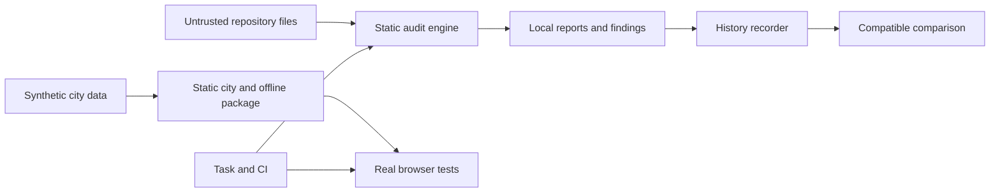
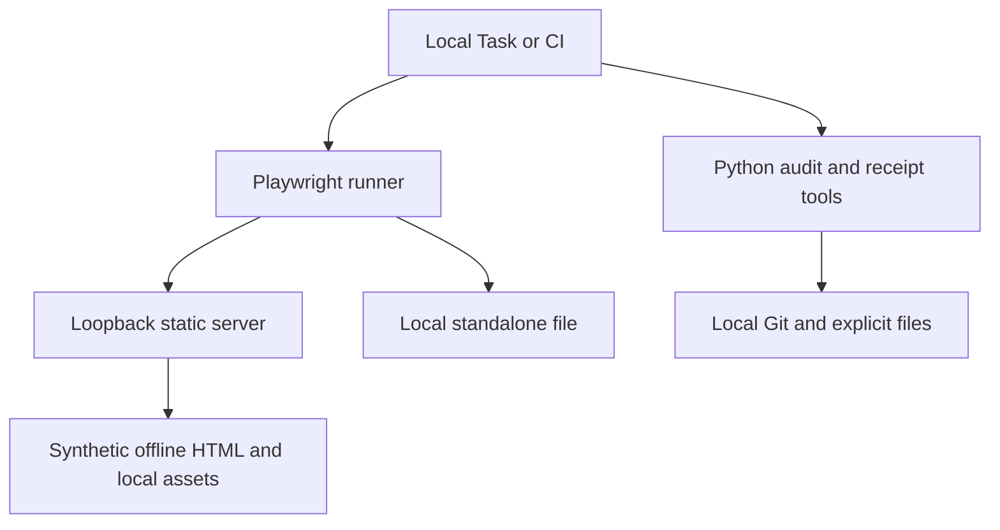
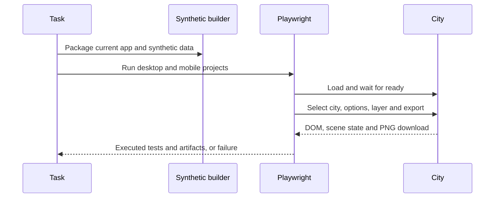

# Harness History and Quality Architecture

## Overview

Scope: reconstruct the current system and add unattended verification and comparable
static audit receipts, without changing audit weights or executing audited code.
Primary objective: evidence-backed maintenance of the audit skill and synthetic city.

<!-- atlas:part=system-design -->
## System Design

The audit engine reads repository files and local Git metadata, prepares optional quoted
judgment tasks, scores findings and writes reports. A converter turns reports into the
city's optional data contract. The city is a static Three.js page; offline packaging
inlines its modules, assets and selected synthetic data.

The additive quality layer owns Playwright tests and history receipts. It does not
participate in scoring and never interprets static enforcement claims as executed tests.
AC-3 through AC-13 in [Plan](Plan.md) define its observable boundaries.

<!-- atlas:table=component-layers -->
| Component | Layer | Path | Depends on |
| --- | --- | --- | --- |
| Audit engine | Product | `skills/harness-audit/scripts/run_checks.py` | |
| City application | Product | `apps/harness-city/index.html` | |
| Browser tests | Verification | `apps/harness-city/tests/` | City application |
| History tool | Verification | `tools/audit_history.py` | Audit engine |
| Repository checks | Verification | `tools/check.py` | |
| Task runner | Delivery | `Taskfile.yml` | Browser tests, History tool, Repository checks |
| CI | Delivery | `.github/workflows/check.yml` | Task runner |
| Basic documents | Knowledge | `docs/0008-v0.1-harness-history-and-quality/` | |

<!-- atlas:diagram=system -->


## Delta Map

| Area | Observed baseline | Target addition |
| --- | --- | --- |
| Documentation | Historical numbered folders, imported as-built chain | One versioned basic retrospective; old paths preserved |
| City tests | Browser-console module and interactive checks | Locked unattended desktop/mobile Chromium tests |
| Audit history | Individual raw reports | Immutable compact receipts and compatibility-gated deltas |
| Placeholder checks | Quoted Python fixtures can erase test presence | Structural Python placeholder handling with regressions |
| Document gate | Scans ignored generated reports | Source-only document scan plus unchanged publication guard |

<!-- atlas:part=ingress-egress -->
## Ingress and Egress

<!-- atlas:table=ingress-egress-matrix -->
| Actor | Direction | Interface | Boundary and restriction |
| --- | --- | --- | --- |
| Owner | In | Task/CLI arguments | Explicit repo, report and comparison paths; no shell interpolation of repository data |
| Audited repository | In | Bounded local file/Git reads | Text is untrusted; no import, install or test execution |
| Browser runner | Local | HTTP on `127.0.0.1:8765` by default | Runner owns a synthetic static server; no unknown-server reuse |
| Offline test | Local | Generated `file://` HTML | Block network; require assets and PNG output to work |
| Package managers | Setup egress | Locked development dependencies and browser download | Setup only; not part of audit execution and not installed in audited repos |
| CI | Out | Test reports, failure screenshots/traces | Synthetic data only; no raw audit reports uploaded automatically |

<!-- atlas:part=network -->
## Runtime and Network

The current environment provides Python 3.14 through uv and Node 24. Browser automation
is a development-only Node package under the app, with an exact lockfile. The existing
skill environment remains managed by its own uv lock. Browser/OS dependency installation
is a setup operation; tests fail explicitly when prerequisites are missing.

No database, cloud service, reverse proxy, container or new client adapter is required.
This retrospective records the existing local runtime rather than inventing a Dev Container
or deployment that was never implemented. Such additions are separate future decisions.

<!-- atlas:diagram=network -->


<!-- atlas:part=code-logic -->
## Code Logic

Browser tests launch a dedicated server, wait for the real ready flag, fail on page errors,
reuse the existing full regression module and exercise real pointer controls separately.
PNG checks wait for the download, decode its pixels and inspect expected description text.
Reduced-motion fixtures make inspection reproducible; live movement is tested separately.

<!-- atlas:diagram=verification-sequence -->


History recording validates an explicit report, records the current repository identity,
commit and working-tree fingerprint, and fingerprints the audit engine/catalog. It writes
a new receipt atomically. Comparison requires matching repository, engine, catalog and
schema context before emitting score/level/check-state deltas. A missing finding is
reported as added/removed, not silently equated with pass or fail.

## Logging and Failure Contract

Logging: use platform-native Playwright/Task/CI output and the existing bounded CLI
result/error pattern for developer utilities. No background service, rotating log store
or new logging framework is added. This is an explicit scoped override of the full
service-style logging milestone; structured receipts are the durable evidence.

History validation errors fail nonzero before writing; stderr carries a bounded reason.
JSON results and receipts contain no source excerpts, environment values or credentials.
Malformed records and incompatible measurements are errors, never empty successful deltas.

<!-- atlas:part=data-model -->
## Data Model and Storage

No database is required. A receipt contains schema version, observation time, label,
repository identity, commit/dirty fingerprint, report SHA-256, engine/catalog fingerprints,
score, pillar levels, normalized check states and the report's limitations. Infrastructure
overlay states remain separate from the 0-100 score. Test-run evidence is not fabricated
from an audit receipt; optional owner-provided runtime results remain a separate concern.

Storage follows the shared application-storage policy read during this run. Concrete
project paths are rooted in this checkout; nothing is stored in a home directory:

```text
.data/storage/local/file/harness-audit/history/YYYY-MM-DD/UTC-run-id/record.json
reports/self-audit/before/                 original raw, defective-engine baseline
reports/self-audit/before-corrected/       corrected-engine baseline
reports/self-audit/after/                  fresh final audit
apps/harness-city/test-results/           ignored screenshots, traces and results
apps/harness-city/playwright-report/      ignored human-readable browser report
```

Receipts use new owner-only directories/files and never replace an existing run. Reject
unsafe destinations and incompatible records. Keep root `.data/`, reports and browser
output ignored. The source-document gate excludes output directories, while publication
checks continue rejecting tracked private/generated content. Existing storage permissions
are checked, never silently changed. The utility exposes explicit input/output paths and
does not install, schedule or automatically ingest receipts into other tools.

## Decision Records

- D-1: the basic retrospective is intentionally not a fabricated full workflow.
- D-2: the old 33-point and corrected 55-point results are different measurement conditions.
- D-3: the city runner executes only trusted synthetic product fixtures, not audited code.
- D-4: immutable receipts and strict compatibility take precedence over a flattering trend.
- D-5: no automatic hooks, client configuration, commits or baseline-image replacement.

<!-- atlas:part=files-touched -->
## Files Touched Per Slice

<!-- atlas:table=files-touched-per-slice -->
| Slice | Path | Change |
| --- | --- | --- |
| M1 | `docs/0008-v0.1-harness-history-and-quality/` | add |
| M2 | `skills/harness-audit/scripts/run_checks.py` | change |
| M2 | `skills/harness-audit/tests/test_run_checks.py` | change |
| M2 | `tools/check.py` | change |
| M2 | `tests/test_repo_quality.py` | add |
| M3 | `apps/harness-city/package.json` | add |
| M3 | `apps/harness-city/package-lock.json` | add |
| M3 | `apps/harness-city/playwright.config.js` | add |
| M3 | `apps/harness-city/tests/` | add |
| M3 | `Taskfile.yml` | change |
| M3 | `.github/workflows/check.yml` | change |
| M3 | `.gitignore` | change |
| M4 | `tools/audit_history.py` | add |
| M4 | `tests/test_audit_history.py` | add |
| M5 | `skills/harness-audit/SKILL.md` | change |
| M5 | `skills/harness-audit/references/TESTING-AND-HISTORY.md` | add |
| M5 | `CONTRIBUTING.md` | add |
| M5 | `README.md` | change |
| M5 | `apps/harness-city/README.md` | change |
| M6 | `extraction-manifest.json` | change |

## Verification Mapping

AC-1/2 map to document/commit checks; AC-3 through AC-7 to browser tests and CI;
AC-8 through AC-10 and AC-14 to history CLI tests; AC-11 to the existing detector
suite; AC-12 to source/publication canaries; AC-13 to skill-link and guidance review.