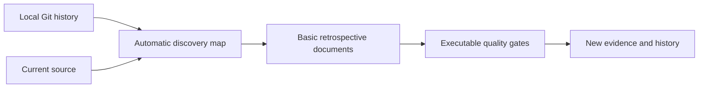
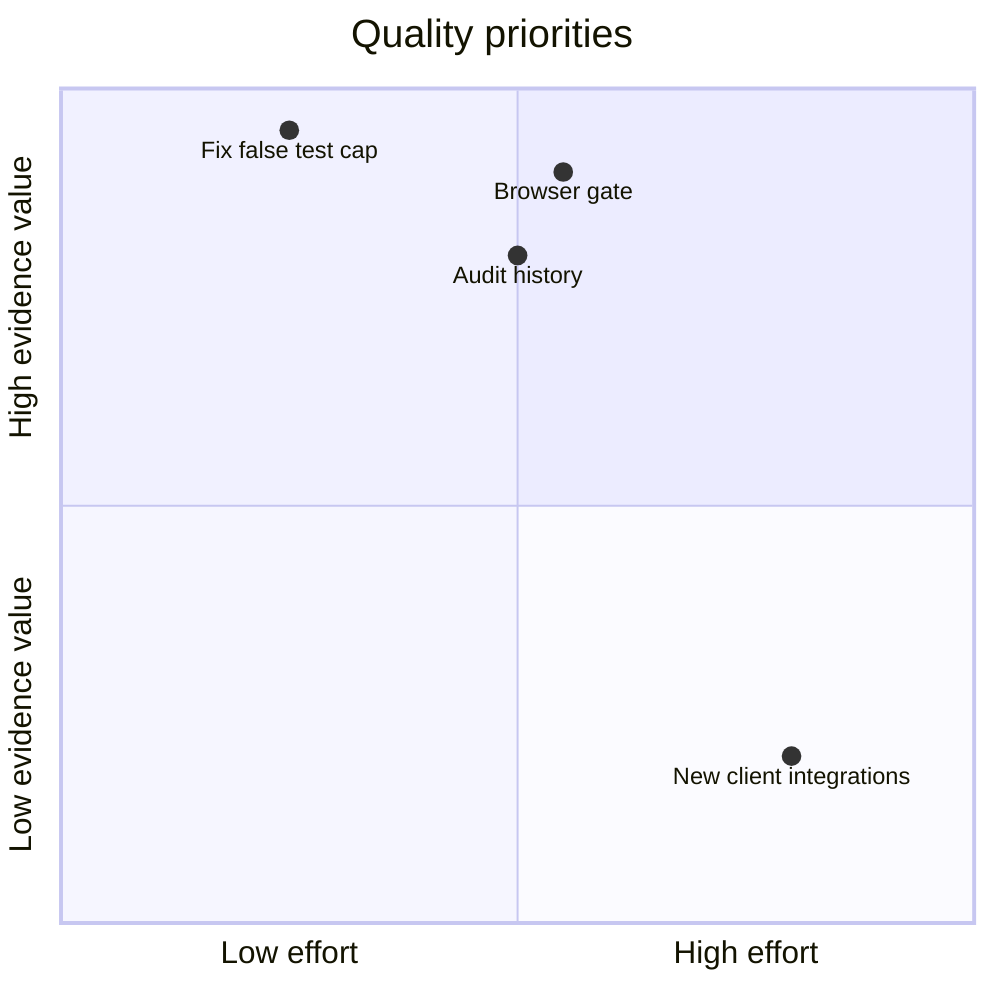

# Harness History and Quality

## Contents

- [Context](#context)
- [Goals](#goals)
- [Decisions](#decisions)
- [Evaluation](#evaluation)
- [Risks](#risks)
- [Next Actions](#next-actions)
- [References](#references)

## Context

This document reconstructs intent after implementation. It does not claim that the
original developers wrote a complete spec before coding. Commit-backed facts and the
current working tree are distinguished in the automatic [discovery map](Map.md).
The original extraction and historical as-built documents remain untouched. ([1](#ref-1))

The repository already has a static audit, synthetic city data, a repeatable Python
check command and a browser-console regression module. The missing connection is an
unattended browser runner and CI gate. The auditor also needs a safe way to retain
comparable findings without treating static checks as runtime verification. ([2](#ref-2))

The owner requested only basic Ideation, Plan, Architecture and Implementation artifacts.
This reduced retrospective is not a full orchestrator pass. Discovery is reconstructed
automatically; no grilling, fabricated interview or invented historical pass is included.
Metadata follows the existing repository profile, retaining the required `type` field
and explicit provenance. ([3](#ref-3))

## Goals

1. Make the actual implementation and its history discoverable in a versioned folder.
2. Execute city regression tests in real Chromium on desktop and mobile layouts.
3. Keep static audit records comparable by repository identity, tool and catalog.
4. Provide separate guidance for owner-authorized runtime tests and static audit history.
5. Improve observed harness defects while preserving the read-only audit boundary.

## Decisions

| Decision | Basis | Consequence |
| --- | --- | --- |
| Preserve earlier docs | Source provenance and existing links matter | Add a versioned entry point; do not move imported history |
| Reuse the city regression module | It already covers material/GPU stability and PNG output | Wrap it in a real browser runner; also exercise pointer clicks |
| Use synthetic data | Public reports may contain private excerpts | Test only the checked-in demo and generated synthetic standalone files |
| Keep runtime tests separate | The auditor promises not to execute audited code | Record execution evidence only from separately authorized test commands |
| Compare compatible audit snapshots | Detector/catalog changes alter meaning | Refuse misleading score comparisons across incompatible engines |
| No client onboarding | Existing entry points are sufficient for this scope | Leave client configuration and integrations unchanged |

## Evaluation

Achievability is high: Python checks, a working city, synthetic fixtures and a browser
regression module already exist. The new browser runner adds one locked development
dependency. History storage is local structured data, not a database or service.

Complexity is moderate. The principal difficulty is trustworthy comparison, not file
generation: distinguish code changes, engine changes, uncommitted changes, unanswered
judgments and checks that actually ran.

### Goal Alignment Evaluation

Added by a retrospective deepening pass on 2026-11-04. Each judgment below is a reviewer
judgment, not a recorded decision. Commit-time evidence is read from `90e9a52`
(2026-10-28 14:09:55 +0100) with `git show --stat` and `git show 90e9a52:<path>`; "today's
tree" marks facts read from the current checkout.

| Goal | Judgment | Evidence |
| --- | --- | --- |
| 1. Discoverable history | Aligned. Reviewer judgment inferred from the commit table in [Map](Map.md) (14 commits named, the last `90e9a52`) and from the `docs/0008-v0.1-harness-history-and-quality/` folder with four documents added by `90e9a52` and later changed by `1b15eeb`. | `git log` for this folder's four documents lists `90e9a52`, `1b15eeb` and `b745e58` (the 2026-11-04 folder alignment). |
| 2. Real Chromium on desktop and mobile | Aligned. Reviewer judgment inferred from `apps/harness-city/playwright.config.js` at `90e9a52`: two projects, `desktop-chromium` (1280 by 900) and `mobile-chromium` (390 by 844, touch), `retries: 0`, and 3 spec files with 3 tests each, so 18 cases. | The commit message of `90e9a52` states 18 browser cases passed; that is a historical statement, not re-run here. |
| 3. Comparable audit records | Aligned. Reviewer judgment inferred from `compare` in `tools/audit_history.py`, which raises "Incomparable history records" when `repository_id`, `report_schema`, `tool`, `fingerprints` or `clone_mode` differ. | `tests/test_audit_history.py` has 9 test functions at `90e9a52`. |
| 4. Separate runtime and static guidance | Aligned. Reviewer judgment inferred from `skills/harness-audit/references/TESTING-AND-HISTORY.md` (present today and added by `90e9a52`), whose section "Two Evidence Paths" says the static auditor does not import, install, build or execute tests of an audited repository. | `git show --stat 90e9a52` lists the file. |
| 5. Fix observed defects, keep the read-only boundary | Aligned, with a measurement caveat. Reviewer judgment inferred from `90e9a52` changing `skills/harness-audit/scripts/run_checks.py` (27 lines) and `skills/harness-audit/tests/test_run_checks.py` (23 lines), while the three Python subprocess sites in the engine are Git queries and the engine's own `audit.py`. | Receipts in today's tree: `before-corrected` 55, `after-quality-work` 55 at `8deb536` (dirty), `post-commit-90e9a52` 42 at `90e9a52` (dirty). The fall to 42 is a coverage change, per [Implementation](Implementation.md#post-commit-handoff). |

Reviewer judgment inferred from the receipts and the Implementation handoff: the score is a
poor indicator of goal 5, which is why the goals stay tied to checks rather than to a score.

### Achievability Evaluation

Reviewer judgment inferred from `90e9a52`: the work was achievable in one change set, since
`git show --stat` reports 39 files changed, 3123 insertions and 101 deletions, and the commit
message records one passing `task check` (251 skill tests plus 3 subtests, 13 tooling tests, 18
browser cases). Those counts are historical statements; this review did not re-run them.

The tight point is time. Reviewer judgment inferred from `Taskfile.yml`, `playwright.config.js`
and `.github/workflows/check.yml`: browser cases carry a 90-second per-test limit and a 900-second
global limit, [Implementation](Implementation.md) records browser runs of 607.1 and 652.0
seconds, and the CI job has `timeout-minutes: 20`. The browser run alone uses about 54 percent
of that CI budget before setup, Python tests and builds. Not recorded: any remote CI run of this
workflow, so its real duration is unknown.

The single new development dependency is `@playwright/test` pinned to `1.64.1` in
`apps/harness-city/package.json`, with `package-lock.json` added by `90e9a52`. Node `engines`
allows `>=22` while the CI job uses Node 24; Not recorded: any test on Node 22.

### Complexity Evaluation

Reviewer judgment inferred from the `90e9a52` file statistics: moderate, concentrated in two
places. `tools/audit_history.py` (382 lines) carries the compatibility rules: engine and catalog
fingerprints, symlink and size rejection, owner-only storage and per-record validation. The
city change in `apps/harness-city/index.html` (267 changed lines) carries rebuild ownership and
the PNG export. The browser tests add 188 lines across four files plus 46 lines of
`playwright.config.js`, and the Python tests add 233 lines across two files.

Reviewer judgment inferred from `tools/check.py`: the repository gates are one script with five
functions (`integrity`, `documents`, `design`, `demo`, `publication`) and no hidden state, so
their complexity stays low. The compounding factor is software WebGL rendering
(`--use-angle=swiftshader` in the Playwright launch arguments), which explains the long browser
run but is not measured separately. Not recorded: a profile of where the browser time goes.

## Risks

- The first self-audit said 33/100 despite citing 12 test files. Quoted placeholder
  fixtures were incorrectly downgraded as unfinished code. A focused regression proved
  the defect; comments, docstrings and explicit unimplemented stubs remain blocked.
- After that detector correction, the baseline is 55/100. The 22-point difference is
  a measurement correction, not a repository improvement. Raw reports remain ignored.
- Ignored audit reports initially broke the document gate because it scanned generated
  Markdown. The repair excludes private output from source-document validation while
  retaining the prohibition on publishing tracked reports.
- Browser output varies by platform; screenshot artifacts support inspection but are
  not silently accepted as a golden baseline or proof of historical behavior.
- New files may be untracked until the owner commits. Audit coverage is Git-aware;
  a working-tree result must disclose this rather than claim a committed improvement.

## Next Actions

The Plan defines observable acceptance criteria. Architecture owns boundaries and storage;
Implementation records executed milestones and fresh verification evidence. Remaining
judgment checks stay unknown unless their actual task/quote workflow is completed.

## References

Local evidence files for this book, all present in today's tree:

- [Discovery map](Map.md), [Plan](Plan.md), [Architecture](Architecture.md), [Implementation](Implementation.md)
- [Repository commands](../../Taskfile.yml) and [CI workflow](../../.github/workflows/check.yml)
- [History tool](../../tools/audit_history.py) and [repository checks](../../tools/check.py)
- [Browser test configuration](../../apps/harness-city/playwright.config.js) and [browser tests](../../apps/harness-city/tests/city.spec.js)
- [Testing and history guidance](../../skills/harness-audit/references/TESTING-AND-HISTORY.md)
- [Extraction retrospective Ideation Book](../0001-v0.1-standalone-extraction-retrospective/Ideation-Book.md)
- [Airport overlay Architecture](../0007-v0.1-airport-overlay-evidence-matched/Architecture.md)
- [History crosswalk](../History-Match.md)

Commit citations: `90e9a52`, `8deb536`, `1b15eeb`, `b745e58`.

### ref-1

[1] Repository maintainers, [history reconstruction](Map.md), local commits through `8deb536`, inspected 2026-10-28; Git inspection command reference: https://git-scm.com/docs/git-show (accessed 2026-10-28).

### ref-2

[2] Repository maintainers, [project guide](../../README.md), [check commands](../../Taskfile.yml) and [city regression module](../../apps/harness-city/tools/check_city.js), working tree inspected 2026-10-28; browser-tool reference: https://playwright.dev/docs/intro (accessed 2026-10-28).

### ref-3

[3] GoogleCloudPlatform, Open Knowledge Format specification, version 0.2, https://github.com/GoogleCloudPlatform/knowledge-catalog/blob/main/okf/SPEC.md (retrieved 2026-10-28). This bundle retains the repository's existing metadata profile;
it does not assert independent human review.