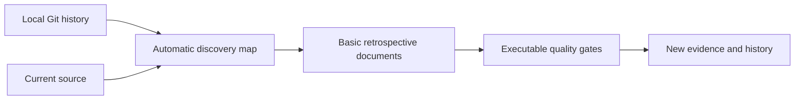
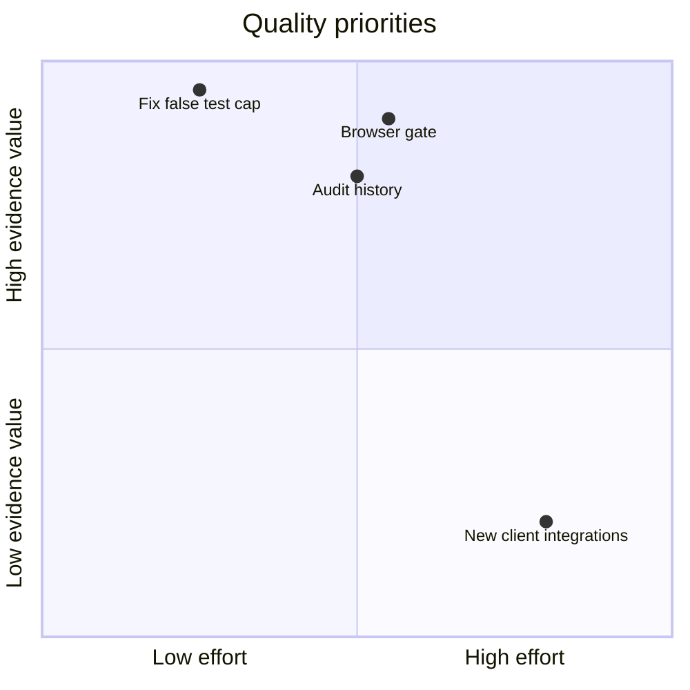

# Harness History and Quality

## Contents

- [Context](#context)
- [Goals](#goals)
- [Decisions](#decisions)
- [Evaluation](#evaluation)
- [Risks](#risks)
- [Next Actions](#next-actions)
- [References](#references)

## Context

This document reconstructs intent after implementation. It does not claim that the
original developers wrote a complete spec before coding. Commit-backed facts and the
current working tree are distinguished in the automatic [discovery map](Map.md).
The original extraction and historical as-built documents remain untouched. ([1](#ref-1))

The repository already has a static audit, synthetic city data, a repeatable Python
check command and a browser-console regression module. The missing connection is an
unattended browser runner and CI gate. The auditor also needs a safe way to retain
comparable findings without treating static checks as runtime verification. ([2](#ref-2))

The owner requested only basic Ideation, Plan, Architecture and Implementation artifacts.
This reduced retrospective is not a full orchestrator pass. Discovery is reconstructed
automatically; no grilling, fabricated interview or invented historical pass is included.
Metadata follows the existing repository profile, retaining the required `type` field
and explicit provenance. ([3](#ref-3))

## Goals

1. Make the actual implementation and its history discoverable in a versioned folder.
2. Execute city regression tests in real Chromium on desktop and mobile layouts.
3. Keep static audit records comparable by repository identity, tool and catalog.
4. Provide separate guidance for owner-authorized runtime tests and static audit history.
5. Improve observed harness defects while preserving the read-only audit boundary.

## Decisions

| Decision | Basis | Consequence |
| --- | --- | --- |
| Preserve earlier docs | Source provenance and existing links matter | Add a versioned entry point; do not move imported history |
| Reuse the city regression module | It already covers material/GPU stability and PNG output | Wrap it in a real browser runner; also exercise pointer clicks |
| Use synthetic data | Public reports may contain private excerpts | Test only the checked-in demo and generated synthetic standalone files |
| Keep runtime tests separate | The auditor promises not to execute audited code | Record execution evidence only from separately authorized test commands |
| Compare compatible audit snapshots | Detector/catalog changes alter meaning | Refuse misleading score comparisons across incompatible engines |
| No client onboarding | Existing entry points are sufficient for this scope | Leave client configuration and integrations unchanged |

## Evaluation

Achievability is high: Python checks, a working city, synthetic fixtures and a browser
regression module already exist. The new browser runner adds one locked development
dependency. History storage is local structured data, not a database or service.

Complexity is moderate. The principal difficulty is trustworthy comparison, not file
generation: distinguish code changes, engine changes, uncommitted changes, unanswered
judgments and checks that actually ran.

## Risks

- The first self-audit said 33/100 despite citing 12 test files. Quoted placeholder
  fixtures were incorrectly downgraded as unfinished code. A focused regression proved
  the defect; comments, docstrings and explicit unimplemented stubs remain blocked.
- After that detector correction, the baseline is 55/100. The 22-point difference is
  a measurement correction, not a repository improvement. Raw reports remain ignored.
- Ignored audit reports initially broke the document gate because it scanned generated
  Markdown. The repair excludes private output from source-document validation while
  retaining the prohibition on publishing tracked reports.
- Browser output varies by platform; screenshot artifacts support inspection but are
  not silently accepted as a golden baseline or proof of historical behavior.
- New files may be untracked until the owner commits. Audit coverage is Git-aware;
  a working-tree result must disclose this rather than claim a committed improvement.

## Next Actions

The Plan defines observable acceptance criteria. Architecture owns boundaries and storage;
Implementation records executed milestones and fresh verification evidence. Remaining
judgment checks stay unknown unless their actual task/quote workflow is completed.

## References

### ref-1

[1] Repository maintainers, [history reconstruction](Map.md), local commits through `8deb536`, inspected 2026-10-28; Git inspection command reference: https://git-scm.com/docs/git-show (accessed 2026-10-28).

### ref-2

[2] Repository maintainers, [project guide](../../README.md), [check commands](../../Taskfile.yml) and [city regression module](../../apps/harness-city/tools/check_city.js), working tree inspected 2026-10-28; browser-tool reference: https://playwright.dev/docs/intro (accessed 2026-10-28).

### ref-3

[3] GoogleCloudPlatform, Open Knowledge Format specification, version 0.2, https://github.com/GoogleCloudPlatform/knowledge-catalog/blob/main/okf/SPEC.md (retrieved 2026-10-28). This bundle retains the repository's existing metadata profile;
it does not assert independent human review.