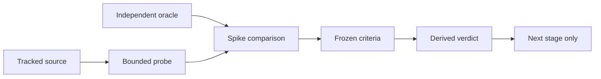
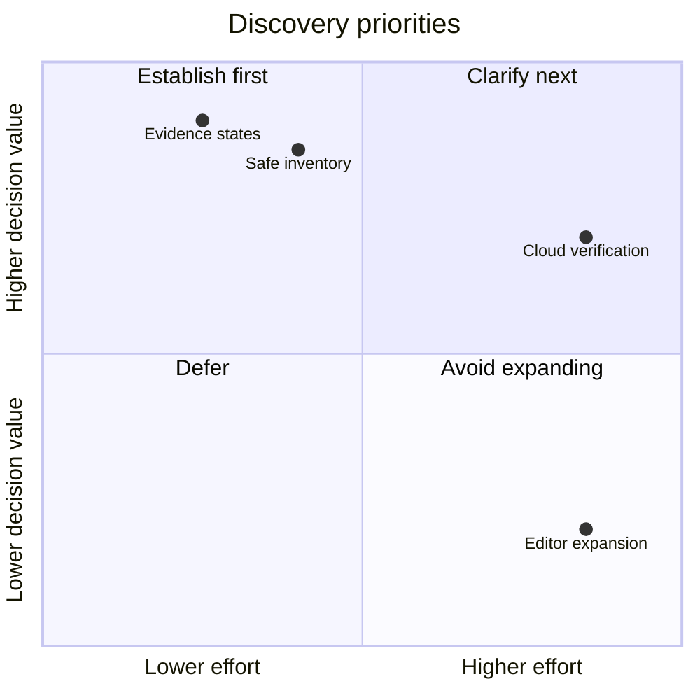

# Evidence-First Project Harness Coverage

## Table Of Contents

- [1. Context](#1-context)
- [2. Initial Idea](#2-initial-idea)
- [3. Goal Alignment Evaluation](#3-goal-alignment-evaluation)
- [4. Achievability Evaluation](#4-achievability-evaluation)
- [5. Complexity Evaluation](#5-complexity-evaluation)
- [6. Visualizations](#6-visualizations)
- [7. Risks](#7-risks)
- [8. Decision Summary](#8-decision-summary)
- [9. Next Actions](#9-next-actions)
- [10. Traceability](#10-traceability)
- [11. References](#11-references)

## 1. Context

Session: autonomous discovery, not a product implementation or a completed specification workflow.
The owner wants a technology-aware harness audit, a number, and an evidence-backed city map.
The [verbatim prompts](research/prompt.md) preserve that intent and the instruction to reuse 0010.

The owner-selected folder was renamed to the versioned pattern. Version v0.1 is assigned to
this new harness-coverage subject on 2026-11-04, not inferred from earlier editor history.
[Research.md](Research.md) remains the original parked city-editor research, byte-for-byte;
its internal old-path prose is historical, not a live instruction to resume editor work.

The subject is the current repository. The realistic sample is eleven tracked source/configuration
files. No .repo clones, host inventory or cloud connection are needed for this bounded question.
The killing assumption is that meaningful coverage requires unsafe access or unverifiable assurance.

## 2. Initial Idea

### 2.1 Problem Statement

The core score, infrastructure checks, research proposals and city prototypes describe different
things. Treating all of them as implemented coverage would mislead a team about what the audit
actually knows. A technology-aware scope needs to state what is applicable, what was checked,
how evidence was obtained, and which claims remain unknown.

### 2.2 Proposed Concept

- Inventory rules and infrastructure, lint, pipelines, SBOM, MCP, skills and extensions.
- Preserve existing seven-pillar arithmetic; overlays are separate evidence, not added points.
- Distinguish implemented checks, declarations, prototypes, missing projections and explicit limits.
- Bind source facts to paths and digests, with model judgments and runtime receipts distinguished.
- Keep machine-local and cloud evidence outside the default repository-only boundary.
- Make the city a view of those facts, never a second scoring system.

CycloneDX provides BOM representations, while OpenSSF Scorecard separates repository-security
checks. These are useful scope references, not proof that this auditor implements them.
([1](#ref-1), [2](#ref-2)) MCP guidance treats local startup and authorization as trust boundaries;
inventorying a declaration cannot verify those runtime properties. ([3](#ref-3))

### 2.3 Intended Users

Teams preparing repositories for agentic work, maintainers diagnosing weak harnesses, and reviewers
who need a map with evidence rather than an unexplained quality label.

## 3. Goal Alignment Evaluation

### 3.1 Target Goal

Make the auditor's actual coverage understandable enough to define the next product scope without
confusing declared controls, shipped detection and observed enforcement.

### 3.2 Alignment Score

Author judgment: 5/5 alignment with the requested scoping goal. This is not a repository score,
a calibrated quality metric, or evidence that the broader product is implemented.

### 3.3 Evidence And Rationale

The probe measures 56 core checks and 60 infrastructure checks, task-wrapper declarations and
missing infrastructure projection into the city. Source-bound observations cover all seven topic
groups; details and limits live in [measured findings](research/coverage-findings.md).

<!-- atlas:table=gaps -->
| Gap | Evidence | Why it matters |
| --- | --- | --- |
| Score versus broader coverage | rules.core_count; rules.infra_count; rules.pillar_weight | Keep overlay completeness separate from the frozen number. |
| Unsupported stack reporting | rules.unsupported_early_exit | Do not turn unscanned scope into low quality or silently omit infrastructure. |
| Lint declaration versus coverage | lint.node_lint_dependency; lint.python_lint_check | Missing Node tooling and existing Python declarations are different facts. |
| Pipeline and hook indirection | pipelines.ci_task_check; pipelines.root_app_test; pipelines.hook_task_precommit | Resolve actual targets before inferring enforcement. |
| Dedicated SBOM coverage | sbom.core_sbom_titles; sbom.unused_dependency_unimplemented | Lockfiles and unimplemented dependency analysis do not establish SBOM assessment. |
| MCP inventory and authority | mcp.core_mcp_titles | Dedicated core coverage is not demonstrated; runtime trust stays unknown. |
| Skill provenance | skills.core_skill_provenance_titles | Orientation is not component provenance or permission enforcement. |
| Extension scope | extensions.infra_extension_declaration | Declaration coverage is not installed or trusted state. |
| City evidence projection | rules.converter_infra_projection; rules.airport_demo_preset | Prototype controls cannot substitute for audited infrastructure levels. |

## 4. Achievability Evaluation

### 4.1 Assumptions

Real source files are sufficient for a bounded coverage inventory. Independent expected facts can
be recorded before implementation, and synthetic cases can exercise otherwise absent failure modes.
Manual implementation-kind labels remain explicit; this is not an automatic semantic classifier.

### 4.2 Feasibility Assessment

The frozen spike evaluates sixteen independently recorded source facts across eleven tracked files,
plus seven seeded synthetic edge cases. Its [result](spike/result.json) records comparisons and
source digests. Both sample and result must reproduce byte-for-byte.

### PoC Candidate Result

<!-- discovery:verdict -->

**Verdict: GO** (every go criterion met, no kill criterion met)

- Decision informed: Whether to scope an evidence-first harness coverage extension before designing new controls or city overlays.
- Next: `spec-workflow`, Use this coverage inventory and its gaps to clarify the evidence contract in the spec workflow, starting with wayfinder; do not implement overlays yet.
- Evidence: real (card minimum real)

| Criterion | Role | Expected | Actual | Met |
| --- | --- | --- | --- | --- |
| G-TOPICS `topics` | go | == 7 | 7 | yes |
| G-CASES `discriminating_cases` | go | >= 12 | 16 | yes |
| G-ORACLE `mismatches` | go | == 0 | 0 | yes |
| G-CONTROL `oracle_controls.corrupt_fact_detected` | go | == true | true | yes |
| G-UNKNOWN `oracle_controls.unknown_promotion_detected` | go | == true | true | yes |
| G-BOUNDARY `oracle_controls.path_escape_rejected` | go | == true | true | yes |
| K-ACCESS `unsafe_reads` | kill | > 0 | 0 | no |
| K-ASSURANCE `unsupported_assurance` | kill | > 0 | 0 | no |

Open questions (owner, lean):

- Should machine-level MCP and installed extension state enter scope? (human; lean: Keep the first audit repository-scoped; accept separately approved redacted imports later.)
- Should the frozen seven-pillar weights change? (human; lean: No; express additional topics as versioned coverage and overlays before recalibration.)
- How should optional cloud execution evidence be admitted? (agent; lean: Propose offline imports pinned to repository, revision, provider, run and observation time; no implicit cloud connection.)
- Can audit evidence be committed? (human; lean: Preserve the current prohibition on raw reports; decide the narrow WN-020 summary carve-out separately.)

Does not prove:

- A single repository is not a representative cross-language calibration corpus.
- Static configuration is not observed local or cloud enforcement, secure MCP behavior, extension installation or skill trust.
- Missing dedicated catalog titles do not prove every possible heuristic is absent.
- This discovery does not fix the known redaction defect, implement new checks, change scores or connect city overlays.
- The spike is not the mandatory later design prototype.

<!-- /discovery:verdict -->

Read the machine contract in [verdict.json](spike/verdict.json). The block above is generated only
by the hypothesis helper, never manually restated. The achieved evidence grade comes from tracked
real inputs; the synthetic sample grade identifies the edge cases and is not the whole experiment.

### 4.3 Dependencies And Blockers

Use the already installed Python 3.14 environment and imported shared discovery assets. The folder
is at docs root, so its root calculation deliberately differs from the clustered template. The normal
scaffold allocates a new ID and rejects an existing target; template-backed population preserves the
owner-selected 0010 without modifying the scaffold tool.

No retained raw store is created. Optional offline report generation is omitted in agent mode.
Sample-index and optional-report process warnings remain visible; no commit is made to hide them.

### 4.4 Mitigations

The reader is restricted to the frozen tracked-file allowlist, rejects symlink components, and bounds
reads to one million bytes per input. The must-fail controls corrupt a count, promote unknown to
verified, and attempt an escaped path. No subject module is imported or command executed.
The only subject metadata command is bounded git ls-files.

VS Code documents a local workspace-trust boundary; a repository's recommended extensions cannot
establish that local state. ([4](#ref-4)) The Agent Skills specification defines metadata and an
experimental allowed-tools field; those declarations are not client-independent enforcement.
([5](#ref-5))

## 5. Complexity Evaluation

### 5.1 Complexity Level

Author judgment: L for the eventual product scope, S for this bounded discovery. The labels are
planning judgments, not measured development estimates.

### 5.2 Complexity Drivers

Technology/component applicability, transitive runner attribution, source privacy, stale evidence,
optional cloud receipts, unknown-state propagation and compatibility with the frozen score all
need explicit contracts. More decorative city objects would not settle any of those questions.

### 5.3 Delivery Scope Split

Tier 1: requested harness topics, normalized provenance and honest report-to-city status.
Tier 2: safe reads/redaction, task attribution, unsupported-stack inventory and freshness.
Tier 3: host installs, cloud connections, fleet scoring and the still-parked editor.
No technology choice, wayfinder map, Plan or production change is made in this discovery.

## 6. Visualizations

### 6.1 Evidence Process

### 6.2 Scope Priorities

The coordinates below express qualitative author priorities, not measured costs or audit scores.

## 7. Risks

- Self-consistency mistaken for correctness: independent oracle before spike; mutation controls;
  manual labels disclosed. Owner: agent.
- A single repo mistaken for calibration: cross-repository corpus remains future work. Owner: human.
- Sensitive values copied into reports: normalized facts only; existing redaction lead remains
  unfixed and blocks broader secret evidence publishing. Owner: agent.
- Static declarations promoted to enforcement: every row keeps static-only assurance and unknown
  runtime state; later execution evidence requires a separate contract. Owner: agent.
- Legacy editor research mistaken for current scope: preserved provenance and parked status remain
  visible in the index and handoff. Owner: human.

## 8. Decision Summary

The decision is derived from the frozen card, not from the author's alignment score. Open questions
with owners and recommendations are in [hypothesis.jsonc](hypothesis.jsonc). The experiment supports
only the next action named by the generated verdict; it is not permission to ship overlays or change
weights. A later mandatory design prototype must evaluate the product design independently.

## 9. Next Actions

Read [the handoff](research/handoff.md), then follow the machine verdict's next route. Carry the
curated inventory and gaps into clarification of the evidence contract. Keep WN-028 as the umbrella
topic; distinguish WN-017 self-SBOM generation from WN-018 broader assessment. Resolve host/cloud
scope, score compatibility and any committed-summary carve-out with the owner at the appropriate stage.

## 10. Traceability

The repository's frontmatter and citation conventions are used. The OKF source was fetched on
2026-11-04; its always-required concept field is type. ([6](#ref-6)) Optional metadata conventions
in this repository are not claimed to be a complete implementation of the evolving external format.

Inputs, oracle and source hashes are in the card, [oracle](data/oracle.json),
[coverage inventory](data/coverage.json), [findings](data/findings.json) and spike result.
This document uses final citation QA with the sibling citation sidecar. Validation results and
rerun commands belong to the handoff and artifact metadata; historical test counts are not current passes.

## 11. References

### ref-1

[1] CycloneDX, "CycloneDX", accessed 2026-11-04. https://cyclonedx.org/

### ref-2

[2] OpenSSF, "Scorecard Checks", accessed 2026-11-04. https://github.com/ossf/scorecard/blob/main/docs/checks.md

### ref-3

[3] Model Context Protocol, "Security Best Practices", accessed 2026-11-04. https://modelcontextprotocol.io/docs/tutorials/security/security_best_practices

### ref-4

[4] Microsoft, "Workspace Trust", accessed 2026-11-04. https://code.visualstudio.com/docs/editor/workspace-trust

### ref-5

[5] Agent Skills, "Specification", accessed 2026-11-04. https://agentskills.io/specification

### ref-6

[6] GoogleCloudPlatform, "Open Knowledge Format Specification", accessed 2026-11-04. https://github.com/GoogleCloudPlatform/knowledge-catalog/blob/main/okf/SPEC.md
