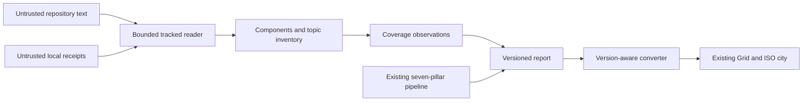
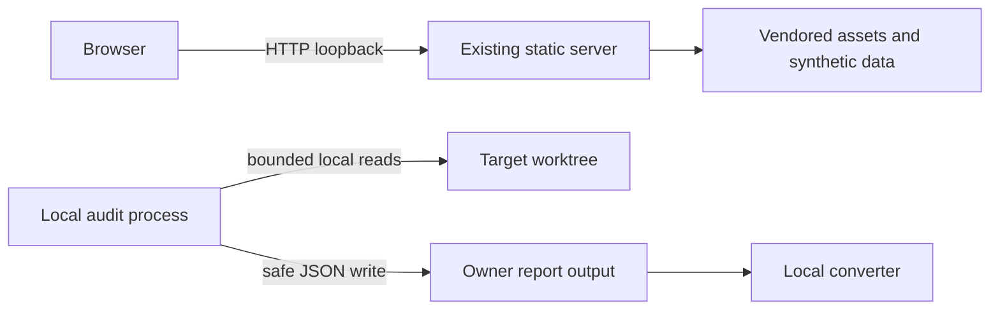
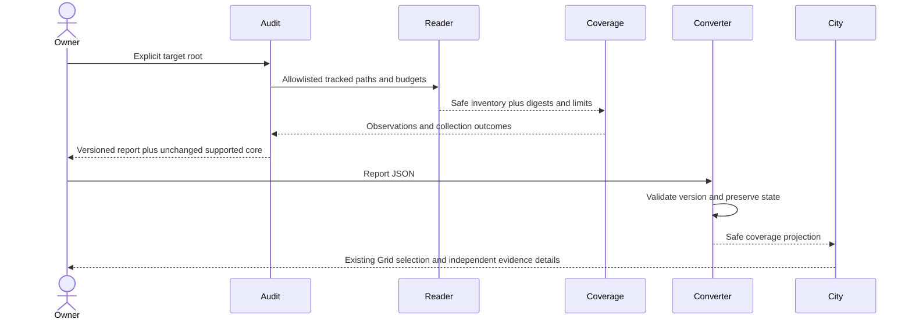
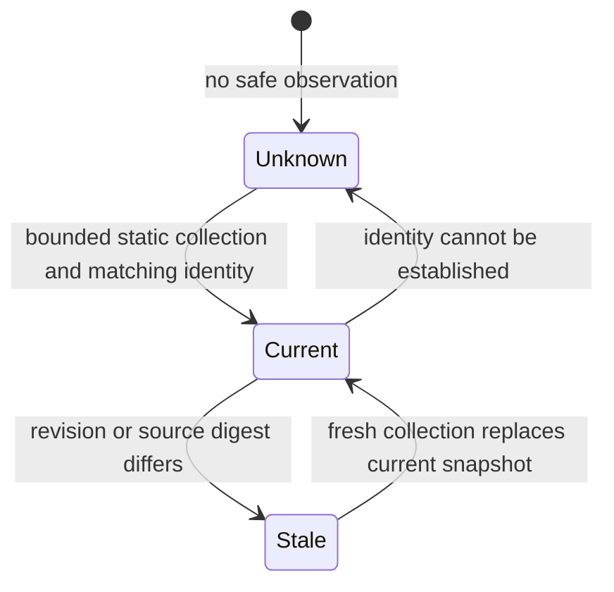
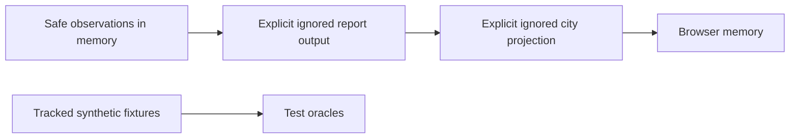

# Harness Coverage Expansion Architecture

## 1. Overview

- Scope: additive static coverage for Python/Node components and three topic objects in the existing Grid/ISO city.
- Primary objective: preserve the scored core while exposing what was and was not observed.

Inputs analyzed: [Plan](Plan.md), especially AC-1..14; the owner-fixed
[prototype decision](Prototype-Decision.md); app DESIGN Grid/Camera; audit schema,
converter and runtime entry paths. This is target design, not an as-built claim.

### Decisions

| ID | Decision | AC |
|---|---|---|
| D1 | Core scorer receives its existing inputs only; coverage is an unscored sibling | AC-1, AC-2 |
| D2 | Bounded tracked-file reader is the sole new collection boundary; redact before persistence or logging | AC-4, AC-5, AC-14 |
| D3 | Applicability, evidence, freshness, collection outcome and receipt outcome are distinct | AC-3, AC-4, AC-6 |
| D4 | Trace configured Python/Node runner edges, never run them | AC-7, AC-8 |
| D5 | Preserve existing Grid, ISO camera, assets and selection; add evidence indicators and inventory | AC-9, AC-10, AC-11, AC-13 |
| D6 | Synthetic fixtures and representative adapter samples are release oracles, not generalization evidence | AC-12 |
| D7 | Place availability, nullable core score and reason codes in a top-level `quality` sibling beside unscored `coverage`; preserve legacy score/pillars when available and omit them only for unavailable core | AC-1, AC-2 |
| D8 | Use Python 3.14+ for harness-audit so the shipped lean-logging contract is available; update package support metadata and lock | AC-14 |

<!-- atlas:part=system-design -->
## 2. System Design

<!-- atlas:diagram=coverage-system -->


### Component Layers

Dependencies name owning components, not runtime network connections.

<!-- atlas:table=component-layers -->
| Component | Layer | Path | Kind | Depends on |
|---|---|---|---|---|
| Safe Reader | Collection | `skills/harness-audit/scripts/coverage.py` | module | Topic Catalog; Logging |
| Topic Catalog | Contract | `skills/harness-audit/checks/coverage-topics.yaml` | data | |
| Report Contract | Contract | `skills/harness-audit/schema/report.schema.json` | schema | |
| Logging | Observability | `skills/harness-audit/scripts/lean_log.py` | module | |
| Audit Coordinator | Application | `skills/harness-audit/scripts/audit.py` | script | Safe Reader; Report Contract; Logging |
| City Converter | Projection | `apps/harness-city/tools/report_to_city.py` | script | Report Contract |
| City Viewer | Presentation | `apps/harness-city/index.html` | application | City Converter |

The new module is justified by a single security boundary shared by collectors,
component inventory and receipt inventory. Do not fork existing check logic:
topic catalog entries reference existing stable check IDs. Existing score logic
is a compatibility oracle, not a target for formula changes.

<!-- atlas:part=ingress-egress -->
## 3. Ingress And Egress

<!-- atlas:table=ingress-egress-matrix -->
| Actor/system | Direction | Protocol/port | Authentication/authorization | Encryption | Contract |
|---|---|---|---|---|---|
| Owner to local CLI | Ingress | Process argv/stdin; no port | Current OS user; explicit root path | Local process | No target commands accepted for execution |
| Tracked target files | Ingress | Filesystem; no port | Allowlisted relative regular files, bounded reads | Host filesystem | Reject escapes/symlinks/untracked files |
| Local receipts | Ingress | Same bounded filesystem boundary | No authenticated issuer in scope | Host filesystem | Presence only, unverified |
| Report/JSON conversion | Egress then ingress | Filesystem; no port | Owner-controlled explicit output | Host filesystem | Versioned schema, no raw source |
| Viewer assets/data | Ingress | Local HTTP 8001 by existing task; 8011 prototype only | Loopback for checks; no new auth service | HTTP loopback only | Synthetic public demonstration |
| Model/service endpoints | None added | No new ports or protocol | No connection permission | N/A | Existing optional behavior outside this additive collector |

No database required. No cloud service, queue, new server, Dev Container, image
or deployment is introduced. Existing environment/lockfiles remain authoritative.

<!-- atlas:part=network -->
## 4. Runtime And Network

Python minimum is **3.14**, owner-approved on 2026-11-05 to use the shipped
lean-logging module. Browser tooling remains **Node >=22**, Playwright 1.64.1
from app package metadata. Existing vendored Three.js **r160** remains in use.
These are repository constraints, not claims about latest supported releases.

Run without root. No container base image is selected because there is no image
work. The collector has no target execution, import, package install, MCP/tool
connection, credential resolution or receipt verification capability. Tests
assert those capabilities are not invoked, rather than relying on convention.

<!-- atlas:diagram=local-network -->


No new outbound edge exists. A diagram is not runtime sandbox enforcement.

<!-- atlas:part=code-logic -->
## 5. Code Logic And Interfaces

The coordinator retains the existing scored pipeline. Add a coverage stage after
stack/component inventory, before report assembly. Coverage exceptions become
safe collection outcomes, never fabricated core score zeros. Stop collection
entirely when the safety prerequisite is not met; do not partially deploy
expanded MCP/skill/secret collectors before the Docker ENV fix.

<!-- atlas:diagram=collection-sequence -->


`collect_coverage(root, tracked_paths, budgets, clock)` is a proposed pure-data
interface; concrete signatures must follow neighboring code during implementation.
`tracked_paths` is a validated snapshot, not an excuse to trust a mutable symlink:
check containment/type and symlink-free path components at read time, open with
no-follow where supported, and compare file identity before/after reading.
If the platform cannot provide the guarantee, return a safe unknown outcome.
Handle arbitrary repository filenames as literal paths, not shell fragments.

Proposed initial budgets: 256 KiB/file, 8 MiB total, 2,048 candidate paths and
runner depth 16. Make these named, deterministic limits; exhausted reads/edges
remain unknown with `budget_exceeded`. This is a conservative design default,
not an experimentally calibrated coverage promise.

Runner nodes use component + source path + named target IDs. Traverse only
allowlisted static syntax; detect cycles; missing/dynamic/conditional targets
produce unresolved edges. Record configured reachability, not install or success.
Do not export raw commands, environment values, endpoints or repository excerpts.

Converter policy: old reports remain valid with coverage absent; current coverage
version preserves all states and safe provenance; unknown coverage major version
retains a valid legacy core if independently valid but marks coverage unsupported
with a limitation. An unknown report-envelope major version is rejected with a
bounded diagnostic. Never infer execution from runner declarations or receipts.

## 6. Logging Disposition

Implementation type: runnable Python scripts plus static browser application.
Logging: **full lifecycle contract** for new/changed Python execution paths,
using the shipped standard-library `lean-logging` module and `emit` API. Load
that skill before implementing or reviewing logging. The logging foundation
is the first runnable milestone; detailed coverage events land with M2.

Events: collection started/completed/limited/failed, conversion started/completed/
rejected. INFO contains safe counts, duration and stable reason codes. TRACE may
include stable synthetic/test IDs and bounded aggregate decisions, not paths,
commands, excerpts, endpoints, tokens or exception payloads from repository text.
ERROR includes safe failure type/reason only. Reuse existing CLI output conventions
for final report output; logging must not corrupt JSON stdout. Contract tests
cover default severity, TRACE opt-in, redaction, bounded records, file retention
and idempotent handlers. No ad hoc `print`, direct logging or console diagnostic
path for the new coverage implementation. Browser failures display bounded safe
limitations, not report content in developer-console diagnostics.

<!-- atlas:part=data-model -->
## 7. Data Contract

This is the proposed wire contract. Schema and converter fixtures must agree
before it is implemented. Envelope evolution must preserve accepted legacy
reports; choose the next report version according to the existing schema, not
by relabelling historical data.

| Entity | Required fields and values | Invariant |
|---|---|---|
| Coverage | `version: 1`, components, observations, runner_edges, collection, limitations | Additive, unscored |
| Component | id, relative root, languages, adapter `python`/`node`/null, applicability | Mixed repository supports per-component decisions |
| Observation | id, component_id, topic_id, check_ids, applicability, evidence, freshness, provenance, receipt, limitations | One stable component/topic observation ID; no score field |
| Applicability | `applicable`, `inapplicable`, `unsupported`, `undetermined` | Not a maturity level |
| Evidence | `declared`, `static_implementation_found`, `execution_observed`, `prototype_simulated`, `unknown` | No execution_observed producer in this scope |
| Freshness | `current`, `stale`, `unknown` | Changed revision/digest is stale; absent identity is unknown |
| Provenance | revision, sources of path/digest/locator, method, observed_at | Relative safe paths; SHA-256 digests; UTC RFC3339 time; no source text |
| Receipt | outcome `absent`/`present_unverified`/`invalid`/`stale`/`partial`/`failed` | Never an authenticated issuer or execution proof |
| Collection | outcome `complete`/`partial`/`failed`, limits and reason codes | Separate from receipt outcome and evidence |
| Runner edge | from, to or null, resolution `resolved`/`unresolved`/`cycle`/`budget_exceeded` | Configured relationship only |
| Quality envelope | Top-level `quality` object with availability `available`/`partial`/`unavailable`, numeric-or-null core score and reason codes; separate from top-level unscored `coverage` | Available/partial reports retain the existing detailed `score` object and seven `pillars`, with `quality.score` equal to `score.final`; unavailable reports use null and omit those core fields; legacy reports omit both new siblings and remain valid |
| Projection | supported coverage version, safe observations, topics-to-object IDs, `synthetic: true`/`false`/`null`, limitations | `true` and `false` come only from explicit input metadata; `null` means origin is unknown |

Current evidence means matching identity, not trusted evidence. Stale observation
retains its original evidence label for inspection but is excluded from current
summaries; never rewrite history as unknown merely to simplify a badge. The
throwaway prototype simplified the stale badge; production must preserve both.
Simulation origin is independent of evidence. A report may provide the optional
`meta.synthetic: boolean` field; the converter copies it to each city record's
`synthetic` field. Missing metadata in a legacy report projects to `null` and is
shown as unknown, not assumed false. Never infer input origin from
`prototype_simulated`; synthetic examples may exercise declared/static labels
but remain labelled synthetic.

<!-- atlas:diagram=observation-lifecycle -->


### Existing City Projection

Keep [DESIGN Grid/Camera](../../apps/harness-city/DESIGN.md) and its existing
geometry vocabulary. Airport, factory and highway carry topic references; badges
and the existing selection panel carry separate states, safe provenance, method,
time and limits. Unsupported/inapplicable topics stay in accessible inventory,
not a fake L0 building. Maintain seven scored districts and existing score-tier
growth rules. Reservations are not newly approved production assets.

### Topic-To-Anchor Mapping

[Plan section 6](Plan.md#6-proposed-approach) fixes the areas: airport =
infrastructure, factory = build/artifact/dependency supply chain, highway =
CI/task/hook reachability. The table resolves those areas to the stable topic
IDs in `skills/harness-audit/checks/coverage-topics.yaml`. Rows marked
*derived* follow from the catalog's check references. The airport row's
`security` mapping is owner-confirmed under the 0005 `INF-*` anchoring rule.

<!-- atlas:table=topic-anchor-mapping -->
| Anchor | Plan area | Topic IDs | Basis | Prior design |
|---|---|---|---|---|
| Airport | Infrastructure | `security` | Owner-confirmed 2026-11-05: topics with `INF-*` check references anchor on the airport; `security` currently has those references | [0005 coverage map](../0005-v0.1-infrastructure-overlay-matched/research/Infrastructure-Coverage-Map.md), [0007 airport assets](../0007-v0.1-airport-overlay-evidence-matched/research/airport-assets.md) |
| Factory | Build/artifact/dependency supply chain | `dependencies`, `ci_build` | Plan area; `ci_build` carries the build side | [0009 supply chain](../0009-v0.1-city-overlays-road-traffic-harness-evidence/Design-Proposal.md#supply-chain-shopping-mall-goods-industry-highway) |
| Highway | CI/task/hook reachability | `ci_build`, plus `coverage.runner_edges` | Plan area | [0009 highway growth](../0009-v0.1-city-overlays-road-traffic-harness-evidence/Design-Proposal.md#highway-that-grows-with-the-city) |
| None | Inventory only | `code_standards`, `testing`, `mcp`, `skills_extensions` | No Plan area; listed in the topic inventory, never drawn as L0 | [Ticket 04](wayfinder-tickets/04-report-city-and-publication.md#resolution) |

Owner decision (2026-11-05): apply the 0005 rule to 0011: a coverage topic
whose `check_ids` reference `INF-*` is anchored at the airport. This maps the
current `security` topic to Airport; the Plan area remains Infrastructure.

A topic shared by two anchors appears under both with one observation ID; it
never counts twice. `dependencies` stays on the factory only, because Plan
section 6 places the dependency supply chain there. Cell positions, the redrawn
grid and the layout conflicts C6..C14 live in
[DESIGN City map](../../apps/harness-city/DESIGN.md#city-map-grid). Relation to earlier designs: 0007 owns the airport's
infrastructure L0-L3 ladder, which stays independent of these indicators. 0009 used the highway as the supply-chain delivery route into the Shopping Mall;
0011 reuses the same Grid reservation for runner reachability instead (DESIGN
conflict C13), and the mall,
harbor, bank, archive and court overlays stay out of scope until their topics
are applicable (ticket 04).

M4 updates DESIGN first for the exact indicator/selection contract, registry and
explanation entries, without changing Grid coordinates or ISO camera. Address
prototype overview label crowding with focus/zoom/decluttering in the existing
viewer. Export must retain synthetic/simulation and evidence limitations.

### Storage And Configuration

Follow the [storage policy reference](Plan.md#storage-policy-reference), without
introducing a new root, database or publication exception. Schema objects are
in-memory during collection; explicit report outputs stay owner-controlled and
ignored. Synthetic fixtures alone enter tracked test data. No retention daemon.

<!-- atlas:diagram=local-artifacts -->


```text
skills/harness-audit/tests/fixtures/coverage/  planned synthetic input trees
docs/0011-v0.1-harness-coverage-expansion/     specification and golden oracle
reports/                                    ignored owner reports
dist/                                       ignored prototype and renders
```

<!-- atlas:part=files-touched -->
## 8. Files Touched Per Slice

Planned operations, not this documentation run's actual file changes. New tests
must be written red-first and run separately; never skip or weaken frozen tests.
Existing paths should be reused rather than creating duplicate test suites.

<!-- atlas:table=files-touched-per-slice -->
| Slice | Path | Change |
|---|---|---|
| M1 | `skills/harness-audit/scripts/lean_log.py` | add |
| M1 | `skills/harness-audit/tests/test_logging_contract.py` | add |
| M1 | `skills/harness-audit/scripts/infra_checks.py` | change |
| M1 | `skills/harness-audit/tests/test_infra_checks.py` | change |
| M1 | `skills/harness-audit/scripts/coverage.py` | add |
| M1 | `skills/harness-audit/tests/test_coverage.py` | add |
| M2 | `skills/harness-audit/schema/report.schema.json` | change |
| M2 | `skills/harness-audit/scripts/audit.py` | change |
| M2 | `skills/harness-audit/scripts/coverage.py` | change |
| M2 | `skills/harness-audit/tests/test_coverage.py` | change |
| M2 | `skills/harness-audit/tests/test_audit.py` | change |
| M2 | `skills/harness-audit/tests/test_score.py` | change |
| M3 | `skills/harness-audit/checks/coverage-topics.yaml` | add |
| M3 | `skills/harness-audit/scripts/coverage.py` | change |
| M3 | `skills/harness-audit/scripts/detect_stack.py` | change |
| M3 | `skills/harness-audit/tests/test_coverage.py` | change |
| M3 | `skills/harness-audit/tests/fixtures/coverage/` | add |
| M4 | `apps/harness-city/DESIGN.md` | change |
| M4 | `apps/harness-city/tools/report_to_city.py` | change |
| M4 | `tests/test_repo_quality.py` | change |
| M4 | `apps/harness-city/index.html` | change |
| M4 | `apps/harness-city/tests/coverage.spec.js` | add |
| M4 | `extraction-manifest.json` | change |
| M5 | `README.md` | change |
| M5 | `docs/0011-v0.1-harness-coverage-expansion/Implementation.md` | change |

Converter contract cases extend the existing root repository tests and synthetic
conversion gate; do not create a parallel tools test suite. Runtime manifest
change is a reviewed future baseline update, never a bypass. No editor files
are touched.

## 9. Handoff And Risks

Test Plan must cover D1..D6 and every AC, including no-execution tripwires,
redaction, receipt variants, converter compatibility and real viewer interactions.
WN-031 remains a production prerequisite. Static evidence cannot establish
security or runtime enforcement. Remaining proposed defaults: budgets and adapter
sample quantity require calibration during implementation, not broader scope.
