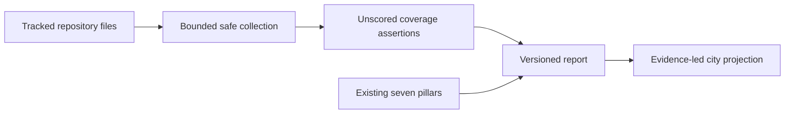
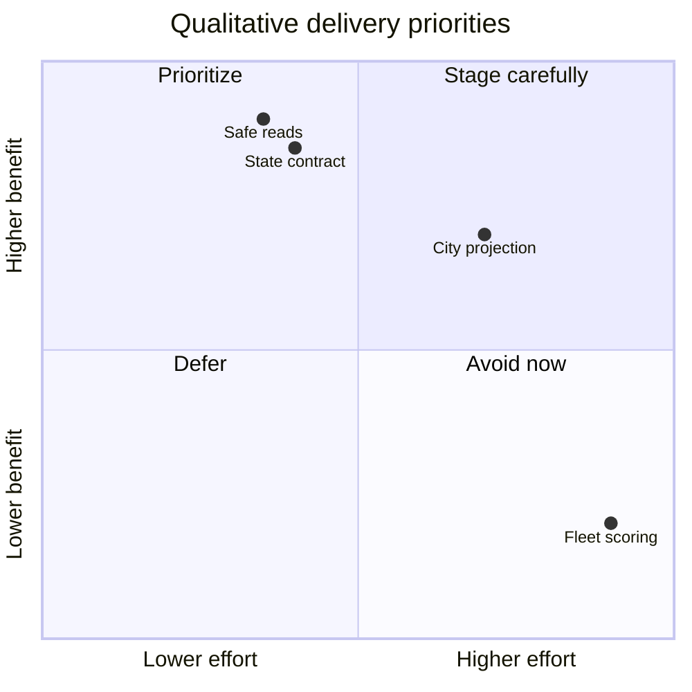

# Evidence-First Harness Coverage Expansion

## Table Of Contents

- [Context](#context)
- [Initial Idea](#initial-idea)
- [Goal Alignment](#goal-alignment)
- [Achievability](#achievability)
- [Complexity](#complexity)
- [Visualizations](#visualizations)
- [Risks](#risks)
- [Decision Summary](#decision-summary)
- [Next Actions](#next-actions)
- [Traceability](#traceability)
- [References](#references)

## Context

The owner approved continuation into this existing 0011 v0.1 folder on
2026-11-05. The [Map](Map.md) and its eight closed tickets are the decision
authority. Its earlier instruction to stop before the spec workflow describes
the completed wayfinder effort, not this newly authorized run.

The [0010 findings](../0010-v0.1-harness-coverage-discovery/research/coverage-findings.md)
record bounded discovery observations at revision
`3fb0c80da21cf5469b127ce26800ada9df62bc79`. They are historical feasibility
evidence, not a current audit or proof of shipped coverage. No private reports
are inputs to this chain.

## Initial Idea

Make the auditor explain what it can assess, what evidence it found, and what
remains unknown, without turning a score or city object into assurance.
Maintainers need component-level coverage; reviewers need provenance; city users
need a faithful projection of those same distinctions.

Keep the seven scored pillars unchanged. Add separate unscored topic overlays
for security, dependency/SBOM/supply-chain declarations, MCP, skills/extensions,
and language-standard coverage. Link existing checks instead of duplicating
their findings. Python and Node remain the only supported language adapters.
Shared CI/build and testing evidence remains visible through topic links.

## Goal Alignment

Assessment: **5/5, strong fit**, a qualitative planning judgment, not a measured
audit score. The approach directly answers the owner's coverage question while
preserving score compatibility and the repository-only boundary.

Separate applicability (`applicable`, `inapplicable`, `unsupported`,
`undetermined`) from evidence status (`declared`, `static_implementation_found`,
`execution_observed`, `prototype_simulated`, `unknown`). Freshness is a separate
dimension. A stale observation must not silently become current evidence.

## Achievability

Feasibility: **medium**, conditional on safety and compatibility work. The
[0010 PoC result](../0010-v0.1-harness-coverage-discovery/Ideation-Book.md#poc-candidate-result)
records GO for further specification using 16 discriminating facts from 11 real
tracked files plus synthetic controls. It does not establish representative
adapter coverage or production safety. Read its
[handoff](../0010-v0.1-harness-coverage-discovery/research/handoff.md) as historical
evidence; do not rerun discovery to substitute for design evaluation.

Prerequisites: fix the known Docker space-delimited ENV redaction defect before
broader sensitive collectors; bound tracked-file reads and reject symlinks;
allow honest partial reports for unsupported/infrastructure-only inputs; preserve
legacy score behavior for supported inputs. Local receipt files establish
presence only: this version has no independent issuer-authentication boundary.

## Complexity

Level: **L**. The difficult work is preserving semantics across collection,
serialization, conversion and display, not adding more titles to a catalog.
The MVP is a versioned coverage envelope, bounded Python/Node collectors and
three city-topic objects. Host/cloud/fleet inspection, new language adapters,
score recalibration, editor work and traffic simulation are excluded.

## Visualizations

Coordinates are prioritization judgments, not empirical measurements.

## Risks

| Risk | Impact | Mitigation | Owner |
| --- | --- | --- | --- |
| Sensitive evidence leakage | High | Safety-first phase and output canaries | Implementer |
| Static evidence promoted to execution | High | Reject local receipt promotion | Implementer |
| City shape implies maturity | High | Separate topic objects and state indicators | Viewer maintainer |
| Discovery treated as representative | Medium | Adapter-specific synthetic samples and explicit limits | Reviewer |
| Browser regressions | High | WN-031 full-suite prerequisite for viewer acceptance | Viewer maintainer |

## Decision Summary

Proceed with a proposal chain, not implementation. Preserve all eight ticket
resolutions. The mandatory later prototype must evaluate airport, factory and
highway topic selection with synthetic evidence, including stale, unsupported
and unknown cases. A prototype preset remains simulated, even when it looks
complete. Spec approval does not waive WN-031 or the publication ban.

## Next Actions

1. Research the state and projection contract against approved discovery evidence.
2. Derive testable acceptance criteria and an explicit compatibility boundary.
3. Evaluate the visual design before deriving architecture.
4. Specify fixtures, ontology and phased implementation; leave runtime unchanged.

## Traceability

This document uses the repository's OKF frontmatter extension. The official
specification requires a nonempty `type` and distinguishes provenance from
verification ([1](#ref-1)). Retrieved 2026-11-05; local scalar trust/lifecycle
conventions are repository extensions, not a claim of full upstream optional
field-shape adoption. Citation QA uses final mode. Artifact checks do not imply
human review. WN-028/WN-029 are planning inputs, not completed features.

## References

### ref-1

[1] GoogleCloudPlatform, "Open Knowledge Format Specification", GitHub, v0.2, accessed 2026-11-05. https://raw.githubusercontent.com/GoogleCloudPlatform/knowledge-catalog/main/okf/SPEC.md
