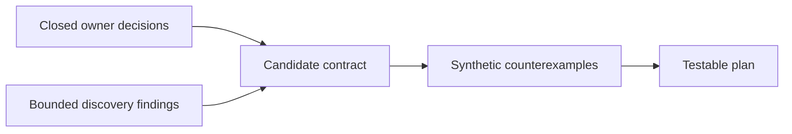
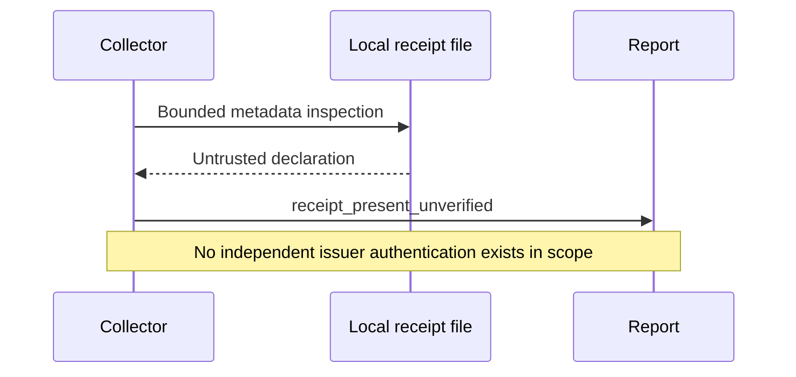
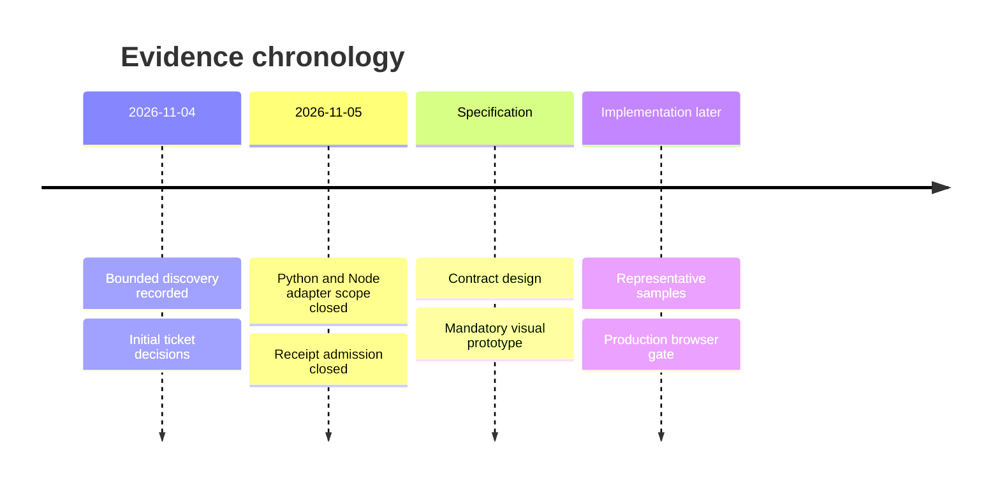
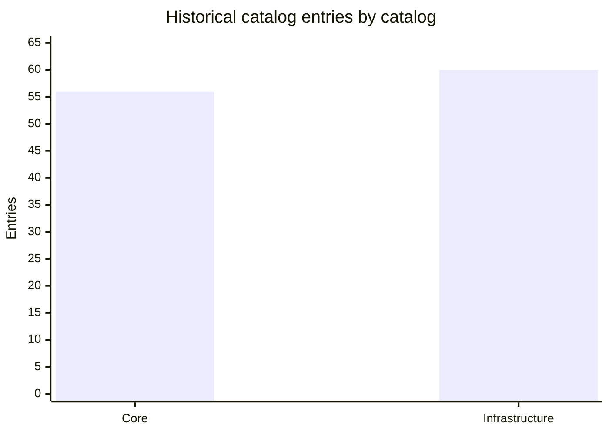
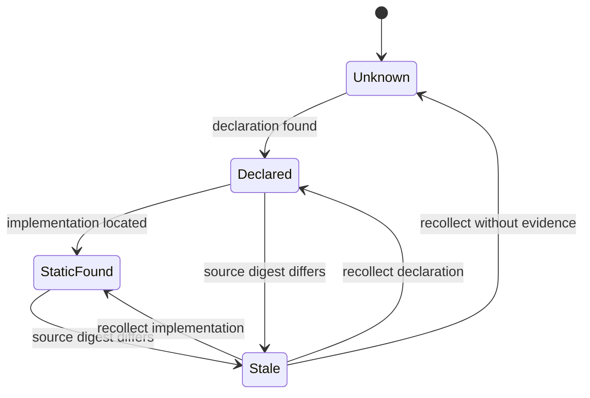

# Separating Coverage From Assurance

## Title Page

Internal engineering report; prepared by GitHub Copilot for Andreas Elser.
Version v0.1, 2026-11-05. Audience: maintainers and architects. No conference,
word limit, service SLA or statistical performance claim is assumed.

## Table Of Contents

- [Title Page](#title-page)
- [Abstract](#abstract)
- [Introduction](#introduction)
- [Related Work](#related-work)
- [Methodology](#methodology)
- [Experimental Setup](#experimental-setup)
- [Results](#results)
- [Threats And Limitations](#threats-and-limitations)
- [Conclusion](#conclusion)
- [Reproducibility](#reproducibility)
- [Traceability](#traceability)
- [References](#references)

## Abstract

This study derives a coverage contract from owner-approved decisions and bounded
repository discovery. It separates applicability, evidence status, freshness and
execution trust instead of compressing them into a score. Historical observations
show dedicated coverage gaps and incomplete city projection, but do not measure
security effectiveness. The contribution is an implementable design direction:
unscored component-topic assertions, safe provenance, conservative receipt
admission, and city indicators that retain uncertainty. Runtime changes and
representative adapter validation remain future work.

## Introduction

RQ1: Can broader coverage be exposed without changing the existing seven-pillar
score? RQ2: Can repository declarations and untrusted receipts be represented
without implying execution? RQ3: Can the city preserve these distinctions?

The proposed contributions are a component-topic coverage model, a safety-first
collection boundary, a status-preserving projection contract, and a falsifiable
fixture/acceptance strategy. These are design contributions, not measured gains.

## Related Work

The primary decision source is [0011 ideation](Ideation-Book.md#decision-summary),
grounded in the [eight closed tickets](Map.md#decisions-so-far). The supporting
[0010 findings](../0010-v0.1-harness-coverage-discovery/research/coverage-findings.md#measured-coverage)
already distinguish a missing catalog title from proof of semantic absence.
The [0010 handoff](../0010-v0.1-harness-coverage-discovery/research/handoff.md#3-verified-locally)
also discloses non-green broader tool checks; this study does not relabel them.

OKF separates a definition's provenance and verification from per-run attestation
([1](#ref-1)). This motivates explicit provenance, but does not authenticate a
repository-local receipt or prescribe this auditor's wire schema. The owner's
receipt restriction, not a generic standard, controls admission here.

## Methodology

Use the approved decisions as constraints, historical discovery as bounded
evidence, and synthetic counterexamples as design falsifiers. Do not execute,
import or install audited repository code. Derive proposed rules only after
separating observed facts from desired behavior.

Applicability answers whether a topic can be assessed for a component. Evidence
status answers what was observed. Neither is a pass/fail verdict. Freshness
invalidates current use when source digests change. Execution observation is
reserved, but cannot be emitted by the repository-only receipt path in v0.1.

## Experimental Setup

This is a documentary/design analysis, not a fresh production experiment. The
historical discovery used 11 allowlisted tracked files and 16 oracle facts at
revision `3fb0c80da21cf5469b127ce26800ada9df62bc79`, with seven seeded synthetic
cases. Its source digests and methods are recorded in the
[result](../0010-v0.1-harness-coverage-discovery/spike/result.json).
One repository is not a representative Python/Node corpus. No hardware-dependent
throughput or latency measurement is reported; no random performance runs apply.

Proposed future validation uses deterministic synthetic single-component Python,
Node, mixed, infrastructure-only and unsupported-language repositories. Sample
count is a justified test-design choice after scope selection, not a universal
coverage threshold. No external repositories are cloned by this workflow.

## Results

The following are historical discovery observations, not remeasured counts or
coverage percentages. Counts overlap conceptually and must not be summed into a
coverage metric.

Source: [0010 findings, Measured Coverage](../0010-v0.1-harness-coverage-discovery/research/coverage-findings.md#measured-coverage).
The chart counts entries in different catalogs, not independent implemented
security controls or a before/after improvement.

| Question | Historical evidence | Proposed response | Still unverified |
| --- | --- | --- | --- |
| Broader topics | No dedicated SBOM/MCP/provenance titles demonstrated | Unscored topic inventory with check links | Cross-repository completeness |
| CI and hooks | Task indirection exists | Bounded configured-target tracing | Installation or execution |
| Unsupported inputs | Early report exit observed | Partial envelope, null unavailable score | Production compatibility |
| Sensitive evidence | Docker ENV redaction defect lead confirmed synthetically | Fix and canary gate before expansion | Full collector adversarial robustness |
| City projection | Infrastructure omitted; airport preset simulated | Versioned topic/state projection | Production rendering and browser suite |

This diagram is an observation lifecycle, not a maturity ladder. Separate
assertions may coexist for the same topic. Simulated evidence is a separate
synthetic channel, not an upgrade path; execution is intentionally absent from
this repository-only admission path.

## Threats And Limitations

Construct validity: catalog titles are not semantic coverage. Internal validity:
discovery's curated labels and tracked working-tree inputs can introduce bias.
External validity: one real repository and synthetic controls do not establish
general precision. Conclusion validity: no statistical score or safety gain can
be inferred from the small descriptive sample.

The known ENV defect remains unfixed in this docs-only run. A path allowlist
alone does not solve filesystem races. A valid digest proves byte identity, not
trustworthiness. Static reachability is not execution. WN-031 remains a separate
viewer acceptance prerequisite. No certification, universal language support,
runtime sandbox assurance or publication exception is claimed.

## Conclusion

RQ1 is feasible as an additive unscored envelope, subject to regression tests.
RQ2 requires conservative admission: local receipts remain unverified. RQ3
requires a real design prototype and status-preserving projection, not reuse of
the airport preset as evidence. These answers justify a Plan, not a release.

## Reproducibility

Historical commands and environment are preserved in the
[0010 handoff](../0010-v0.1-harness-coverage-discovery/research/handoff.md#4-probe-usage).
The frozen oracle, sample and result remain there; this workflow does not modify
or rerun them. Repository licensing is in [LICENSE](../../LICENSE).
Current document validation is recorded in this chain's Workflow Report and
sidecars. New prototype results must be recorded separately and clearly labeled
synthetic. No audited code, private report, live service or secret is required.

## Traceability

Primary source: this folder's ideation and closed decisions; supporting version:
0010 v0.1 only. Audience and outline were owner-approved on 2026-11-05. Thesis
and RQs are derived from those decisions. All empirical values above are labeled
historical. Official OKF v0.2 retrieved 2026-11-05 ([1](#ref-1)); repository
frontmatter uses its local scalar metadata extensions. Citation QA: final mode.

## References

### ref-1

[1] GoogleCloudPlatform, "Open Knowledge Format Specification", GitHub, v0.2, accessed 2026-11-05. https://raw.githubusercontent.com/GoogleCloudPlatform/knowledge-catalog/main/okf/SPEC.md
