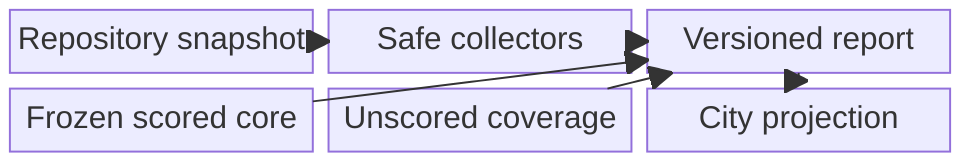
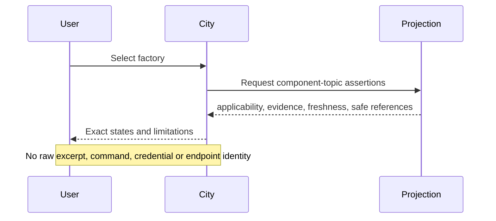
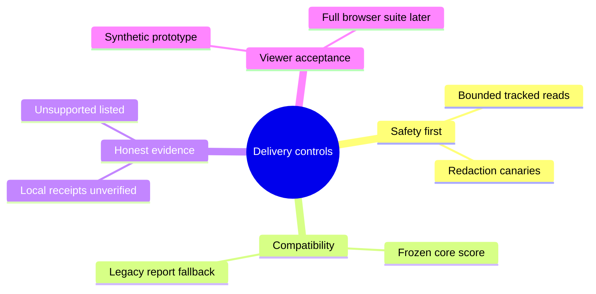
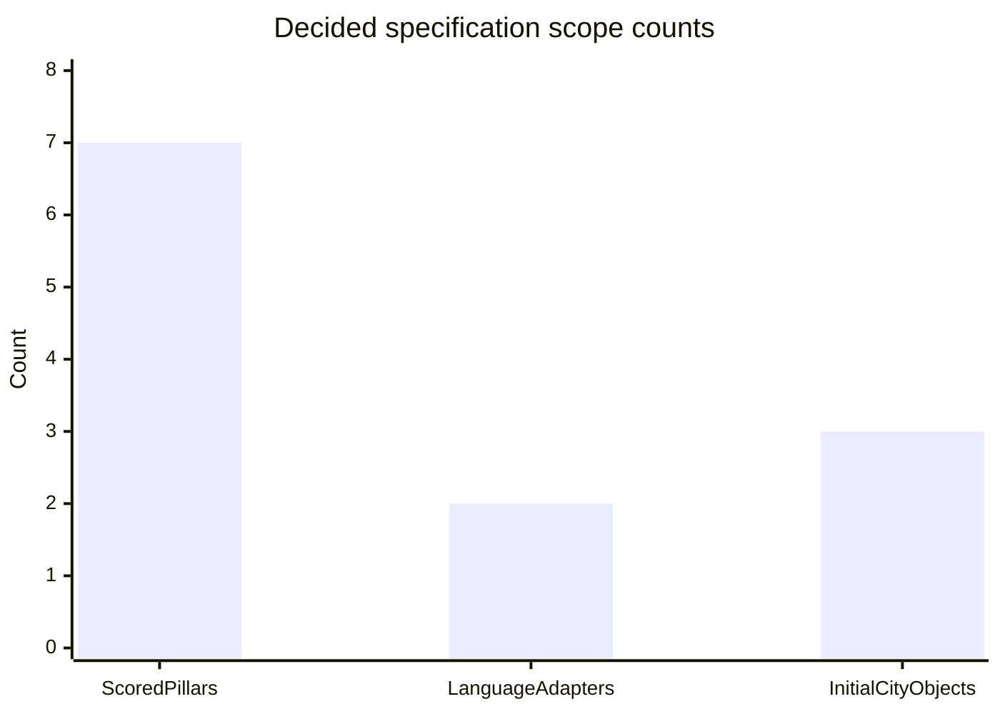

# Broader Coverage Without Stronger Claims

## Title Page

Decision brief for maintainers, architects and the project owner. Version v0.1,
2026-11-05. Prepared by GitHub Copilot; owner Andreas Elser. Thesis: report more
coverage by retaining uncertainty, not by manufacturing a stronger score.

## Table Of Contents

- [Title Page](#title-page)
- [Executive Summary](#executive-summary)
- [Background](#background)
- [Solution Design](#solution-design)
- [Implementation And Operations](#implementation-and-operations)
- [Evaluation](#evaluation)
- [Limitations And Trade-offs](#limitations-and-trade-offs)
- [Recommended Next Steps](#recommended-next-steps)
- [Traceability](#traceability)
- [References](#references)

## Executive Summary

Approve a safety-first, additive report contract. Retain the seven scored
pillars and their arithmetic. Add unscored component-topic assertions covering
security, dependencies/SBOM, MCP, skills/extensions and coding standards, with
links to CI/build and testing evidence already collected. Python and Node are
the only initial language adapters. Unknown, unsupported and inapplicable are
different answers, not failures to hide.

The requested city design starts with airport, factory and highway topic
objects. Indicators and selection details convey evidence; object presence does
not. A synthetic design prototype informs the architecture, but production
viewer acceptance still requires WN-031's full browser suite.

## Background

[Research results](Research-Paper.md#results) describe bounded historical gaps,
not an exhaustive semantic audit. Existing catalog checks and a simulated airport
do not establish report-driven topic coverage. The intended users need to see
what the report knows, how it knows it, and where that knowledge stops.

OKF's provenance/verification distinction supports keeping sources visible
without treating metadata as an enforcement mechanism ([1](#ref-1)). This
proposal uses the repository's existing metadata conventions and makes no new
assurance claim from them.

## Solution Design

Proposed responsibility split: bounded file access precedes interpretation;
existing core scoring stays separate; coverage assertions form an additive
envelope; conversion retains states for display. A report without coverage is a
legacy input, not a fully covered repository. Unsupported schema versions are
reported, never guessed into success.

Every assertion binds to a repository revision, source digest, safe locator,
collection method and observation time. No local receipt is authenticated by
this release. Configured runner reachability may be reported, but hook
installation or execution may not be inferred.

## Implementation And Operations

Deliver in order: repair redaction and bounded reads; define report compatibility
and applicability; add topic collectors and configured-target tracing; preserve
states through conversion; implement approved city indicators; run regression
and safety gates. These are future implementation phases, not changes made by
this specification run.

The auditor runs locally and reads repository files without importing, executing,
installing or connecting audited code. No cloud deployment, live CI admission,
host inventory or trust-root provisioning is implied. Reports remain local and
uncommitted. Only synthetic examples may be committed. Storage/configuration
design must defer to the shared policy cited by the later Plan.

## Evaluation

These are scope counts from the closed decisions, not comparable performance
metrics or measured readiness. No before/after score is claimed.

| Dimension | Existing evidence in research | Proposed acceptance |
| --- | --- | --- |
| Scoring | Seven-pillar baseline | Identical supported-input score regression |
| Unsupported input | Early exit reported historically | Partial report and explicit unsupported languages |
| Sensitive evidence | Known ENV redaction defect | Canary absent from all output channels |
| Receipts | Repository-local text is untrusted | Presence-only, no execution promotion |
| City | Airport prototype is simulated | Projection preserves each assertion's states |
| Viewer | Current full gate not certified here | WN-031 must pass before viewer acceptance |

## Limitations And Trade-offs

More explicit unknowns may make coverage look less complete; that is an honest
trade-off. Two adapters keep scope supportable but leave other languages
unsupported. Metadata and digests improve traceability but do not authenticate
an issuer. A bounded static auditor cannot prove dynamic control effectiveness.
No SLA, security certification or universal coverage guarantee is offered.

The redaction fix and production/browser checks are implementation prerequisites.
This document authorizes neither a runtime baseline change nor a committed real
report. WN-020 publication, WN-030 editor and detailed traffic/growth work remain
separate decisions.

## Recommended Next Steps

Derive observable acceptance criteria, evaluate the synthetic visual prototype,
then specify boundaries, fixtures and phased implementation. Original visual
treatment selection is superseded by the owner's 2026-11-05 correction: use
the defined Grid and existing ISO city, with its current camera, assets and
selection pattern. The prototype evaluates evidence presentation, not an
alternative city design. Keep all implementation tasks unchecked until their
actual validations pass.

## Traceability

Owner-approved sources: this folder's ideation and research, with Map/tickets
as decision authority. Audience and outline approved 2026-11-05. Official OKF
v0.2 retrieved 2026-11-05 ([1](#ref-1)); local metadata shapes are repository
extensions. Citation QA: final mode. No human-review trust tier is assigned.

## References

### ref-1

[1] GoogleCloudPlatform, "Open Knowledge Format Specification", GitHub, v0.2, accessed 2026-11-05. https://raw.githubusercontent.com/GoogleCloudPlatform/knowledge-catalog/main/okf/SPEC.md
